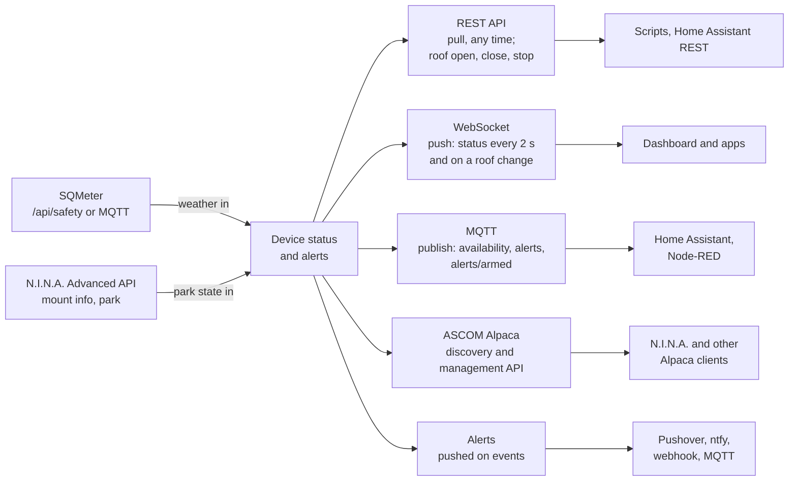

# Integrations

RoofRoof exposes the device's data through these integration paths. The roof's state and readings are in the status (REST and WebSocket), and the REST API can open, close and stop it; the roof's MQTT topics, Home Assistant cover and Alpaca Dome *come in later specs* and will use the same paths.

## Supported integration paths

<!-- diagram: DIA-15
sources: include/WebServer.h include/MQTTClient.h include/AlertDispatcher.h lib/AlpacaLogic/include/AlpacaRouter.h
blocking: false
fingerprint: 5522f44c9bf3d7d1
-->
<figure class="diagram" markdown>



<figcaption>Integration paths: which way the data flows on each, and who typically uses it.</figcaption>
</figure>

??? info "Diagram in words"

    The device status and alerts feed every path:

    - **REST API**: pulled any time, by scripts and Home Assistant's REST integrations; with the password, it also opens, closes and stops the roof and clears a fault.
    - **WebSocket**: pushed live, the status every 2 seconds and within 250 ms of a roof state or fault change, to the dashboard and apps.
    - **MQTT**: published to your broker - availability, alerts and the alerts pause switch - for Home Assistant or Node-RED.
    - **ASCOM Alpaca**: answers discovery and the management API for N.I.N.A. and other Alpaca clients. No device is served yet.
    - **Alerts**: pushed when something happens, to Pushover, ntfy, a webhook or MQTT.

    Two paths come in: SQMeter's weather verdict (polled over HTTP or read from MQTT) and N.I.N.A.'s mount state through its Advanced API (see [Safety inputs](../user-guide/safety-inputs.md)).

### REST API

Pull the status and configuration over plain HTTP. See [REST API](rest.md) for behaviour and the password, and the [API Reference](reference.md) for every route's parameters and schemas - also as [`openapi.json`](openapi.json) for Postman and client generators.

```bash
# System status
curl http://roofroof.local/api/status

# Configuration
curl http://roofroof.local/api/config
```

### WebSocket

Real-time streaming over a persistent connection. Connect to `/ws/status` for the device status (2 second cadence). See [WebSocket](websocket.md) for details.

### MQTT

Configure RoofRoof to publish to an MQTT broker: availability, alerts and an alerts pause/resume switch for Home Assistant. See [MQTT Integration](../user-guide/mqtt.md) for setup.

### ASCOM Alpaca

An Alpaca server for N.I.N.A. and other Alpaca clients, found by Alpaca discovery - no driver or bridge. It serves no device yet. See [ASCOM Alpaca](../user-guide/alpaca.md).

### Alerts

The device sends its own notifications via Pushover, ntfy, a webhook or MQTT. See [Alerts](../user-guide/alerts.md).
