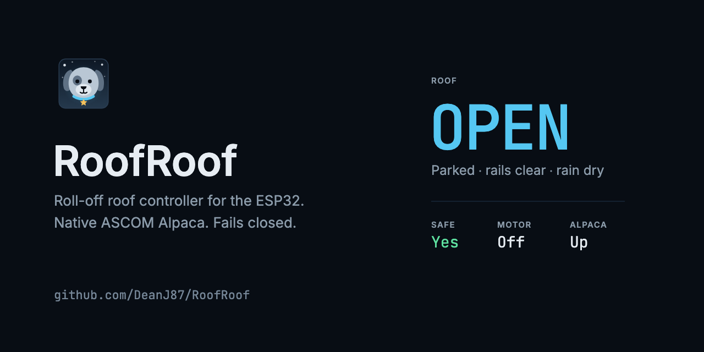

# Brand



RoofRoof's mark is its dog (the name is the bark a roll-off roof makes when it opens): a grey, floppy-eared pup with a patch over one eye and a cyan collar, under a few stars on a dark tile. It is the same dog that asks the setup wizard's questions (the `Mascot`, DS-13 in the [Coding Standards](coding-standards.md)), drawn the same at every size, down to the 16 px favicon. The full kit (every logo variant, favicons, social cards, stickers and labels) is in [`brand/`](https://github.com/DeanJ87/RoofRoof/tree/main/brand) in the repository, with the usage rules in its [README](https://github.com/DeanJ87/RoofRoof/blob/main/brand/README.md).

## The short version

| Size or use | Mark |
|---|---|
| 40 px and larger | `roofroof-mark.svg`: the dog on a starry tile |
| Below 40 px | `favicon.svg` (the dog filling a plain tile) or `roofroof-mark-flat.svg` |
| Home screen, PWA | App icon (`roofroof-app-icon-512.svg`, or the square maskable one) |
| Night-vision screens | Night (red) |
| Print, silkscreen, emboss | Print, silkscreen (6 mm and up), emboss (20 mm and up) |

- Keep a quarter of the mark's height clear around it.
- The full-colour marks bring their own dark tile, so they work on light and dark pages; use the print or mono variants where there's no room for the tile.
- Don't stretch, mirror, recolour, outline, simplify or add effects to the mark.
- Write the name as **RoofRoof**.

The brand colours and fonts are the app's own; see [Coding Standards](coding-standards.md) for how the UI uses them.

## Making PNGs and print files

The social cards, banners and stickers contain text in Inter and JetBrains Mono. To share or print them, render them with the project's fonts:

```bash
node tools/brand/build.mjs    # only after changing the mark: writes the SVGs
node tools/brand/render.mjs    # also renders each mark at 16 to 512 px into brand/render/icons/
```

See the [brand README](https://github.com/DeanJ87/RoofRoof/blob/main/brand/README.md#png-and-print-files) for the options, including a release banner for a given version. Releases get their banner automatically from the changelog: see [Releasing](releasing.md).
