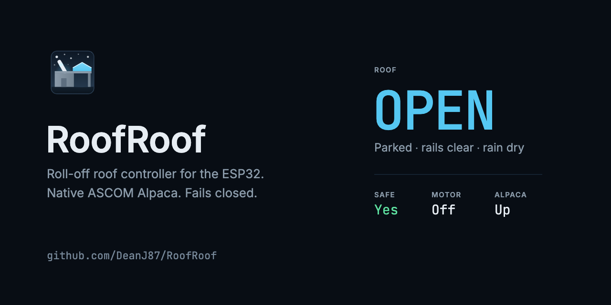

# Brand



RoofRoof's mark is a small observatory under a starry sky, its roof rolled off along the rails to the right and the telescope out; the roof is the cyan part. The full kit (every logo variant, favicons, social cards, stickers and labels) is in [`brand/`](https://github.com/DeanJ87/RoofRoof/tree/main/brand) in the repository, with the usage rules in its [README](https://github.com/DeanJ87/RoofRoof/blob/main/brand/README.md).

## The short version

| Size or use | Mark |
|---|---|
| 40 px and larger | Detailed (`roofroof-mark.svg`) |
| 17 to 39 px | Flat (`roofroof-mark-flat.svg`) |
| 16 px | `favicon-16.svg` |
| Night-vision screens | Night (red) |
| Print, silkscreen, emboss | Print, silkscreen (6 mm and up), emboss (20 mm and up) |

- Keep a quarter of the mark's height clear around it.
- Dark backgrounds only for the full-colour mark; use the print or mono variants on light ones.
- Don't stretch, mirror, recolour, outline or add effects to the mark.
- Write the name as **RoofRoof**.

The brand colours and fonts are the app's own; see [Coding Standards](coding-standards.md) for how the UI uses them.

## Making PNGs and print files

The social cards, banners and stickers contain text in Inter and JetBrains Mono. To share or print them, render them with the project's fonts:

```bash
node tools/brand/build.mjs    # only after changing the mark: writes the SVGs
node tools/brand/render.mjs
```

See the [brand README](https://github.com/DeanJ87/RoofRoof/blob/main/brand/README.md#png-and-print-files) for the options, including a release banner for a given version. Releases get their banner automatically from the changelog: see [Releasing](releasing.md).
