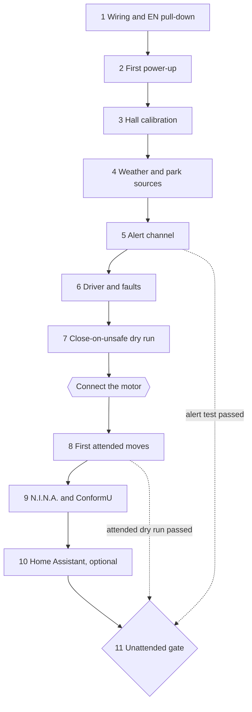

# Commissioning guide

This is the one ordered procedure for bringing a new roof controller into service, from a bare board on the bench to a roof that closes itself in the rain. Do the stages in order. Each stage rests on the ones before it, and the order is the safety order:

1. the motor stays **disconnected** until the controller has been shown to hold the driver off, refuse what it should refuse and stop what it should stop;
2. the **EN pull-down** is proven before the first firmware runs, not assumed;
3. the roof is **never left unattended** until an alert channel has delivered a test alert and the **close-on-unsafe dry run** has passed.

A [printable checklist](commissioning-checklist.md) carries every check below with a box and a space for the measured value. Print it and fill it in as you go: step N of stage S here is box S.N there.

<!-- diagram: DIA-30
sources: include/RoofPins.h lib/RoofLogic/src/RoofController.cpp lib/CloseSequenceLogic/src/CloseSequence.cpp include/CloseOnUnsafe.h
blocking: true
fingerprint: 7c183e2197d0eaa3
-->
<figure class="diagram" markdown>



<figcaption>The commissioning order. The motor is connected only after stage 7, and unattended use needs the alert test and both dry runs.</figcaption>
</figure>

??? info "Diagram in words"

    1. Stages 1 to 7 all run with the motor's leads disconnected from the driver: wiring and the EN pull-down, first power-up, Hall calibration, the weather and park sources, the alert channel, the driver and fault tests, and the close-on-unsafe dry run with a hand-held magnet standing in for the roof.
    2. Only then is the motor connected, for the first attended moves and the attended dry run on the real roof (stage 8).
    3. Stage 9 adds N.I.N.A. over Alpaca and ConformU, stage 10 the optional Home Assistant link.
    4. Stage 11 is the gate for unattended use. It needs the alert test from stage 5 and the attended dry run from stage 8.

!!! danger "Safety rules for the whole procedure"
    - The roof is moved by a motor strong enough to damage a telescope. Until stage 11 passes, **someone is at the roof for every move, with a way to cut the motor supply within reach** (a switch or an unplugged lead, not a software button).
    - **Park the mount** (or take the telescope off the mount) before any move of the real roof.
    - The roof closes only onto a parked mount, and opens only while the weather is safe. Those checks are not to be worked around for a test; the procedure below tests them with real inputs.
    - A step that fails stops the procedure. Fix the cause (see [Troubleshooting](../reference/troubleshooting.md)) and repeat the step before going on.

---

## What you need

- A multimeter. A logic analyser or oscilloscope is optional (marked *analyser* where it adds a check; a meter does the rest).
- A bench or adjustable 12 V supply is useful but not needed: the procedure uses a setting to fake a low supply.
- A magnet like the ones on the roof, to hold at the Hall sensor by hand.
- A stopwatch, a tape measure and, if current sense is fitted, a clamp meter.
- Another person at the roof for stages 8 onward, a phone for the alert channel, and the PC that runs N.I.N.A. with a mount you can park.
- A running [SQMeter](https://github.com/DeanJ87/SQMeter) reachable from the roof controller (its safety endpoint decides the weather), with a way to make it report unsafe (its manual override).
- A serial connection (`pio device monitor --baud 115200`, or any terminal at 115200) for the log. Most checks name the log line to look for.

### Optional: rehearse on a spare board with the bench build

If you have a spare ESP32, flash the **bench** firmware onto it ([Bench mode](../user-guide/bench-mode.md): `pio run -e esp32dev_bench -t upload` and `-t uploadfs`, **over USB only**; it is not a release file). It simulates the roof and never switches its EN, RPWM or LPWM pins on, so you can rehearse the dashboard, the alerts, the close-on-unsafe sequence, N.I.N.A. over Alpaca and ConformU on a bare board before the roof board exists. **On a bare board tie GPIO36 to GND** (or fit the 100k/22k divider): a floating supply input can read as 12 V and the bench firmware then latches the `benchSupply` fault. The bench roof starts half-way, which reads `unknown`; every page shows a bench banner and alert titles start with `Bench: `. Leaving bench mode means flashing the standard firmware (USB, or **Updates**).

Bench mode does **not** replace the checks of this guide on the roof's own board: the wiring, the EN pull-down, the Hall sensor and the real timings are only proved there. **Never flash the bench build onto the roof's board**: the standard firmware refuses a bench image over the network, and a bench build that sees 12 V latches a fault, but do not rely on either.

### Commands and settings used in this guide

**In the web UI.** The dashboard's [Roof card](../user-guide/dashboard.md#roof) has **Open**, **Close**, **Stop** and, with a fault latched, **Clear fault**; a **Stop** bar sits at the bottom of every page while the roof moves. The roof's settings are in **Settings → Roof**, in five sections: **Roof motion**, **Hall sensor**, **Current and supply**, **Weather sources** and **Mount park** ([Configuration](../user-guide/configuration.md#settings-pages)). A save is refused while the roof moves. Use these wherever you are at a screen.

**From a shell.** The same commands are in the REST API, and the steps below give the `curl` form for settings. Paste these once; they are handy for scripting and for checks that need a log window beside them. If you turned on password protection (stage 2), add `-u admin:YOURPASSWORD` to every `curl -X POST`.

```bash
export ROOF=http://roofroof.local
roofstatus() { curl -s $ROOF/api/status | python3 -c 'import json,sys; print(json.dumps(json.load(sys.stdin)["roof"], indent=2))'; }
roofopen()   { curl -s -X POST -H "X-RoofRoof: 1" $ROOF/api/roof/open;        echo; }
roofclose()  { curl -s -X POST -H "X-RoofRoof: 1" $ROOF/api/roof/close;       echo; }
roofstop()   { curl -s -X POST -H "X-RoofRoof: 1" $ROOF/api/roof/stop;        echo; }
roofclear()  { curl -s -X POST -H "X-RoofRoof: 1" $ROOF/api/roof/clear-fault; echo; }
```

`roofopen`, `roofclose`, `roofstop` and `roofclear` are the Roof card's buttons by another name; where the guide says `roofopen`, pressing **Open** is the same. `roofstatus` prints the `roof` section of [`GET /api/status`](../api/rest.md#get-apistatus): `state`, `hall.counts`, `supplyVolts`, `fault` and the rest. Settings are changed with [`POST /api/config`](../api/rest.md#post-apiconfig); the field names are in [Configuration](../user-guide/configuration.md#roof). The Stop button (the card's, or the bar's on any other page) is the quickest way to stop a move from a phone at the roof.

---

## Stage 1: Wiring and the EN pull-down (everything off)

Power is off, the USB cable is out, and **both motor leads are disconnected from the IBT-2's motor terminals and insulated**. Nothing in stages 1 to 7 needs the motor.

1. **Wiring against the pin table.** Check every wire against [Wiring](wiring.md#pin-table) with the meter on continuity: RPWM to GPIO25, LPWM to GPIO26, R_EN and L_EN joined to GPIO27, the supply sense to GPIO36, the Hall output (through its divider) to GPIO39, the optional current-sense outputs to GPIO34 and GPIO35, park switches to GPIO32 and GPIO33, the rain contact to GPIO4.
2. **The EN pull-down.** With the ESP32 unpowered, measure from the joined R_EN/L_EN pins at the IBT-2 to GND: between 8 and 11 kΩ (never open circuit). Measure again at the ESP32's GPIO27 pin. This is the part that holds the driver off during a reset, a crash, a brown-out and flashing, so do not go on without it. See [The EN pull-down](wiring.md#the-en-pull-down).
3. **Optional pull-downs** of 10 kΩ on GPIO25 and GPIO26, if you fitted them: same measurement.
4. **The dividers.** Measure each resistor in place: 100 kΩ over 22 kΩ on the 12 V sense; 10 kΩ over 20 kΩ on each current-sense line and on the Hall output. Confirm the Hall sensor has its 5 V supply and that its output goes through the divider and never straight to GPIO39 ([Hall sensor](wiring.md#hall-sensor-ss49e)).
5. **Polarity of the switches.** Each park switch must **close when the mount is parked**; the rain contact closes when it rains. Confirm with the meter on the cable at the ESP32 end.
6. **Motor supply.** A switch (and a fuse) in the 12 V feed, the switch within reach of where you will stand at the roof. The motor leads stay off the driver.

!!! warning "Stop here if the pull-down is missing"
    Do not power the board with the driver connected until step 2 reads about 10 kΩ. Without it a reset can start the motor.

## Stage 2: First power-up (motor still disconnected)

1. **Flash and join WiFi** if you have not (on a spare bare board running the [bench build](../user-guide/bench-mode.md), tie GPIO36 to GND first): [Flashing](../getting-started/flashing.md), then [First Boot](../getting-started/first-setup.md). Do it from USB only, with the 12 V motor supply **off**, and with a meter on GPIO27: it reads 0 V throughout the flash (a floating EN during flashing is a hazard [Wiring](wiring.md#the-en-pull-down) names). Note the device's address.
2. **EN, RPWM and LPWM through a start.** With a meter on GPIO27, then GPIO25 and GPIO26, read 0 V before you plug in, while the board starts, and after it has started (the log shows the start-up; give it a minute). While the board is held in reset (hold the EN button on the DevKit), GPIO27 must still read 0 V: that is the pull-down at work. *Analyser:* capture GPIO25, 26 and 27 through a power-on and a reset; all three stay low.
3. **Turn on password protection** now: **Settings → Device → Security → Password-protect changes** ([Security](../user-guide/security.md)). Roof commands need it, and a person's command is the one the roof obeys from an unknown position. Add `-u` to the commands above.
4. **Boot between the magnets.** With no magnet near the sensor, `roofstatus` shows `state: unknown`, `hall.level` between, and `driving: false`. EN (GPIO27) stays low; nothing moves by itself. Hold a magnet at the Hall sensor, restart from **System → Restart device**, and the state is that end after the restart. (This is stage 3's check too; do it again there once the thresholds are set.)
5. **Supply reading.** Switch the 12 V supply on (the motor is still disconnected). Compare `supplyVolts` with a meter at the IBT-2's input: within about 0.2 V. (The unplugged-sense check is in stage 6, once the weather and park sources are set up.)
6. **Park switches and the rain contact.** If fitted, set the park switches (**Settings → Roof → Mount park**, `park.switches`: `one` or `two`) and the rain contact (**Weather sources**, `safety.rainContact`), or with:
   ```bash
   curl -X POST $ROOF/api/config -H "Content-Type: application/json" -d '{"park":{"switches":"two"},"safety":{"rainContact":true}}'
   ```
   Operate each switch by hand at the roof end of the cable and watch `parkSwitches.switch1`, `switch2` change between `closed` and `open`, and `rainContact` between `raining` and `dry`. Read them over the **real cable length**: if a level is slow or noisy (`unreadable`) add the external 10 kΩ pull-up to 3.3 V at the ESP32 end ([Pull-ups](wiring.md#pull-ups-and-the-input-only-pins)).
7. **Current sense (if fitted).** Leave `roof.currentSenseEnabled` off until stage 8. With the motor disconnected the reading would only be noise.

## Stage 3: Hall calibration with the live reading (motor disconnected)

Follow [Calibration](calibration.md#hall-sensor): note `hall.counts` between the magnets, at the closed end and at the open end (hold the magnet where the roof's magnet will sit, and a few millimetres short of that), set `roof.hallHighEnd`, `roof.hallHighCounts` and `roof.hallLowCounts` (**Settings → Roof → Hall sensor**, where the live reading is drawn against the thresholds as you type them).

1. **Resting value** (about 2000 with the 10k/20k divider) and **both end readings**, written on the checklist.
2. **The rails are never reached by a magnet.** Bring the magnet as close to the sensor as it ever gets (touching): the reading must stay clear of 30 and 4065. These values are reached only with the sensor disconnected or shorted.
3. **Set** the high end and both thresholds, halfway between the resting value and each end's reading, at least 80 counts apart.
4. **Check the states.** The Roof card's Hall marker follows the magnet and its level changes at the thresholds. With the magnet at each end `state` is `closed` or `open` correctly (check which is which!), and away from both it is `unknown`. Restart between the magnets and at each end to see the same after a boot.
5. **A disconnected sensor.** Unplug the Hall sensor's output at the ESP32: `hall.counts` reads 0, `hall.level` becomes `rail` and within a second a `hallRail` fault is latched, even at rest. Plug it back in and clear the fault with `roofclear`.

## Stage 4: Weather and park sources (motor disconnected)

The roof opens only on a safe weather verdict and closes only onto a confirmed park, so these inputs are tested with the real sources, one at a time. Details: [Safety inputs](../user-guide/safety-inputs.md). Keep a log window open: each result is a line with the `Safety` tag.

!!! warning "Unsafe weather starts the automatic close"
    Whenever you make the weather unsafe in stages 4 and 6, **hold the closed magnet at the Hall sensor** (roof `closed`), so the automatic close has nothing to do. With the roof open or stopped and the mount parked, an unsafe verdict would ask the real mount to park and command a close that times out and latches a fault. Before stage 7 check that the close sequence is idle (no `Close` lines in the log and `roof.closePhase`, where shown, idle).

1. **SQMeter over HTTP.** Set it up in **Settings → Roof → Weather sources**, or with:
   ```bash
   curl -X POST $ROOF/api/config -H "Content-Type: application/json" -d '{"safety":{"http":{"enabled":true,"url":"http://sqmeter.local/api/safety"}}}'
   ```
   With SQMeter safe, the log shows `Weather unknown` for at most one poll after boot, then `Weather safe`.
2. **Unsafe in, unsafe out.** Make SQMeter unsafe (its manual override): `Weather unsafe: SQMeter HTTP says unsafe: reasonFlags ...` appears within 5 s. Release the override. Then unplug SQMeter: the verdict is unsafe ("unreachable" or "stale") within 35 s.
3. **Wrong address.** Set the URL to a path that does not exist (an empty 404 reply): the source is reported unreadable, and the device does not reboot. Put the right URL back.
4. **SQMeter over MQTT** (only if you use it; needs MQTT set up, [MQTT](../user-guide/mqtt.md)): stop SQMeter's MQTT and the log says `SQMeter MQTT offline` at once. After a RoofRoof reconnect (restart it), a retained `safe=1` left on the broker does not make the verdict safe by itself.
5. **Rain contact** (if fitted): wet it or short it. The verdict goes unsafe with the contact as the reason. A contact alone is never enough for a safe verdict.
6. **N.I.N.A. and the mount.** In N.I.N.A. install the **Advanced API** plugin (2.2.15 or newer) and turn the API on; set the N.I.N.A. address (**Settings → Roof → Mount park**, `park.nina.url`) to `http://<PC>:1888`, or with:
   ```bash
   curl -X POST $ROOF/api/config -H "Content-Type: application/json" -d '{"park":{"nina":{"url":"http://192.168.1.20:1888"}}}'
   ```
   - With the mount parked and no switches set (`park.switches: none`): the log shows `Park: parked`.
   - Slewing or unparked readings are correct (`not parked`, with the reason).
   - Close N.I.N.A.: `N.I.N.A. not responding` within about 4 s.
7. **Park switches against N.I.N.A.** Set `park.switches` as fitted. With the mount parked and every switch closed: parked. Open one switch with the mount still parked: not parked, and the reason says the sources **disagree**.
8. **A save doesn't reset the verdict.** Change something unrelated (the NTP server). The verdict and the park result stay as they were.
9. **The site and the clock for the daylight failsafe** ([Daylight failsafe](../user-guide/close-on-unsafe.md#daylight-failsafe)). In **Settings → Roof → Daylight** switch **Location set** on and enter the observatory's latitude and longitude (north and east positive), and check **Settings → Time** shows NTP synced. The Roof card's **Daylight** line now shows the sun's altitude against the threshold (`Sun -14.2° < 0.0°` at night). Compare it with an almanac or a planetarium app for the same moment: within 0.5°. A wrong sign on the longitude puts the sun on the other side of the earth.
10. **Leave the daylight mode on Alert (the default) or Off until stage 11.** **Alert and close** refuses every open while the sun is up and starts the automatic close, which would get in the way of the daytime tests in stages 6 to 8. Stage 7 tries it on purpose.

## Stage 5: The alert channel (before anything can run unattended)

A roof left open in the rain is only caught if the alert reaches you. Set this up and prove it now, because the critical alerts go out only to channels you have switched on, and with none set up the serial log is the only report.

1. **Set up at least one channel** (Pushover, ntfy, a webhook, or MQTT to Home Assistant): [Alerts](../user-guide/alerts.md#channels).
2. **Test each of the ten roof events** (**Settings → Alerts**, roof rows, **Test** on each row, on a phone): each one arrives, with its example values. The three daylight rows (**Roof open in daylight**, **Roof closed after daylight**, **Daylight check not working**) are ordinary events with their own levels; set **Roof open in daylight** to a level you will hear in the morning. The critical ones (**The mount doesn't park**, **The roof doesn't close**) offer only Urgent and Wake me and no silent sounds. Check the wording and the layout on the phone you will carry; change the wording with **Text** if you like (a critical alert keeps its reason either way).
3. **The phone lets the critical level through.** Check your phone's silent or do-not-disturb setting lets a Wake me (Pushover emergency, ntfy max) alert sound.
4. **Critical alerts ignore the master switch.** Turn **Send alerts** off with one channel still on, press **Test** on a critical row: it still arrives. Turn **Send alerts** back on.
5. **MQTT only?** If MQTT is your only channel, a critical alert over MQTT (seen in Home Assistant) carries the reason text.
6. **Real events arrive in stages 6 and 7**; you will tick them there.

!!! warning "This is a gate"
    Stage 11 cannot pass without an alert that really arrived on your phone. A channel that has never delivered a test is no channel.

## Stage 6: The driver and the faults (motor disconnected)

With the motor leads off, the controller still runs its whole drive logic. A hand-held magnet stands in for the roof: the roof reads `open` when you hold the open end's magnet at the sensor, and starts "moving" when you take it away.

**Setup:** the closed magnet held at the sensor except where a step says otherwise, SQMeter safe, N.I.N.A. connected with the mount parked (and every park switch closed), so the checks pass.

1. **Refusals first.**
   - No weather source (set `safety.http.enabled` off for a moment): `roofopen` is refused, `weatherNotSafe`. Turn it back on.
   - N.I.N.A. closed, or a park switch open: `roofclose` is refused, `mountNotParked`. Restore both.
   - A fitted park switch opened **during** a close (hold the open magnet, `roofclose`, take the magnet away, then open the switch): the move stops with a `parkInterlock` fault naming the switch. Clear it with `roofclear`.
   - Between the magnets (`state: unknown`): a person's `roofclose` or `roofopen` is allowed (slowly, to the first magnet); N.I.N.A. and MQTT cannot do it.
2. **The drive pattern.** Hold the closed magnet (state `closed`) and run `roofopen`. Take the magnet away. For the length of the move watch GPIO25, 26 and 27: EN goes high only while driving; RPWM and LPWM are never both high; the PWM runs at 20 kHz. *Analyser:* capture a full open, a close, a stop and a reversal (open then close at once); RPWM and LPWM are never both high and EN drops before the stop is reported. With a meter, GPIO27 reads about 3.3 V only while driving and returns to 0 V on `roofstop`.
3. **Stop.** `roofstop` during the move: EN falls at once (GPIO27 to 0 V) and `state` becomes `stopped`. A new start waits half a second (the dead time).
4. **The timeout.** Start `roofopen` again and present no magnet. With the default settings the roof faults on `timeout` after the move's expected time plus `roof.timeoutMarginSeconds` (from the closed magnet, about 65 s at the defaults: 1850 mm at 38 mm/s is about 49 s, plus the 15 s margin and the ramp). EN drops, `state` is `error`, `fault` names the cause, the measured value and the limit.
5. **Leave-time fault.** Hold the closed magnet at the sensor, run `roofopen` and keep the magnet there: after `roof.leaveMagnetSeconds` (10 s) the fault is `didNotLeave`. This is what a motor wired backwards looks like on the real roof (stage 8).
6. **A fault stays latched.** With a fault latched: `roofopen` and `roofclose` are refused (`faultLatched`). Press the board's reset, then power-cycle it five times: the fault is still latched each time, and only `roofclear` clears it. A restart request made right after a fault waits until the fault is saved, and the fault is still latched after the restart.
7. **Settings and uploads are refused during a move.** While a move is running (magnet away), save any `roof.*` setting, start a web UI upload and press **Restart**: each answers `409` and the move continues.
8. **The Hall sensor lost mid-move.** Start a move, unplug the Hall sensor: `hallRail` fault, EN drops, and a **Roof fault** alert arrives on your phone with the reading. Plug it back in and clear the fault.
9. **A low supply.** The supply minimum is a setting, so raise it above your supply instead of lowering the supply: set `roof.minSupplyVolts` to `15` and `supplyLow` goes true; `roofopen` and `roofclose` are refused with the voltage and the limit, and after about 30 s a **12 V supply low** alert arrives. Put `roof.minSupplyVolts` back (default 11), and the alert is over. Then, with the 12 V supply on, unplug the supply-sense wire at the ESP32: `supplyVolts` reads 0 and `roofopen` and `roofclose` are refused for the supply (once the weather and park checks pass). Plug it back in. (With an adjustable bench supply you can also take the real supply below the limit.)
10. **A lost weather source.** Switch SQMeter off for longer than `safety.staleSeconds` (30 s) plus 30 s: **Weather source lost** arrives.
11. **Power pulled mid-move.** Start a move (magnet away), pull the board's power, restore it: the log names the reset reason (power-on or brown-out), `state` is `unknown`, and the roof does not move by itself.
12. **A power-cycled fault does not repeat its alert.** With a fault latched, reset the board (not a power cut): no new fault alert. After a power cut one alert arrives after the 60 s start-up grace.
13. **The dashboard follows.** On the Roof card, with the closed magnet held and the weather safe and the mount parked: the state and position follow the real state; **Close** greys with the reason when you pull a park switch or close N.I.N.A.; **Open** greys with the verdict when the weather is unsafe; a fault (unplug the Hall sensor) shows on the Roof card and the Status card, and **Clear fault** works once the sensor is back. With the WiFi dropped, **Open**, **Close** and **Clear fault** grey with "No live data" and **Stop** still sends. During a move the **Stop** bar appears on **Settings** and **Updates** as well; **Stop roof** from there stops the move. A restart with the page open keeps Open and Close greyed until live data returns. Look at the card and the Stop bar on your phone in the dark and say whether you are happy with them.

## Stage 7: The close-on-unsafe dry run (motor disconnected)

This is the whole safety function, run end to end with nothing to move. Read [Close on unsafe weather](../user-guide/close-on-unsafe.md) first. **Setup:** the roof "open" (hold the open magnet at the sensor of the roof's own board), N.I.N.A. connected, the mount **unparked**, SQMeter safe, alerts on, the log open. Set `park.timeoutSeconds` to 30 for the test and back to your mount's real value after (a little above the longest time it takes to park).

**Reset between steps.** A critical alert for the same cause is sent at most once every 30 minutes, and a person's stop stands the sequence down (also across a restart). Between the steps below, **end the sequence and rearm the alerts**: park the mount, run `roofclose`, present the closed magnet so the roof reads `closed`, then set up the next step. (A restart also clears the alert limit, not the stand-down.)

1. **The normal run.** Make SQMeter unsafe. Within 1 s the log shows `Close sequence started: unsafe: ...` and `Asking N.I.N.A. to park the mount`; N.I.N.A.'s mount parks. 4 to 5 s after the mount reports parked (and every park switch closes) the log shows `Closing the roof: the mount is parked`. Bring the closed magnet to the sensor: `Roof closed after unsafe weather`. On your phone, **Unsafe: closing** (with the weather's reasons) and then **Roof closed after unsafe weather** arrive.
2. **The mount doesn't park.** Reset to "open" and unparked, close N.I.N.A. (or disable its park), make SQMeter unsafe. At `park.timeoutSeconds` (plus a few seconds) **Mount didn't park** arrives as a critical alert on your phone; no new park request is sent for 5 minutes; the roof stays open. Do it again with **Send alerts** off and one channel on: it still arrives. Then **turn Send alerts back on**.
3. **A person's stop is respected.** Start a normal run, and press Stop (`roofstop`, or the web UI) while the roof "closes": the roof stops, **Automatic close stopped** arrives, and nothing more happens while it stays unsafe. Do it again, pressing Stop in the 4 s between "mount parked" and the close starting: no close starts.
4. **The stand-down survives a restart.** After step 3's stop, restart from **System → Restart device**: the sequence is still stood down, and a **Still:** alert arrives.
5. **Position unknown.** With the roof between the magnets (magnet away) and the verdict unsafe, restart the board: no park request is sent, and after 2 s **Roof can't close by itself: position unknown** arrives. Hold a magnet at the sensor to make the position known.
6. **A flapping verdict.** With N.I.N.A. closed, switch SQMeter between safe and unsafe every few seconds: park requests go out at most every 30 s, and **Mount didn't park** still arrives.
7. **Alerts all the way.** The roof alert on each critical event reached your phone with the alert master switch off and one channel on (step 2); the same events reached it with **Send alerts** on.
8. **Network behaviour during a close.** Start a normal run and, while it waits for the park (N.I.N.A. slow or the park held back): `POST /api/restart`, a firmware upload, a web UI upload and `POST /api/wifi/connect` each answer `409` naming the automatic close, and the sequence carries on. After pressing Stop (stood down), restart and a WiFi change are accepted. With the home router switched off, restart and a WiFi change from the setup hotspot are accepted.
9. **The hotspot never opens the roof.** With the setup hotspot on, `roofopen` answers `409` `hotspot`, from a phone on the hotspot and from the home network; close and stop behave as usual.
10. **A WiFi change with the roof open.** Request a close during the change: it waits (`closePending`) and starts once the WiFi has joined, or after 15 s at most. Saving MQTT settings with the broker unreachable answers within 1 s.
11. **A close wins over an upload.** Start a web UI upload with the roof open and request a close: the upload stops (`409`) and the close is under way within a few seconds. Pull the network cable mid-upload: a close is not blocked for more than 5 s.
12. **Command-line OTA** (only if you use it, roof closed): the device restarts through the plan, and an open during the upload is refused.
13. **The daylight dry run** (by day; skip to step 14 at night and do it the next morning). Reset to "open" with the mount unparked and SQMeter safe.
    - **Alert.** With the mode on **Alert** and the sun above the threshold (lower the **Sun altitude** threshold below the sun's altitude shown on the Roof card if you need to), **Roof open in daylight** arrives about 30 s later, saying nothing closes the roof. Nothing moves, and `roofopen` is still accepted.
    - **Alert and close.** Set the mode to **Alert and close**. Within about a second the log shows `Close sequence started: daylight, Sun ...` and `Asking N.I.N.A. to park the mount`; the mount parks, the close starts 4 to 5 s after the park is confirmed, and with the closed magnet at the sensor **Roof closed after daylight** arrives. **Unsafe: closing** does not.
    - **Opening refused.** With the roof `closed`, `roofopen` answers `409` `daylight` with the sun and the threshold, and the Roof card's **Open** greys with the same reason. N.I.N.A.'s Open shutter gets the same refusal.
    - **The park first.** Reset to "open" and unparked with N.I.N.A. closed: **Mount didn't park** arrives at `park.timeoutSeconds`, worded "It is daylight ...", and the roof stays open.
    - **A person's stop.** Start the daylight close again and press Stop while the roof "closes": **Automatic close stopped** arrives once, worded "in daylight", nothing more happens and no 30-minute reminders follow. Make SQMeter unsafe: after 30 s the weather close starts (**Unsafe: closing**). Press Stop again and make SQMeter safe.
    - **The check can't run.** Switch **Location set** off: the Roof card's Daylight line says **Location not set**, nothing is refused, and **Daylight check not working** arrives 10 minutes later. Switch it back on.
    - Put the threshold back, and set the mode back to **Alert** or **Off** until stage 11.
14. **N.I.N.A. over Alpaca, motor still disconnected.** Do [stage 9](#stage-9-nina-over-ascom-alpaca-and-conformu) steps 1 to 7 now, with the hand-held magnet standing in for the roof and N.I.N.A.'s dome driving it.

!!! warning "Second gate"
    All of stage 7 passes, with its alerts on your phone and **Send alerts** back on, and the close sequence idle, before the motor is connected.

---

## Connect the motor

Switch off the 12 V supply. Reconnect the motor leads to the IBT-2. Park the mount. Have the second person at the supply switch. Do not close the roof onto anything; clear the track.

## Stage 8: First attended moves on the real roof

At the roof, the roof at its closed end (state `closed`), the 12 V switch in reach, SQMeter safe, the mount parked. Do these in order: each one prepares the next.

1. **Go slowly first, and fail fast.** For the first moves set `roof.topDutyPercent` to `40` (the slow duty) so the roof never goes faster than the slow duty, and `roof.leaveMagnetSeconds` to `3`, so a motor wired backwards (which would push the closed end stop) faults within 3 s instead of 10:
   ```bash
   curl -X POST $ROOF/api/config -H "Content-Type: application/json" -d '{"roof":{"topDutyPercent":40,"leaveMagnetSeconds":3}}'
   ```
2. **The first move: a short one, with a finger on Stop.** `roofopen`. Watch the roof leave the closed end. If it moves toward closed instead, stop it (`roofstop`; it faults `didNotLeave` after the 3 s leave time): set `roof.openDirection` to the other value (`forward` or `reverse`), `roofclear`, and try again. **The slow duty moves the roof, under load, in both directions.** If the roof doesn't move at 40%, raise `roof.slowDutyPercent` and the top duty together.
3. **Stop is instant.** `roofstop` part-way: the roof stops at once and `state` is `stopped`, and `roofopen` carries on from there.
4. **A full open and close at 40%.** Let it run end to end and note the time. It must end at its magnet, within the timeout with the default margin, and not drive hard into the rubber stops. The roof slows near each end by the ramp-down setting; adjust `roof.rampDownMs` if it arrives too fast.
5. **Travel and speed, before any move above 40%.** Measure the travel between the two magnets' trigger points with the tape and set `roof.travelMm`. From the 40% time in step 4, set `roof.speedMmPerSecond` = travel ÷ (that time × 0.4), so the slow-down near each end starts in the right place. Then set `roof.topDutyPercent` to `70`, run an open and close, time them and refine the speed. Only then set `roof.topDutyPercent` to `100`, time a full open (stopwatch: `opening` to the magnet) and settle `roof.speedMmPerSecond` (travel ÷ seconds). The firmware assumes the speed is proportional to the duty: if the 40% time is clearly not about 2.5 times the 100% time, increase `roof.timeoutMarginSeconds` to cover the difference. Set `roof.leaveMagnetSeconds` back to `10` (or a value you have measured the leave time for).
6. **The supply under the motor's start.** During each start `supplyLow` must stay false and `supplyVolts` stay above `roof.minSupplyVolts`; a dip over 250 ms would fault `supplyLow`. If it does, check the supply and wiring, not the limit.
7. **The jam stop, without a jam.** Don't jam the roof. With current sense off, a jam is caught as "no magnet before the timeout" and the roof stops with a `timeout` fault. Test that the timeout stops a moving roof: set `roof.speedMmPerSecond` to twice its real value and `roof.timeoutMarginSeconds` to `3`, run `roofopen` and let it fault **part-way** (the second person ready at the supply switch). The roof stops where it is, EN drops, `fault` is `timeout`. Restore both values, `roofclear`, and finish the move. Then feel the motor housing and the IBT-2 heatsink: warm is fine. If either is too hot to hold after the longest run, shorten `roof.timeoutMarginSeconds` and `roof.leaveMagnetSeconds` or cool the driver, since that is the longest time the motor can be left on a jam.
8. **Current sense, if fitted.** Turn `roof.currentSenseEnabled` on and follow [Calibration](calibration.md#current-sense): with a clamp meter on one motor lead, compare `motorAmps` at 40% and at 100% duty and set `roof.currentAmpsPerVolt`; the start-up surge ends well under 250 ms; set `roof.maxCurrentAmps` above the steady running current and the surge and below the stall current. Test it: set `roof.maxCurrentAmps` just under the running current, run a move, and the roof stops on `overCurrent` within about a quarter of a second; restore it. With the motor running, unplug one sense wire at the ESP32: the reading must change visibly, and the lowest steady running current at the slow duty must be clearly different. If they are clearly apart set `roof.minRunningAmps` between them (or fit the 47 kΩ pull-up instead); then unplugging a sense wire while running latches `currentUnreadable`.
9. **Position after a power cut.** Start a move, cut the 12 V and the board's power part-way. The worm gear holds the roof. Restore power: the roof is `unknown`, nothing moves by itself, and a person's `roofopen` or `roofclose` moves it slowly to the first magnet.
10. **A full run at the real settings.** Open and close once each, attended, to confirm the settled values.
11. **The attended dry run of close-on-unsafe on the real roof.** Open the roof. With the mount unparked, N.I.N.A. connected and the second person at the supply switch, make SQMeter unsafe (manual override) and watch stage 7 step 1 happen with the real roof: the park request, the mount parking, the close, **Unsafe: closing** and **Roof closed after unsafe weather** on your phone. Then repeat stage 7 step 3 with a stop while the real roof closes (the roof stops; **Automatic close stopped** arrives), and close the roof yourself. **Third gate.**

## Stage 9: N.I.N.A. over ASCOM Alpaca, and ConformU

Details: [ASCOM Alpaca](../user-guide/alpaca.md). Alpaca is off by default and an Alpaca client is not a person: it can't move a roof whose position is unknown, clear a fault or stop a close in bad weather. Do steps 1 to 7 first **with the motor still disconnected** (hand-held magnets, as in stage 6), before "Connect the motor" below; steps 2 and 5 are then repeated on the real roof, attended, after stage 8.

1. **Switch Alpaca on** (**Settings → Network → ASCOM Alpaca**) and restart. In N.I.N.A.'s dome equipment, discover **RoofRoof roof** and connect (add it by IP and port 80 if discovery doesn't cross your network).
2. **Open and close from N.I.N.A.** with the weather safe and the mount parked. ShutterStatus runs through opening, open, closing and closed.
3. **Weather unsafe:** N.I.N.A.'s Open shows an error with the weather's reason, and nothing moves.
4. **Mount not parked:** N.I.N.A.'s Close shows the park reason.
5. **Stop from N.I.N.A.** stops a move in safe weather. During a close in unsafe weather it shows an error and the close **continues**; the web UI's Stop still stops it, and no **Automatic close stopped** alert arrives for the client's stop. A client's stop of a close waiting behind an upload is refused in bad weather.
6. **Position unknown:** after a boot between the magnets N.I.N.A.'s Open and Close say only a person can move the roof.
7. **Alpaca off:** every Dome command, Stop included, answers "disabled". Turn it back on afterwards if you use it.
8. **ConformU.** Run ConformU against the device (version 4.5.0 passes in CI against the simulator) **only on a [bench-build](../user-guide/bench-mode.md) board (GPIO36 tied to GND) or with the roof's own board attended, motor disconnected or a person at the roof ready to stop it**: it opens, closes and stops the shutter. Fix nothing by hand-editing results; every error is a finding.

## Stage 10: Home Assistant and MQTT (optional)

Skip this stage if you don't use MQTT. Details: [MQTT](../user-guide/mqtt.md).

Do this stage with the motor disconnected (hand-held magnet) the first time, and keep MQTT roof commands off until step 3 passes.

1. **Watch.** Enable MQTT and Home Assistant discovery. The roof appears as a **Roof** cover (read-only while commands are off) with position, supply, Hall and fault entities, and motor current only with current sense on. The base topic carries one retained document, `<base>/state`. Move the roof from the dashboard and see the cover and sensors follow within a second or two; a fault turns the fault sensor on with its text.
2. **Commands off by default.** With **Settings → Network → MQTT → Accept roof commands** (`mqtt.roofCommands`) off, publish `OPEN` to `<base>/roof/set`: the answer on `<base>/roof/result` says `switchedOff` and nothing moves. Look at the toggle in Settings and review its wording.
3. **Commands on (optional).** Switch it on. With the weather safe, `OPEN` opens and `STOP` stops. A **retained** `OPEN` left on the broker, then a device restart: the answer is `retained` and nothing moves. After a boot between the magnets, `OPEN` and `CLOSE` answer `positionUnknown`. With the automatic close running in unsafe weather, `STOP` answers `unsafeClose` and the close continues; the web UI's Stop still stops it.
4. **A dead broker link.** Pull the broker's network cable (a half-open link) during a close (attended, or driverless): the close completes with no park-interlock fault, and the log shows the MQTT write dropped.
5. **Discovery on the real WiFi.** After a connect, the discovery burst gets through without a write-budget disconnect.

## Stage 11: The gate for unattended use

The roof may run unattended only when every line here is ticked on the [checklist](commissioning-checklist.md#stage-11-the-gate-for-unattended-use):

1. The alert channel delivered a test on your phone (stage 5), and the critical events delivered in the dry runs (stages 7 and 8). With **Send alerts** off they still arrived (stage 7 step 2); **Send alerts** is switched back **on**.
2. The close-on-unsafe dry run passed with the motor disconnected (stage 7) **and** attended on the real roof (stage 8 step 11), with `park.timeoutSeconds` set a little above your mount's longest park time.
3. Password protection is on, the settings are backed up ([Backup & restore](../user-guide/configuration.md#backup-restore) in **Settings → Device**, kept off the device) and the commissioned values are written on the checklist.
4. **Health after a long session.** After an hour or more with the dashboard open, MQTT and a few uploads at rest, `roofstatus` shows `maxWatchdogBeatAgeMs` well under 50 and `maxStepGapMs` near 20, `watchdogTrips` is 0, and `stackFree.roof` in `/api/status` is above 2048 bytes.
5. **The daylight mode is the one you want**: **Alert and close** if you never image the sun (the roof parks and closes itself after sunrise), **Alert** to be told only, **Off** for solar imaging. The site is set and the Roof card's Daylight line shows the sun (stage 4 step 9), and the daylight dry run passed (stage 7 step 13).
6. **The first unattended spell is short**: close the roof, leave it closed, then try an evening you can watch from the phone and the log. Keep the phone with you, with alerts on.

---

## Advanced checks (analyser or debug build)

These are checks for someone who wants proof beyond the commissioning steps. They need a logic analyser or a debug build and are **not** required to pass the gate; each is also covered by the native tests.

- EN, RPWM and LPWM at boot, and the open, close, stop and reversal sequence, on an analyser (stage 6 step 2 with a capture).
- A debug build that blocks the control task for 500 ms while driving: EN falls within 110 ms of the last step and the fault cause is `watchdog`.
- Stop drops EN before the REST reply (analyser); a start waits only the 500 ms dead time.
- 200 rounds of settings save and close/stop sent together: `maxStepGapMs` under 100 and `watchdogTrips` 0.
- Under a burst of dashboard loads and a settings save at rest, `maxStepGapMs` stays near 20 ms.
- Capture real N.I.N.A. v2 mount-info and park replies and compare them with the test fixtures (`test/test_nina/fixtures.h`).
- The poller's stack low-water mark (debug log) stays above 2 KB with N.I.N.A.'s full reply; the main loop's and the motion task's stack and heap headroom after a full sequence and with N.I.N.A. polling the Dome stay above 2 KB.

---

## If a step fails

[Troubleshooting](../reference/troubleshooting.md#commissioning) lists the symptoms seen while commissioning: a roof that moves the wrong way, `didNotLeave`, `timeout`, `hallRail`, `supplyLow`, a refused open or close, N.I.N.A. not found, no alert.
