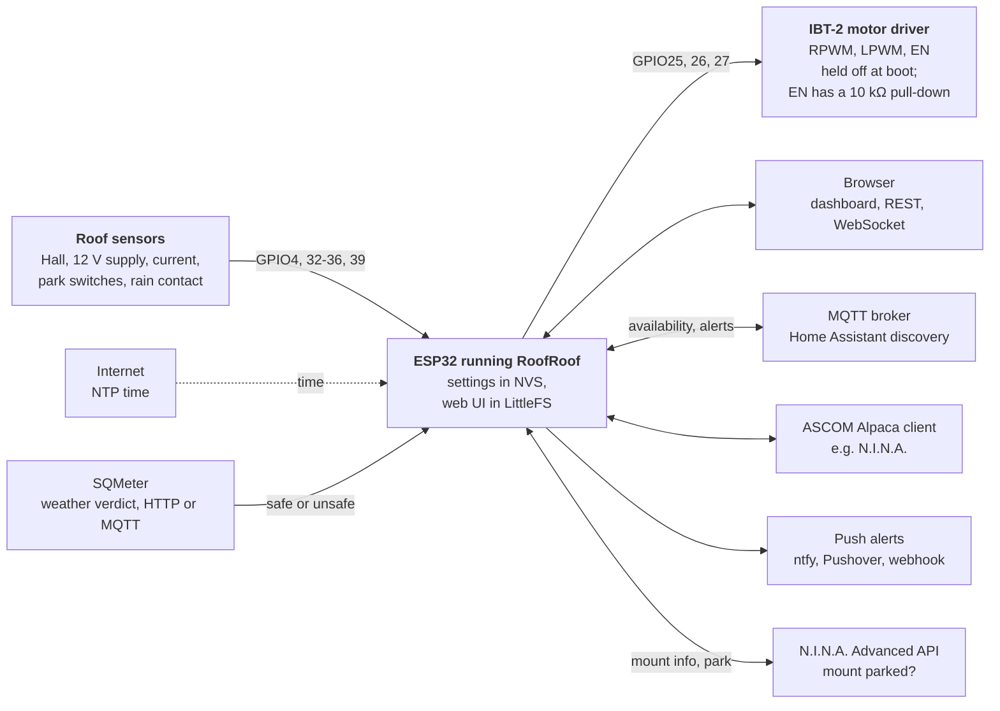

# RoofRoof

RoofRoof

ESP32 roll-off roof controller · roof hardware stage

Firmware and a web UI for an observatory roll-off roof: a safe, networked controller you reach from a browser, N.I.N.A. and Home Assistant.

RoofRoof is firmware for an ESP32 that will drive an observatory roll-off roof through an IBT-2 (BTS7960) motor driver. It was started as a copy of the author's SQMeter project, keeping its platform (WiFi setup, the web UI, the REST API, MQTT, alerts, updates, ASCOM Alpaca) and removing everything about sensors and sky quality.

!!! note "Roof hardware stage"
    The device serves its web UI, a REST API, live status, MQTT with Home Assistant discovery, an ASCOM Alpaca server and push alerts, and it holds the motor driver off from the first instruction of `setup()`. **It moves the roof only on an authenticated REST command** ([REST API](api/rest.md#roof)): open only while the weather is safe, close only onto a parked mount. The automatic close on bad weather, the Alpaca Dome device, MQTT roof topics and the dashboard's roof card come in later specs, and pages that will describe them say so.

There is no public docs site: these docs and the [live demo](live-demo.md) are built by CI and downloaded as an artifact.

<!-- diagram: DIA-01
sources: src/main.cpp#setup include/WebServer.h include/MQTTClient.h include/AlertDispatcher.h include/MotorDriver.h include/TimeManager.h
blocking: false
fingerprint: 791d3e72bdd5b26e
-->
<figure class="diagram" markdown>

<figcaption>What RoofRoof connects to: the motor driver it holds off, the ESP32 in the middle, and everything it talks to.</figcaption>
</figure>

??? info "Diagram in words"

    - **The ESP32** keeps its settings in NVS and the web UI's files in LittleFS.
    - **The motor driver** (IBT-2): the firmware sets GPIO27 (EN), GPIO25 (RPWM) and GPIO26 (LPWM) low as the first thing at boot. EN also has a hardware 10 kΩ pull-down, so the driver stays off before the firmware runs. The roof's control task drives it on a person's command, every 20 ms, with a watchdog that drops EN if the task stalls.
    - **Roof sensors:** the Hall sensor, the 12 V supply and (when fitted) the motor current on the ADC, the park switches and the rain contact on GPIO inputs ([Wiring](hardware/wiring.md)).
    - **Outputs:**
        - Browsers get the dashboard, the REST API and live WebSocket status.
        - An MQTT broker gets availability and alerts, with Home Assistant discovery; it can also switch alerts on and off.
        - ASCOM Alpaca clients such as N.I.N.A. can discover the server; it lists no device yet.
        - Alerts go to ntfy, Pushover, a webhook or MQTT.
    - **Inputs:**
        - SQMeter's weather verdict, over HTTP or through the MQTT broker.
        - N.I.N.A.'s Advanced API: whether the mount is parked, and a park request when the roof needs to close.
    - **From the internet:** NTP time only. The device never downloads updates.

---

## Features

- :material-wifi: **Web Interface**

    Real-time dashboard over WebSocket. No polling. No app required.

- :material-broadcast: **MQTT**

    Availability, alerts and an alerts pause switch for Home Assistant or any broker.

- :material-update: **Updates**

    Upload new firmware or web UI files from the browser, or flash over USB. Nothing is downloaded by the device.

- :material-connection: **ASCOM Alpaca**

    An Alpaca server for N.I.N.A. Discovery and the management API work; the roof's device comes in a later spec.

- :material-bell-ring: **Alerts**

    Pushover, ntfy, webhook or MQTT, with per-event levels and your own wording, and a pause switch.

- :material-shield-lock: **Safe from boot**

    The motor driver is held off from the first instruction of `setup()`, and EN has a hardware pull-down.

---

## FAQ

### Does it move a roof yet?

No. This is the platform stage. The motor, the roof position, the safety rules and the Alpaca Dome device come in later specs. What exists now is the network platform and the guarantee that the driver stays off ([Wiring](hardware/wiring.md)).

### Is this SQMeter?

No. RoofRoof started as a copy of the author's SQMeter project (a sky quality meter) and removed its sensors, safety monitor, sky and weather logic, Bluetooth, display, battery, language packs and GitHub release check. It is a separate project with its own repository, partition layout name (`l2`), hostname (`roofroof`) and setup hotspot (`RoofRoof-Setup`). A board that ran SQMeter starts as a new device: RoofRoof's settings live under another NVS namespace and its backups use another key, so SQMeter's settings are ignored (not erased) and an SQMeter backup is refused ([Flashing](getting-started/flashing.md)).

### Does it work with N.I.N.A.?

Not yet usefully. N.I.N.A. can discover the Alpaca server, but no device is served until a later spec ([ASCOM Alpaca](user-guide/alpaca.md)).

### Does it need Home Assistant or MQTT?

No. The device works on its own from the browser. MQTT, with Home Assistant discovery, is optional ([MQTT Integration](user-guide/mqtt.md)).

---

## Quick Start

New device? Go to [Flashing Your Device](getting-started/flashing.md) — you only need a USB cable and the release files. Wire the motor driver's EN pull-down first ([Wiring](hardware/wiring.md)).

Already flashed? Go to [First Boot](getting-started/first-setup.md) to configure WiFi.
