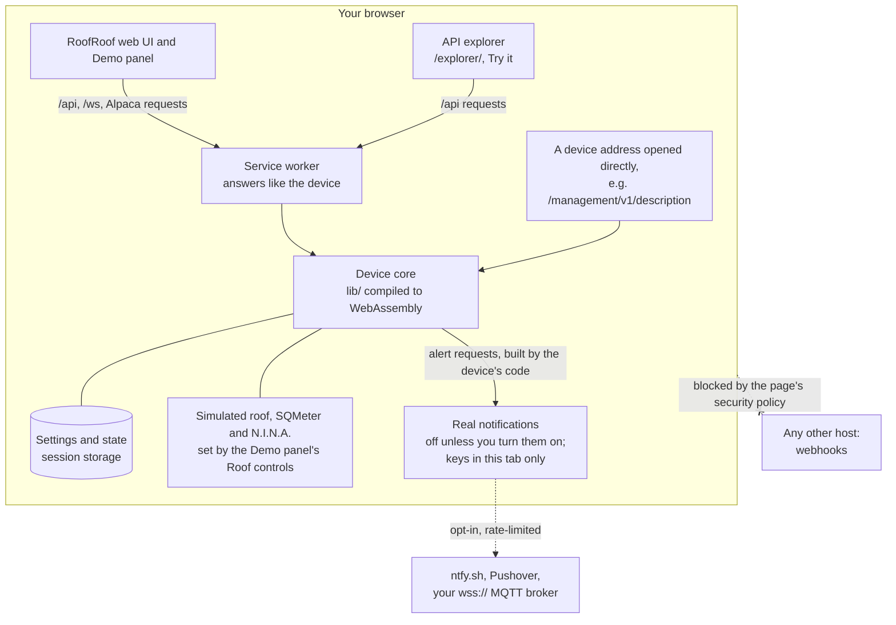

# Live Demo

The demo is a simulated RoofRoof in your browser. It runs **the firmware's own code** - the settings rules, the alert engine and the ASCOM Alpaca API, compiled to WebAssembly - so it behaves the way a real device does. No hardware, no account.

There is **no public demo site**. The demo is built by CI and shipped inside the docs artifact, or you can run it from a checkout.

The demo has a **simulated roof**: the firmware's own motion logic, command checks, close-on-unsafe sequence and roof alerts, driving a simulated motor, magnets and Hall sensor. See [The roof](#the-roof).

With **Settings → Device → Diagnostics → Advanced diagnostics** on, the simulated roof feeds the [diagnostics](user-guide/diagnostics.md) page and move log. Device-only values such as heap and step time show as not available.


---

## Run it

=== "From the CI artifact"

    1. Open the **Docs & Demo** workflow run for a commit or pull request on GitHub (you need access to the repository).
    2. Download the **site** artifact and unzip it.
    3. Serve it and open the demo:

    ```bash
    python3 -m http.server -d site 8000
    # docs:  http://localhost:8000/
    # demo:  http://localhost:8000/demo/
    # API explorer: http://localhost:8000/demo/explorer/
    ```

    The demo is built with relative paths, so it also works from any folder you serve.

=== "From a checkout"

    ```bash
    cd web
    npm ci
    npx msw init public/ --save      # the service worker that answers the API
    npm run build:demo               # writes web/dist-demo
    npm run preview:demo             # serves it
    ```

---

## What's real and what's simulated

| Real (the device's code) | Simulated (the demo) |
|---|---|
| Settings: defaults, validation and error messages | WiFi, restarts and firmware uploads |
| Alerts: which events fire, their level, wording and stacking - and the exact requests a device sends | Delivery - nothing is sent, unless you turn on [real notifications](#real-notifications) |
| Backup and restore of settings | The network - the demo connects to nothing unless you opt in |
| The Alpaca management API and the Dome N.I.N.A. talks to | The device's clock, which you can speed up |
| The roof's motion logic, gates, close sequence and alerts | The roof itself (motor, magnets, Hall sensor, current, 12 V supply), SQMeter and N.I.N.A. |

Because the dashboard, the Alpaca page and the Alpaca API all come from one emulated device, they always agree.

---

## The tour

On your first visit the demo offers a short tour: what RoofRoof is, the Status card, the Roof card, opening the roof, bad weather and the automatic close, the alerts bell and the Demo panel. Each action step finishes when the device reacts; **Do it for me** does it for you (opening also runs the device's clock 10x). **Skip tour** or Esc ends it; **Take the tour** in the Demo panel starts it again. It works with the keyboard alone, on phones, and without animation.

---

## Things to try

Open the **Demo** button (bottom right) for the demo's own controls. **Run the device clock 10x faster** shortens the device's own delays (alert cooldowns) so you don't wait.

Then change settings and watch them take effect:

- **Settings → Alerts**: change an event's level or write your own wording, then **Test** - the alert shows under the bell with "Demo: nothing was sent".
- **Settings → Network**: turn MQTT or Home Assistant discovery on and see the pills and dependencies react.
- **Settings → Device → Backup & restore**: back up, change something and restore.
- Enter an invalid value and you get the device's own error message.
- **Demo → Restart setup wizard**: the demo starts set up; this puts it back to a new device's state and opens the [setup wizard](user-guide/setup-wizard.md). Try **Test** on the Weather and N.I.N.A. pages, with the Roof controls making the weather unsafe or unparking the mount.

Device addresses work too: open `/management/v1/description` or `/api/status` on the demo's address to see what the device would answer.

---

## The roof

The demo's roof starts closed, with the weather safe and the mount parked. Open and close it with
`POST /api/roof/open` and `/api/roof/close` (or through the Alpaca Dome). A move takes about 50 s
with the device's default travel and speed; at 10x it takes about 5 s.

The **Roof** section of the Demo panel makes things go wrong on purpose:

| Control | What it does | What the device does |
|---|---|---|
| **Weather**: Safe, Unsafe, Rain | the simulated SQMeter's answer (seen at its next poll, within 5 s) | unsafe or rain with the roof open: asks the mount to park, waits for the park to hold, closes; opening is refused |
| **Mount**: Park, Unpark | the imaging app parks the mount (an 8 s slew) or unparks it | closing onto an unparked mount is refused |
| **Park fails** | the mount slews but never reaches park | the roof stays open; once the park time limit runs out, a critical "mount didn't park" alert |
| **Jam** | the roof can't move | the move stops with a fault and motion locks out until **Clear fault** (the jam removed first) |
| **Sun up** | forces the daylight state to day, the sun 10° above the threshold, whatever the location and the clock, until you switch it off | mode "Alert": one "Roof open in daylight" alert; mode "Alert and close": an open roof parks and closes, and opening is refused with the daylight reason. Set the mode in Settings → Roof → Daylight |
| **12 V supply**: Normal, Low | 12.6 V or 10.5 V | a move is refused, and one under way stops with a supply-low fault |

Reloading the page restarts the demo device: a roof stopped part-way then reads *unknown*, as a
real board would after a restart between the magnets. **Reset demo** starts again from closed.

The demo's own firmware build for a real board is [bench mode](user-guide/bench-mode.md).


---

## Your changes

Changes last until you close the tab - a refresh keeps them. **Reset demo** in the Demo panel starts over. Nothing is stored anywhere but your own browser.

---

## API explorer

The API explorer (at `demo/explorer/` in the artifact) lists every REST API route from the [OpenAPI description](api/reference.md). Pick one and **Test Request**: the demo's emulated RoofRoof answers in your browser, and each route shows a `curl` line to run against your own device.

---

## Real notifications

Want to feel an alert arrive? In the Demo panel, **Real notifications** → **Send real notifications from this demo**, confirm, and set up any of:

- **ntfy** - a topic on ntfy.sh (and an access token if it's protected). Topics are public: anyone who knows the topic can read it.
- **Pushover** - your user key and an app token.
- **MQTT** - a broker that accepts **MQTT over secure WebSockets** (`wss://...`), and a base topic; alerts go to `<base>/alerts`.

Then **Send a test**. The message is built by the device's own code - the same title, wording, priority and tags a real RoofRoof sends - and the result shows under the bell and in the panel ("Delivered", or the service's own error).

- Messages go **from your browser** straight to the service; never through a server of ours.
- Your keys stay **in this tab only**: not in the saved demo, URLs or logs, and gone when you reload, close the tab or press Reset demo.
- At most **one message per service every 30 s, 10 per visit**, so nothing can flood anyone's phone.
- **Wake** alerts are sent as **Urgent** - Pushover's emergency level needs acknowledging.
- **Webhooks and self-hosted ntfy servers** need a real RoofRoof: the page may only reach ntfy.sh, Pushover and secure MQTT brokers.

---

## Nothing leaves your browser

Unless you turn on real notifications, the demo only talks to itself: there is no server behind it, and the page's security policy lets it reach only ntfy.sh, Pushover and secure WebSocket brokers - which it does only for real notifications you turned on, in that tab. Keys or addresses you type into the device's alert or MQTT settings go nowhere. An automated test exercises the pages and checks that no request leaves the page.

<!-- diagram: DIA-12
sources: web/src/demo/device.ts web/src/demo/handlers.ts web/src/main.tsx tools/demo-core/bridge.cpp web/vite.demo.config.ts
blocking: false
fingerprint: 6b9a9eaae9a20ff9
-->
<figure class="diagram" markdown>



<figcaption>How the demo works: the firmware's own logic, entirely inside your browser.</figcaption>
</figure>

??? info "Diagram in words"

    - Everything runs in your browser; there is no server behind the demo.
    - The **device core** is the firmware's own `lib/` code compiled to WebAssembly. It keeps the settings and state in the tab's **session storage**, and runs the roof's motion logic and close sequence against a **simulated roof**, SQMeter and N.I.N.A.; the Demo panel's Roof controls change what those report.
    - The **web UI** and Demo panel make the same requests as on a real device; a **service worker** answers them from the core. So does the **API explorer**'s Try it. Device addresses opened directly (such as `/management/v1/description`) are answered by the core too.
    - **Real notifications** are off by default. Turned on, the browser sends the core's alert requests - the ones a real RoofRoof would send - to ntfy.sh, Pushover or your secure WebSocket MQTT broker, at most one per service every 30 s.
    - The page's security policy blocks every other host, so nothing reaches a webhook.

---

## Source

- The device code: `lib/`, built for the browser by `tools/demo-core`
- The request handling and Demo panel: `web/src/demo/`
