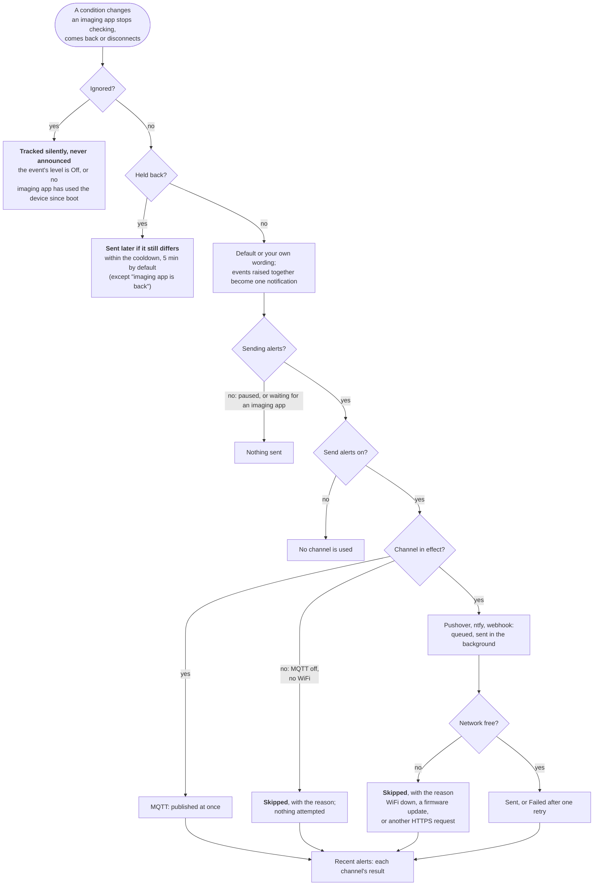

# Alerts

RoofRoof can send push notifications itself - over Pushover, ntfy, a webhook, or MQTT - so you hear about a change even when N.I.N.A. and the observatory PC aren't running.

!!! note "What raises an alert today"
    This release is the platform only. The events that exist now are the three **imaging-app** events (see [The imaging app](#the-imaging-app)), which need an ASCOM Alpaca device, plus **Alerts resumed** and the **Send test** messages. There is no Alpaca device until a later spec, so in practice you will see tests and "Alerts resumed". The [close on unsafe weather](close-on-unsafe.md) sends four critical `roof` alerts with fixed wording; the roof's own events with their levels and wording *come in a later spec* and use the same channels described here.

Configure everything in **Settings → Alerts**: turn on **Send alerts** (the master switch for every channel), pick your channels, **Save**, then use **Send test** next to each channel.

<!-- diagram: DIA-06
sources: lib/AlertLogic/src/AlertEngine.cpp lib/DeviceCore/src/DeviceAlerts.cpp#runAlerts src/WebServerAlerts.cpp#WebServer::processAlerts src/WebServerAlerts.cpp#WebServer::sendAlerts src/AlertDispatcher.cpp#AlertDispatcher::dispatch src/AlertDispatcher.cpp#AlertDispatcher::deliver
blocking: false
fingerprint: 6076032fae4689a3
-->
<figure class="diagram" markdown>



<figcaption>Why an alert does or doesn't arrive: every gate a change passes on its way to your channels.</figcaption>
</figure>

??? info "Diagram in words"

    1. The device compares the imaging-app state (is each Alpaca device still being checked?) with what you were last told, every second.
    2. **Tracked silently, never announced**: an event whose level is Off, and imaging-app events for a device no app has used since boot.
    3. **Held back for now, sent later if still true**: a change within the cooldown since that condition's last alert (5 minutes by default). "The imaging app is back" is not held back.
    4. The alert gets its default or custom wording; events raised in the same second become one notification.
    5. **Alerts paused** (by you, Home Assistant or a script, or because the imaging app disconnected in "Only while an imaging app is connected"): nothing is sent, except the critical `roof` alerts of the [close on unsafe weather](close-on-unsafe.md#alerts).
    6. While sending, with **Send alerts** on, the alert goes to every enabled channel: MQTT at once; Pushover, ntfy and the webhook in the background. With **Send alerts** off no channel is used.
    7. A channel that is switched on but not in effect (MQTT alerts with MQTT off, internet channels without WiFi) is **skipped** with the reason, and nothing is attempted.
    8. A background send is **skipped** when WiFi is down, a firmware update is running or another HTTPS request holds the connection; otherwise it is **sent**, or **failed** after one retry on a connection error.
    9. Each channel's result appears under **Recent alerts**.

---

## Events

Every event has its own **level**, and with Pushover on, its own **sound**:

| Event | When | Default level |
|---|---|---|
| The imaging app stops checking | No request reached a device for the **Silent for** time. See [The imaging app](#the-imaging-app) | Urgent |
| The imaging app is back | It started checking again | Quiet |
| The imaging app disconnects | An imaging app disconnected normally, e.g. at the end of a session | Off |
| Alerts resumed | Alerts went from paused to sending (always Quiet, not a setting) | Quiet |

| Roof (close on unsafe weather) | The mount didn't park, the roof didn't close, the roof can't close by itself, or a person stopped the automatic close. See [Close on unsafe weather](close-on-unsafe.md#alerts) | Wake (fixed; sent even while paused or switched off, to the channels that are on) |

*The roof's own events, with their settings, come in a later spec.*

| Level | Pushover | ntfy |
|---|---|---|
| Off | not sent | not sent |
| Quiet | priority -1, no sound | `low` |
| Normal | priority 0 | `default` |
| Urgent | priority 1, bypasses quiet hours | `high` |
| Wake me | priority 2 (emergency): repeats every minute for up to an hour until acknowledged | `max` |

**Test** on an event row sends a sample of that event to every enabled channel at the level and sound currently picked - no need to save first - and shows each channel's result. A Pushover emergency test keeps repeating until you acknowledge it in the app.

A sound left on **Default** uses the Pushover channel's default sound. Webhook and MQTT payloads carry the level as `"level": "quiet" | "normal" | "urgent" | "wake"`.

### Several at once

Alerts raised at the same moment arrive as one notification at the loudest of their levels, using that event's sound. Webhook and MQTT payloads then also carry `"events": [...]` with the others.

### Your own wording

**Text** on an event row lets you write the title and message yourself. Click a `{variable}` to insert it at the cursor; anything left empty keeps the built-in wording, shown greyed out. **Test** sends your wording filled in, before you save.

| Variable | Value |
|---|---|
| `{event}` | The event name, as in webhook payloads: `client_lost`, ... |
| `{device}`, `{time}`, `{date}`, `{level}` | Device name, local time and date, alert level |
| `{silent_for}`, `{last_checked}`, `{client_id}` | Imaging-app events: the **Silent for** time ("2 min"), when the app last checked ("21:04", or "3 min ago" without a clock) and the Alpaca ClientID it sent. For these events `{device}` is the Alpaca device |

Titles are up to 80 characters and messages up to 240. An unknown `{name}` is left as typed, so a typo shows up in the test.

**Cooldown** (default 5 min) is the minimum time between alerts of the same kind, so a flapping condition doesn't spam you. A change held back by the cooldown isn't lost: if the condition still differs from what you were last told when the cooldown ends, that alert is sent then.

---

## When to send

When the observatory is idle you may not want alerts at all. **Settings → Alerts → When to send** has two choices:

| When to send | What happens |
|---|---|
| **Any time** (default) | Alerts go out whenever something happens, unless you pause them. |
| **Only while an imaging app is connected** | Alerts start when an imaging app (e.g. N.I.N.A.) connects an Alpaca device, and stop when it disconnects. If it stops responding without disconnecting, alerts keep coming - and you're told it went quiet. |

Under it, a status line says what's happening and why, for example:

- "Sending alerts."
- "Paused - the imaging app disconnected at 05:42. Alerts resume when it connects again."
- "Paused by you at 21:04 (Pause button)."
- "Paused from Home Assistant or MQTT at 21:04."
- "Waiting for an imaging app to connect - nothing is sent until then."

**Pause alerts** / **Resume alerts** (there, or in the bell's flyout) take effect straight away, in either mode. A pause lasts until you resume; with **Only while an imaging app is connected** the next connect also resumes. While paused nothing is sent and phones don't ring, but the device keeps watching, so resuming doesn't replay stale changes. The state survives restarts. Resuming sends one quiet **Alerts resumed**. *Later specs add where things stand (the roof and the weather) to it.*

A crash isn't the end of a session: an imaging app that goes silent doesn't pause alerts - that's exactly when you want to hear about it. Only a clean disconnect does.

**Only while an imaging app is connected** needs Alpaca: with **Settings → Network → ASCOM Alpaca** off no imaging app can connect, so the choice is kept but shown *Inactive: Alpaca is off*, and alerts go out any time until Alpaca is back on ([settings dependencies](../reference/settings-dependencies.md), D-12).

### The imaging app

The device notices when an imaging app - anything that talks to its Alpaca devices - stops checking:

- **The imaging app stops checking**: a device had a client (connected, or polling since the device restarted) and no request has reached it for its **Silent for** time - the PC slept, the app crashed or the network dropped. Sent once per loss, at Urgent by default.
- **The imaging app is back**: the first request after that - straight away, even within the cooldown, so every "stops checking" gets exactly one "is back". Quiet by default. A client that keeps dropping out and coming back is still limited by the cooldown on "stops checking".
- **The imaging app disconnects**: a normal disconnect, e.g. at the end of a session. Off by default; no "stops checking" follows it.

**Silent for** is one setting for every Alpaca device (default 2 min, 30 seconds to 60 minutes; `alerts.clientSilentSeconds`).

Nothing is sent about a device no app has used since the device restarted. The exception is a restart the device causes itself (a crash, the watchdog, an update) while an app had a device connected: so if the app doesn't check it again within its **Silent for** time after boot, you're told it stopped checking. Requests from the device's own web page (the Alpaca page's live state) don't count. Alpaca requests don't name the application, so alerts name the device, not the app. The Alpaca page shows each device's state ("Connected, last checked 3 s ago"). These events need Alpaca switched on, and are sent at any hour (the "only when it's dark" limits don't apply).

### Automating pause and resume

**N.I.N.A.** - choose **Only while an imaging app is connected**, or call the API from a sequence (e.g. an *External Script* instruction): `curl -X POST http://roofroof.local/api/alerts/arm` to resume at the start, `.../api/alerts/disarm` to pause at the end.

**Home Assistant (MQTT)** - with [MQTT discovery](mqtt.md#home-assistant) on, an *Alerts* switch appears automatically (on = sending, off = paused). Without it, the device publishes `<base>/alerts/armed` (retained `1` sending / `0` paused) and listens on `<base>/alerts/armed/set` (`1`/`0`, `on`/`off`, `true`/`false`):

```yaml
mqtt:
  switch:
    - name: "RoofRoof alerts"
      state_topic: "roofroof/alerts/armed"
      command_topic: "roofroof/alerts/armed/set"
      payload_on: "1"
      payload_off: "0"
      icon: mdi:bell-ring
```

**Home Assistant (REST)**:

```yaml
rest_command:
  roofroof_alerts_on:
    url: "http://roofroof.local/api/alerts/arm"
    method: post
  roofroof_alerts_off:
    url: "http://roofroof.local/api/alerts/disarm"
    method: post
```

Add `username`/`password` if the device's password protection is on. `GET /api/alerts/armed` says whether alerts are being sent, the mode, and why ([REST API](../api/rest.md#get-apialertsarmed-post-apialertsarm-post-apialertsdisarm)).

## Channels

### Pushover

1. Create an application at [pushover.net](https://pushover.net/apps/build) and copy its API token - it goes in **App token**
2. Copy your **user key** from the Pushover dashboard
3. Enable **Pushover**, paste both, optionally pick a default sound, **Save**, **Send test**

### ntfy

Enable **ntfy** and set a topic. The server defaults to `https://ntfy.sh`; use your own server's URL if you self-host, plus an access token if it requires one. Topics on ntfy.sh are public - choose a long, unguessable topic name, then subscribe to it in the ntfy app.

### Webhook

POSTs a JSON body to any `http://` or `https://` URL - e.g. a Home Assistant webhook trigger, Node-RED, or a relay to Discord/Slack. An `http://` URL can use an IPv6 address in brackets (`http://[fd00::10]:8080/hook`); `https://` needs a host name ([IPv6](ipv6.md)):

```json
{"device":"RoofRoof","event":"client_lost","title":"The imaging app stopped checking","message":"No request reached the device for 2 min.","level":"urgent","timestamp":1759500000}
```

`event` is one of `alerts_on`, `client_lost`, `client_back`, `client_disconnected`, `roof`, `test`. An optional **Authorization header** value is sent as-is (e.g. `Bearer <token>`).

HTTPS webhooks are verified against a built-in set of common root CAs (Let's Encrypt, DigiCert, Sectigo/USERTrust, Google Trust Services, Amazon). For a self-signed server on your own network, either use `http://` or turn on **Skip certificate checks** - only do that on a network you trust.

### MQTT

Uses the broker from the MQTT settings. Publishes:

- `<base>/alerts` - each alert as JSON (`event`, `events` when several are stacked, `title`, `message`, `level`, `device`, `timestamp`), not retained

Alert delivery by MQTT needs MQTT switched on - see [MQTT](mqtt.md#topics).

---

## Recent alerts

**Clear** in the flyout empties the list on the device.

A bell in the header shows how many alerts arrived since you last looked, and opens the last 20 alerts since boot with each channel's result: **Sent**, **Failed** or **Skipped** (e.g. no WiFi, MQTT off, or an OTA update in progress), with the reason on hover. New alerts appear as soon as the device records them; the page doesn't need reloading. A channel that can't deliver shows as **Inactive** with the reason under its switch, isn't counted in the channels badge, and has no **Send test** until it can. **Send test** waits for that status and shows the actual result. The list is also available from `GET /api/alerts/recent`.

## Pushover keys

The **user key** is the 30-character key at the top of your Pushover dashboard; the **app token** is the 30-character API token of an application you create there. Settings rejects anything else - a pasted email address, or the token in the user field, is the usual cause of Pushover's "user identifier is not a valid user" error.
