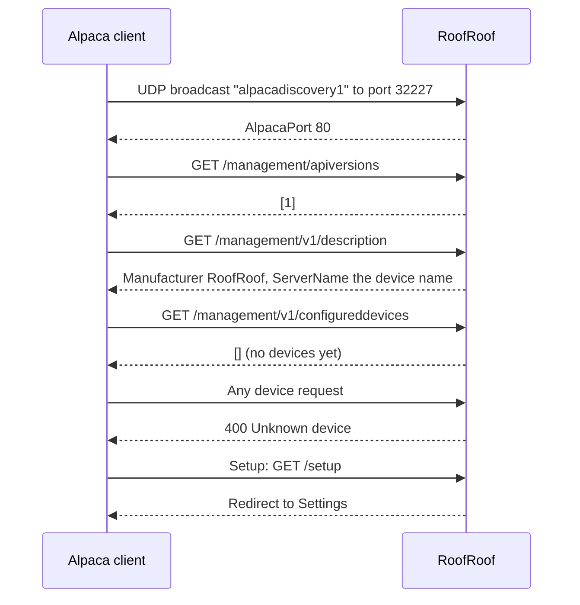

# ASCOM Alpaca

RoofRoof speaks ASCOM Alpaca directly - no separate bridge or Windows driver. N.I.N.A. and other Alpaca clients find the device on the network and connect straight to its IP address.

!!! note "No device is served yet"
    This release is the platform only. The Alpaca server answers discovery and the management API, and the configured-devices list is empty (`[]`). The roof's Dome device and its safety-monitor behaviour *come in a later spec*, and ConformU conformance testing is suspended until then, because there is no device to test.

---

## Enabling Alpaca support

1. Open the web UI and go to **Settings → Network**.
2. In the **ASCOM Alpaca** card, turn on **Serve Alpaca devices**.
3. **Save**.
4. When asked, restart the device: the UDP discovery listener that N.I.N.A. uses to find the device only starts at boot.

Alpaca support is disabled by default.

---

## What the server answers today

<!-- diagram: DIA-18
sources: lib/AlpacaLogic/src/AlpacaDiscovery.cpp lib/AlpacaLogic/src/AlpacaRouter.cpp src/WebServerAlpaca.cpp#WebServer::setupAlpacaRoutes
blocking: false
fingerprint: 7d5b70cd0c1a24f8
-->
<figure class="diagram" markdown>

<figcaption>An Alpaca client and RoofRoof: discovery, the management API and the Setup button.</figcaption>
</figure>

??? info "Diagram in words"

    1. The client broadcasts `alpacadiscovery1` on UDP port 32227. RoofRoof answers `{"AlpacaPort": 80}` - only when **Serve Alpaca devices** was on when it started, since the listener starts at boot.
    2. The client asks the management API: `/management/apiversions`, `/management/v1/description` (Manufacturer `RoofRoof`, ServerName the device name) and `/management/v1/configureddevices`, which is an empty list until a device is added in a later spec.
    3. A request for any device (`/api/v1/...`) is answered with HTTP 400 "Unknown device".
    4. `/setup` redirects to **Settings** in the web UI, where the ASCOM Alpaca card is.

### Alpaca page

The web UI's **Alpaca** page shows the Alpaca server's state and the host and port to use when adding the server manually (port `80`, discovery on UDP `32227`). Once a device exists it lists each advertised device with its `UniqueID`, API base URL and live state, and, under **Imaging app**, whether an imaging app is checking it. Today it says there is no Alpaca device yet.

### If discovery doesn't find the device

- Confirm **Serve Alpaca devices** is on under **Settings → Network → ASCOM Alpaca** and the device has been restarted since.
- Discovery is a UDP broadcast (and, with [IPv6](ipv6.md) on, the IPv6 group `ff12::a1:2345`) - it won't cross VLANs/subnets or most VPNs; the client and the device need to be on the same local network segment.
- As a fallback, most Alpaca clients (including N.I.N.A.) let you add a server manually by IP:port instead of relying on discovery - use the device's IP and port `80`.

---

## Imaging-app alerts

The device notices when an imaging app stops checking an Alpaca device, and alerts can be sent only while one is connected. These need an Alpaca device, so they apply from the spec that adds one - see [Alerts](alerts.md#the-imaging-app).

## Reference

See the [REST API reference](../api/rest.md#ascom-alpaca-api) for the Alpaca routes and the [ASCOM Alpaca API spec](https://ascom-standards.org/api/) for the response envelope and standard error codes.
