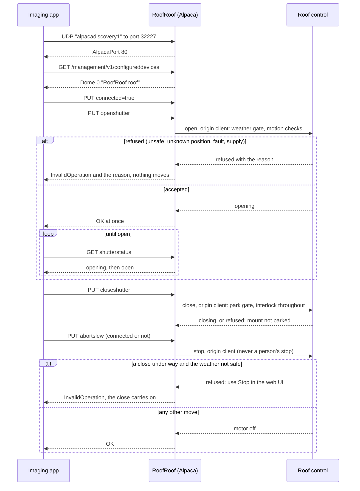

# ASCOM Alpaca

RoofRoof speaks ASCOM Alpaca directly - no separate bridge or Windows driver. N.I.N.A. and other Alpaca clients find the device on the network and connect straight to its IP address.

The device offers one Alpaca device: the roof, as a **Dome** with a shutter and nothing else. An imaging app can open the roof, close it, stop it and see whether it is open, closed or moving. Every Alpaca command goes through the **same checks as the web UI's** buttons: the roof opens only while the weather is safe and closes only onto a confirmed park. An imaging app can do less than a person at the web UI: it can't move a roof whose position is unknown, and it can't clear a fault.

!!! warning "Alpaca has no password"
    ASCOM Alpaca has no login, so anything on your network can send the roof Alpaca commands while Alpaca is on. The safety rules still apply to every command, but keep the device on a trusted network and never expose it to the internet ([Security](security.md)).

---

## Enabling Alpaca support

1. Open the web UI and go to **Settings → Network**.
2. In the **ASCOM Alpaca** card, turn on **Serve Alpaca**.
3. **Save**.
4. When asked, restart the device: the UDP discovery listener that N.I.N.A. uses to find the device only starts at boot.

Alpaca support is off by default. Turning it on lets imaging apps open, close and stop the roof.

## Adding the roof in N.I.N.A.

1. In N.I.N.A., go to **Equipment → Dome**.
2. Open the device list and pick **RoofRoof roof** under the Alpaca devices (N.I.N.A. finds it by discovery). If it isn't listed, see [If discovery doesn't find the device](#if-discovery-doesnt-find-the-device).
3. **Connect**. The shutter state shows as Open, Closed, Opening, Closing or Error.
4. Use N.I.N.A.'s Open and Close shutter buttons, or the **Open dome shutter** and **Close dome shutter** instructions in a sequence. N.I.N.A.'s Stop button stops the roof.

N.I.N.A.'s **Setup** button opens the device's Settings page.

---

## What the Dome does

| Member | What it does |
|---|---|
| `OpenShutter` | Opens the roof, through the same checks as the web UI's Open. Returns at once; progress shows in `ShutterStatus`. Needs a connected client. Refused while the roof is closing, a close is waiting, or a close was stopped part-way: an imaging app can't reverse a close. |
| `CloseShutter` | Closes the roof, through the same checks as the web UI's Close. Returns at once. Needs a connected client. A close that has to wait for an upload or an MQTT connect to stop succeeds and shows as closing. |
| `AbortSlew` | Stops the roof at once, keeping its position estimate (the roof's Stop, not its Abort), connected or not. It can't stop a close while the weather isn't safe (below). |
| `ShutterStatus` | 0 open, 1 closed, 2 opening, 3 closing, 4 error (below). |
| `Slewing` | True while the roof is opening or closing, or a close is waiting to start. |
| `CanSetShutter` | True. |
| Every other `Can...` | False. |
| `Slaved` | False; setting it false is accepted, true is not implemented. |
| `Altitude`, `Azimuth`, `AtHome`, `AtPark`, `FindHome`, `Park`, `SetPark`, `SlewToAltitude`, `SlewToAzimuth`, `SyncToAzimuth` | Not implemented: the roof has no azimuth, altitude, home or park of its own. The mount's park is N.I.N.A.'s. |
| `DeviceState` | `ShutterStatus`, `Slewing` and `TimeStamp` (once the clock is set). |

The device is `Dome` number 0, interface version 3, with the `UniqueID` `roofroof-<MAC>-dome-0`, which doesn't change across restarts and updates.

### Shutter state

| The roof | `ShutterStatus` |
|---|---|
| At the closed magnet | Closed (1) |
| At the open magnet | Open (0) |
| Opening | Opening (2) |
| Closing, or a close waiting to start | Closing (3) |
| Stopped part-way, position unknown, a fault latched, or the roof controller not running | Error (4) |

Only the closed magnet reads as closed, and only the open magnet as open: an app waiting for "open" never starts slewing the mount under a part-open roof. A roof stopped part-way reads as error; an app that wants it closed can still close it.

---

## When a command is refused

A refused open or close changes nothing and returns ASCOM's **InvalidOperation** error (`1035`, `0x40B`) with the reason, which N.I.N.A. shows. The reasons are the same as the web UI's:

| Reason | Example message | What to do |
|---|---|---|
| Weather not safe (open) | `Weather not safe: unsafe: rain` | Wait for the weather. There is no override ([Safety inputs](safety-inputs.md)). |
| Mount not parked (close) | `Mount not parked: park not confirmed (N.I.N.A. not responding)` | Park the mount; check the [park rule](safety-inputs.md#park). |
| Position unknown | `Position unknown: only a person can move the roof` | Move the roof to a magnet from the web UI ([Roof motion](roof-motion.md)). |
| A fault is latched | `A fault is latched: a person must clear it first: No target magnet after 61.0 s >= 60.0 s timeout` | Find the cause, then clear the fault in the web UI. |
| Supply low | `Supply 10.9 V < 11.5 V` | Check the 12 V supply. |
| Closing (open) | `The roof is closing or was stopped while closing: an imaging app can't reverse a close` | Let it close, or open it from the web UI. |
| Closing in bad weather (stop) | `The roof is closing and the weather isn't safe: an imaging app can't stop it (Stop in the web UI can)` | Use Stop in the web UI if the roof must not close. |
| Busy | `An upload is being written: try again in a moment` | Wait for the upload or restart to finish. |
| Not connected | ASCOM NotConnected (`1031`): `Not connected: connect to the Dome first` | Connect first. |
| Alpaca off | NotConnected: `Alpaca support is disabled in device settings`, for every Dome command including Stop | Turn Alpaca on, or use the web UI. |

Disconnecting, or an imaging app that goes quiet, never stops or starts a move: a move has its own time limit and magnet checks in the roof's motion logic, and stopping a close half-way would leave the roof neither open nor closed. The [imaging-app alerts](alerts.md#the-imaging-app) tell you when an app has gone quiet.

## Stop from N.I.N.A. in bad weather

Alpaca has no password, so nothing an imaging app sends may call off or hold up the [close on unsafe weather](close-on-unsafe.md). While the roof is closing (or a close is waiting to start) and the weather isn't safe, N.I.N.A.'s Stop (`AbortSlew`) is **refused** with a message saying so, whoever started the close, and the roof carries on closing onto the parked mount. If the roof must not close (someone at the roof), press **Stop in the web UI**: it works on every page, and a person's stop stands the automatic close down until the roof is closed or the weather has been safe for 10 minutes. N.I.N.A.'s Stop works as usual for every other move, and it never counts as a person's stop. The Alpaca connection is not a safeguard: ASCOM asks for it, but it is one setting for the whole server; the roof's own checks are what protect it.

<!-- diagram: DIA-18
sources: lib/AlpacaLogic/src/AlpacaDome.cpp lib/AlpacaLogic/src/AlpacaRouter.cpp lib/RoofIoLogic/src/DomeBridge.cpp src/WebServerAlpaca.cpp#WebServer::AlpacaBackend::domeCommand
blocking: true
fingerprint: abf1798b2d9676a2
-->
<figure class="diagram" markdown>

<figcaption>An imaging app and the roof's Dome: every command goes through the roof's own checks.</figcaption>
</figure>

??? info "Diagram in words"

    1. The app broadcasts `alpacadiscovery1` on UDP port 32227; RoofRoof answers `{"AlpacaPort": 80}` (only when **Serve Alpaca** was on when it started).
    2. The app lists the configured devices and finds one: Dome 0, "RoofRoof roof".
    3. It connects. Open and close are refused with NotConnected until it has.
    4. `OpenShutter` goes to the roof control with the client origin, through the weather check and the motion checks. A refusal comes back as InvalidOperation with the reason, and nothing moves. An accepted open returns at once; the app polls `ShutterStatus` until it reads open.
    5. An open while the roof is closing, a close is waiting, or a close was stopped part-way, is refused: an imaging app can't reverse a close. `CloseShutter` goes through the park check at the start, and the park is re-checked on every control step while closing. A mount that isn't confirmed parked refuses the close.
    6. `AbortSlew` stops the roof at once, connected or not, except a close while the weather isn't safe, whoever started it: that is refused with InvalidOperation and the close carries on (Stop in the web UI can stop it). It is never a person's stop.

---

## ConformU

The Dome is checked with ASCOM **ConformU** (conformance and the Alpaca protocol check) on every change, against a desktop simulator that runs the same Alpaca code and the same roof logic with a simulated roof. It must pass with no errors, issues or configuration alerts.

!!! danger "ConformU moves the roof"
    ConformU opens and closes the shutter, and calls Stop, as part of its checks. Run it against a real RoofRoof only with the motor disconnected or with a person at the roof, ready to stop it.

---

## Alpaca page

The web UI's **Alpaca** page shows the Alpaca server's state and the host and port to use when adding the server manually (port `80`, discovery on UDP `32227`). It lists the Dome with its `UniqueID`, API base URL and live state (`ShutterStatus`, `Slewing`), and, under **Imaging app**, whether an imaging app is checking it. The demo has no roof, so it offers no Dome.

### If discovery doesn't find the device

- Confirm **Serve Alpaca** is on under **Settings → Network → ASCOM Alpaca** and the device has been restarted since.
- Discovery is a UDP broadcast (and, with [IPv6](ipv6.md) on, the IPv6 group `ff12::a1:2345`) - it won't cross VLANs/subnets or most VPNs; the client and the device need to be on the same local network segment.
- As a fallback, most Alpaca clients (including N.I.N.A.) let you add a server manually by IP:port instead of relying on discovery - use the device's IP and port `80`.

---

## Imaging-app alerts

The device notices when an imaging app stops checking the Dome, comes back, or disconnects, and alerts can be sent only while one is connected - see [Alerts](alerts.md#the-imaging-app).

## Reference

See the [REST API reference](../api/rest.md#ascom-alpaca-api) for the Alpaca routes and the [ASCOM Alpaca API spec](https://ascom-standards.org/api/) for the response envelope and standard error codes.
