# Close on unsafe weather

When the weather is not safe and the roof is not closed, RoofRoof closes it by itself. A blip never
moves the roof: the close starts only once the weather has been unsafe for a while (the
[weather hold](#the-weather-hold), 60 s by default), except in rain, which starts it at once. Then:

1. it asks N.I.N.A. to park the mount (when a N.I.N.A. address is set);
2. it waits until the park is **confirmed**: the [park rule](safety-inputs.md#park) (as the park
   source says: N.I.N.A. says parked, every fitted park switch is closed, or both) has said parked
   for 4 s without a break;
3. it closes the roof through the same checks as any other close (the park is checked at the
   start and on every control step while closing), and watches it reach the closed magnet. A roof
   whose position is unknown closes too, slowly, to the first magnet ([below](#closing-when-the-position-is-unknown)).

The roof **never opens by itself**, and an Open is refused while the weather isn't safe. Only a
person at the web UI or the REST API, with the password, can confirm one past the weather SQMeter
alone calls unsafe (never rain, never a source in doubt) and past daylight ([A person's confirmed open](#a-persons-confirmed-open)).
An open already under way stops as soon as the weather isn't safe (unless confirmed that way), so
the roof opens no further; the sequence then parks and closes from there.

"Not safe" means unsafe *or unknown*: doubt counts as unsafe, and the roof's verdict says so at
once (Open is refused, an opening roof stops). After a restart with the roof open, the device
counts the start-up as doubt: if no weather source has said safe by the end of the hold, it asks for a park.

Every step has a time limit. A step that runs out stops the sequence where it is and sends a
critical alert naming the step. The roof is never closed onto a mount that isn't confirmed parked:
a wet telescope can be dried, a crushed one can't be fixed.

<!-- diagram: DIA-22
sources: lib/CloseSequenceLogic/src/CloseSequence.cpp lib/CloseSequenceLogic/src/CloseSequenceDaylight.cpp lib/CloseSequenceLogic/src/CloseSequenceRestore.cpp lib/CloseSequenceLogic/src/WeatherHold.cpp lib/CloseSequenceLogic/src/NinaLost.cpp lib/CloseSequenceLogic/include/CloseSequence.h
blocking: true
fingerprint: cfb19ab58eb7da35
-->

```mermaid
stateDiagram-v2
    accTitle: The close on unsafe weather
    accDescr: From idle, an unsafe verdict that has lasted through the weather hold (rain at once), with the roof not closed, starts an attempt that asks N.I.N.A. to park (unless park requests are off: then it only waits for the park); a roof already closing is only watched. A roof whose position is unknown starts the same attempt once the reading has settled for 2 s, and so does a roof with a Hall rail fault latched while a blind close is still allowed. When the park has held for 4 s the roof is closed, or driven blind towards closed when the Hall sensor is dead; with the opt-in, a N.I.N.A. lost for the set time and every fitted park switch closed also allow the close. Reaching the closed magnet ends the sequence, with a critical needs-a-person notice when the close started from an unknown position or without N.I.N.A.'s park. A park not confirmed in time, a refused, interrupted or too-long close leads to a five-minute wait, during which a confirmed park still closes the roof, then a new attempt. Any other fault, or a roof controller that did not start, stands the sequence down until a person acts; so does a blind close that has ended by its limit, a stall or a fault, with a critical alert asking a person to check the roof. A close that outlasts its guard is stopped and the sequence halts. A person's stop (also while it can't move) stands it down; halted and stood-down sequences end when the roof is closed or it has been safe for 10 minutes, or earlier when a person at the roof releases the hold while it is safe; a stood-down one also ends when an Open (a person's or an imaging app's) starts the roof moving. A weather that has been safe through the hold's clear spell before the close was commanded ends the sequence; a close already commanded runs to the end. A person's confirmed open (the weather SQMeter alone calls unsafe, or daylight) keeps those reasons from starting the sequence while it is in effect; rain and any doubt about the source still do. With the daylight close on, "not safe" also means the sun is up and "safe" means neither; when the weather turns unsafe after a daylight-only attempt, a waiting or can't-move sequence starts again at once, a halted one or one a person stood down after 30 s of unsafe weather in all. The times are the defaults of settings; with "Close didn't start" set to try again, a waiting close that doesn't start in time is called off and leads to the wait instead of the halt.
    [*] --> Idle
    Idle --> WaitPark: not safe past the weather hold, roof not closed (park request; also from an unknown position or with a Hall fault a blind close may answer)
    Idle --> Closing: not safe, a close already running
    Idle --> CannotMove: not safe, another fault latched, or the roof controller not started
    WaitPark --> Closing: park held for 4 s, or N.I.N.A. lost for the set time with every fitted switch closed (close, slow close or blind close)
    WaitPark --> RetryWait: park not confirmed in time (critical alert)
    WaitPark --> Idle: safe past the clear spell
    RetryWait --> Closing: park held for 4 s (close)
    RetryWait --> WaitPark: after 5 min (park request)
    RetryWait --> Idle: safe past the clear spell
    Closing --> Idle: closed magnet read (a notice if it started from an unknown position or without N.I.N.A.'s park)
    Closing --> RetryWait: close refused or interrupted (critical alert)
    Closing --> WaitPark: close not run (park no longer held, or the device about to restart)
    Closing --> Halted: too long (stop, critical alert)
    Closing --> RetryWait: a waiting close didn't start, policy retry (stop, critical alert)
    Closing --> CannotMove: fault (critical alert)
    Closing --> CannotMove: a blind close ended by its limit, a stall or a fault (critical alert, a person must check the roof)
    WaitPark --> CannotMove: a fault with no blind close allowed, or the roof controller not started (critical alert)
    RetryWait --> CannotMove: a fault with no blind close allowed, or the roof controller not started (critical alert)
    WaitPark --> HeldByPerson: a person's stop (critical alert)
    Closing --> HeldByPerson: a person's stop (critical alert)
    RetryWait --> HeldByPerson: a person's stop (critical alert)
    CannotMove --> RetryWait: the fault was cleared, or a blind close may now answer it
    CannotMove --> HeldByPerson: a person's stop (critical alert)
    CannotMove --> Idle: closed, or safe for 10 min
    HeldByPerson --> Idle: closed, or safe for 10 min
    Halted --> Idle: closed, or safe for 10 min
    HeldByPerson --> Idle: a person releases the hold while safe (attended)
    Halted --> Idle: a person releases the hold while safe (attended)
    HeldByPerson --> Idle: an Open starts the roof moving
    HeldByPerson --> Idle: weather unsafe 30 s in all, daylight-only attempt (starts again)
    Halted --> Idle: weather unsafe 30 s in all, daylight-only attempt (starts again)
    RetryWait --> Idle: weather unsafe, daylight-only attempt (starts again)
    CannotMove --> Idle: weather unsafe, daylight-only attempt (starts again)
```

<figure class="diagram" markdown>

<figcaption>The close on unsafe weather (and, with the daylight close on, in daylight: "not safe" then also means the sun is up). The times shown are the defaults; each is a setting. The weather hold (60 s of unsafe weather added up, rain at once) comes before the first step; its safe spell is the same length. With park requests off (park.requestPark) no park request is sent: the sequence only waits for the park. From waiting or closing, a fault with no blind close allowed, or a roof controller that didn't start, also stands the sequence down (CannotMove), and the roof reading closed always ends it. A roof whose position is unknown no longer stands it down: it closes slowly to the first magnet.</figcaption>
</figure>

??? info "Diagram in words"

    The times below are the defaults; each is a setting ([Settings of the automatic close](#settings-of-the-automatic-close)).

    1. While the weather is safe, or the roof is closed, nothing happens (`Idle`). A blip doesn't count: the sequence sees the weather as unsafe only once the [weather hold](#the-weather-hold) has fired, which is at once for rain and after 60 s of added-up unsafe time otherwise.
    2. When the weather is not safe and the roof is open, stopped part-way, opening or of unknown position, an attempt starts: N.I.N.A. is asked to park (`WaitPark`), unless **May ask N.I.N.A. to park** is off, when the sequence only waits for a park confirmed some other way. A position that is unknown must have stayed so for 2 s first (the moments after a restart don't count). The same holds for a roof with a Hall rail fault latched while a [blind close](#blind-close-when-the-hall-sensor-has-failed) is still allowed. If a close is already running (a person's, or one waiting for an upload to stop), it is only watched (`Closing`).
    3. When the park result has said parked for 4 s without a break, the roof is closed (`Closing`). From an unknown position this is a [slow close to the first magnet](#closing-when-the-position-is-unknown); with the Hall sensor dead it is a [blind close](#blind-close-when-the-hall-sensor-has-failed). With the [opt-in](#the-opt-in-close-without-ninas-park) on, N.I.N.A. lost for the set time with every fitted park switch reading closed stands in for the park. Reaching the closed magnet ends the sequence; a close that started from an unknown position, or without N.I.N.A.'s park, then raises a critical "needs a person" notice.
    4. If the park isn't confirmed within `park.timeoutSeconds` (at once if N.I.N.A. isn't set up), a critical alert says the mount didn't park (or, when N.I.N.A. can't be read, that it can't close because N.I.N.A. is unreachable) and the roof stays open (`RetryWait`). For 5 minutes no park request is sent, but a confirmed park still closes the roof. Then a new attempt starts, for as long as the close is wanted.
    5. If the close is refused or stops part-way, a critical alert says the roof didn't close, then the same 5-minute wait; no close is commanded in those 5 minutes, even if the weather clears and turns again. A close the roof doesn't run because the park stopped holding at that moment, or because the device is about to restart, isn't a failure: the sequence goes back to the step it came from, and the park must hold for 4 s again.
    6. If the close takes longer than its own timeout plus 30 s (or a waiting close doesn't start within 30 s), it is stopped where it is, a critical alert says so, and the sequence halts (`Halted`): nothing more is sent or moved. With **Close didn't start** set to **Try again**, a waiting close that doesn't start in time is called off instead, a critical alert says so, and the 5-minute wait follows (`RetryWait`), as for a refused close.
    7. If the roof has any other fault latched (not a Hall rail fault with a blind close allowed), or its controller didn't start, nothing is sent and a critical alert says it can't close by itself (`CannotMove`). A blind close that has ended (by its limit, a stall or a fault) also leaves the sequence here, with a critical alert asking a person to check the roof; there is never a second blind close for the same fault. Once a person has cleared the fault (or a blind close may now answer it), the 5-minute wait follows.
    8. A person's stop or abort during the sequence, or while it can't move, stands it down (`HeldByPerson`) with a critical alert: nothing more is sent or moved.
    9. `CannotMove`, `HeldByPerson` and `Halted` end when the roof reads closed, or the weather has been safe for 10 minutes without a break. `HeldByPerson` and `Halted` also end earlier when a person at the roof presses **Release hold** while the weather is safe and daylight doesn't want the roof closed ([Release hold](#release-hold)), and `HeldByPerson` ends as soon as an Open (the dashboard's, N.I.N.A.'s or MQTT's) starts the roof moving ([Opening ends the hold](#opening-ends-the-hold)); ending a stand-down moves nothing, the close is only armed again.
    10. While a person's confirmed open is in effect, the weather counts as safe for this sequence only when SQMeter alone says unsafe (no rain, no doubt), and daylight as not wanting a close; the verdict itself is unchanged, and the first reason that wasn't confirmed starts the sequence as usual. The override also resets the weather hold. Once the weather has been safe for the hold's clear spell (60 s) while the sequence waits, the wait is called off (`Idle`); with the daylight close on, only when the sun isn't up either. A close already commanded runs to the closed magnet. If it turns unsafe again within 10 minutes, the attempt carries on where it was, its time limit still running.
    11. An attempt that began only because of daylight, or a weather attempt or stand-down the weather has left for 10 minutes while daylight still wants a close, is a daylight attempt until the weather first turns unsafe. Then a waiting or stood-down (can't move) daylight attempt ends at once (`Idle`) and the weather attempt starts on the same pass; one a person stood down, or a halted one, ends once the weather has been not safe for 30 s in all since the stop, added up over unsafe spells (a new stop starts the count again); a person's stop on that very pass stands it down as a daylight stand-down (the 30 s count then applies). An attempt waiting for the park becomes the weather's own attempt, with its full time limit from then.
    12. A restart of the device (not a power cut) keeps a stand-down, and an attempt or back-off with the time it has run (plus 10 s for the restart), so a board that keeps restarting still reaches its limits; the weather hold of an attempt restored that way starts fired, since the close was already wanted. A restart after the close was asked for but before the roof took it carries on from the park wait; it isn't a failed close.

## The weather hold

A single unsafe reading, a SQMeter that browns out and restarts, or a cloud passing for a few
seconds must never move a roof. So the automatic close does not start the moment the verdict turns
unsafe; it starts when the weather has been unsafe for long enough. The verdict itself is not
delayed: Open is refused at once, an opening roof stops at once, the status says unsafe at once. Only
the close's start waits.

- **Summed time.** The unsafe seconds add up (`autoClose.unsafeHoldSeconds`, 60 s by default,
  0 to 300; 0 starts the close as soon as the verdict turns unsafe, as before). The close is wanted
  when the total reaches the hold.
- **Rain at once.** SQMeter's rain flag starts the close with no wait, from any source, even a stale
  one. A failed rain sensor is not rain: it is held like any other reason.
- **A clear spell.** Time added up is forgotten only after the weather has been safe for as long as
  the hold. Once the close is wanted, it stays wanted until then, so a verdict that flaps every 5 s
  reaches the hold in about two minutes, starts one close, and doesn't call it off at each safe
  moment. The roof never reopens by itself: N.I.N.A. opens it.
- **A silent SQMeter.** A weather source turns stale after `safety.staleSeconds` (30 s by default)
  without a good reply, and a stale, unreachable or unreadable source counts as unsafe like any
  other reason. So a SQMeter that goes quiet starts the close after the stale time plus the hold:
  about 90 s by default, up to one 5 s poll later (about 95 s). A SQMeter that restarts in a few
  seconds never even turns the source stale, and so never moves the roof. Set the two together: a
  longer stale time makes the close later for a silent SQMeter too.
- **Called off before the motor runs.** If the weather has been safe for the clear spell before the
  motor starts, the hold lets go and the waiting close (the park request, the park wait or the
  back-off) is called off. Once the motor is closing, the close finishes: a close wins.
- **A person's override.** An Open confirmed past the weather ([A person's confirmed open](#a-persons-confirmed-open))
  resets the hold, so the reasons it covers never start a close behind the person's back.
- **After a restart.** A close that the restart restored mid-attempt carries on with the hold
  already fired. After a plain start the hold is empty and the start-up window, while the sources
  still read "waiting", counts as doubt and is held like the rest.

The dashboard's Roof card shows the count under its **Weather** row while it runs ("Closing in 42 s
unless it clears"), and the status has it as `roof.weatherHold` (`countedSeconds`, `leftSeconds`,
`fired`).

## Closing when the position is unknown

The automatic close used to stay put from an unknown position: after a crash 10 s into
an open, the board restarted with the roof about 10 % open and its Hall sensor healthy (reading
"between"), and a close sat in "can't move" for minutes while the weather turned. It now closes, the
same way a person's move from an unknown position does:

- only for unsafe weather, or daylight that wants the roof closed, once the weather hold has fired;
- only once the park is confirmed (or the [opt-in](#the-opt-in-close-without-ninas-park) applies);
- at the slow duty, towards closed only, stopping at the first magnet it reads;
- with the hard timeout of a move from an unknown position: the whole travel at the slow speed plus
  the timeout margin ([Roof motion](roof-motion.md#timeouts-and-faults));
- a wrong magnet is a fault, as for every move.

Afterwards the critical alert **Roof closed from an unknown position** asks a person to check the
roof. The position stays something a person decides about: Open from an unknown position is still a
person's alone, and the automatic close never opens.

## Blind close, when the Hall sensor has failed

With the Hall sensor itself dead, no magnet can ever tell the roof where it is. If only a **Hall
rail fault** is latched (the sensor reads at the end of its range), `roof.blindClose` is on (the
default, also after an update) and the weather and the park say close, the automatic close drives
the roof towards closed **on time alone**:

- at the slow duty, for at most the same limit as a move from an unknown position (the whole travel
  at the slow speed plus the margin);
- the supply at rest is read just before the motor drives. After the first second (the start-up
  surge), a sag of at least `roof.blindSagVolts` (2.0 V by default, 0.5 to 6.0) held for 500 ms is
  taken as a stall at the end of the chain and stops the motor. Current sense is not fitted; the
  supply minimum (11.0 V by default, 250 ms) stays a second, harder stop. Set the sag from a
  bench measurement ([Commissioning, stage 8](../hardware/commissioning.md#stage-8-first-attended-moves-on-the-real-roof));
- it also stops on any fault the controller still checks (a low supply, a late step, the park
  interlock) and on Stop;
- the Hall fault stays latched and the position stays unknown. Stopping at the limit or on a stall is
  not a new fault;
- **one blind close per fault.** The fault record remembers it, also across a restart, so a board
  that keeps restarting in the rain doesn't drive the chain again and again. Clearing the fault
  allows one more.

When it ends, the critical alert **Roof closed blind: check the roof** says whether it stopped at
the limit, on a stall or on a fault, and asks a person to check the roof. With `roof.blindClose` off,
a Hall fault leaves the roof where it is and the critical alert says it can't close. Any other
latched fault (a timeout, a wrong magnet, the supply) moves nothing, as before.

## When N.I.N.A. can't be reached

By default the roof **never closes without a confirmed park**, whatever the weather, rain included:
a wet telescope can be dried, a crushed one can't be fixed. What "confirmed" means follows the park
source ([Safety inputs](safety-inputs.md#park)):

| Park source | The park is confirmed by | N.I.N.A. unreachable |
|---|---|---|
| Park switches only | The fitted switches alone | Doesn't matter; the switches confirm |
| N.I.N.A. and park switches | Both, in agreement; a disagreement blocks and alerts | Blocks the close |
| N.I.N.A. only | N.I.N.A. | Blocks the close |

While the park can't be confirmed the sequence keeps asking N.I.N.A. and keeps its attempt-and-back-off
loop running for as long as the close is wanted. The critical Wake-me alert **Can't close: N.I.N.A.
unreachable, mount park unknown** (or **Can't close: N.I.N.A. and the park switches disagree**)
goes out, and is repeated at the reminder interval until a person resolves it or the park is
confirmed.

### The opt-in: close without N.I.N.A.'s park

If you would rather risk a telescope that wasn't parked than an open roof in the rain, you may
let the automatic close go on without N.I.N.A.: **Close when N.I.N.A. is lost**
(`autoClose.ninaLostClose`, off by default) with **After** (`autoClose.ninaLostMinutes`, 5, 1 to
60). It applies only when:

- the park source is N.I.N.A. only, or N.I.N.A. and park switches;
- the weather is unsafe (daylight alone never uses it);
- N.I.N.A. has been unreachable, stale or unreadable, without a break, for that many minutes; and
- with N.I.N.A. and park switches, every fitted switch reads closed (the switches stand in alone; a
  switch that isn't closed still blocks). With N.I.N.A. only, nothing confirms the park at all.

!!! danger "The risk"
    With N.I.N.A. only, the roof closes onto a mount nobody has confirmed parked. A telescope
    pointing up can be crushed by a roll-off roof. Use it with the park switches fitted, and only
    if a wet roof worries you more than a missed park.

It applies to the automatic close only, never to Alpaca, MQTT or a person's command (a person's
[Close anyway](#a-persons-confirmed-close) is a separate thing and needs the password), and to its
re-check while the close runs. A Wake-me alert, **Roof closed without N.I.N.A.'s park**, says it
happened.

## Park before every move

The park rule gates **Open as well as Close**: a roll-off roof moving over a telescope that points
up can hit it either way. An Open or Close that only the park refuses, from the web UI, REST,
[Alpaca](alpaca.md) or [MQTT](mqtt.md#roof-commands), doesn't just fail when RoofRoof can ask
N.I.N.A. to park (a N.I.N.A. address is set and **May ask N.I.N.A. to park** is on). It is accepted
as **waiting for the park**: N.I.N.A. is asked at once and again every park request gap, and once
the park has held for the park hold time the command runs through every check again. The roof never
moves before that. The wait ends:

- when the park holds (the move runs);
- at the park time limit (`park.timeoutSeconds`, 240 s by default) with the critical **Mount didn't
  park** alert naming the command, the roof staying where it is;
- on any Stop or Abort, or a new Open or Close;
- when another check refuses the command (the weather turns unsafe for a waiting Open, a fault, the supply);
- when the automatic close starts: it calls off a waiting Open, and a waiting Close carries on beside it.

The dashboard shows the wait and its time left, with Stop; an imaging app sees `ShutterStatus`
opening or closing while it waits, and error after a failed wait ([Alpaca](alpaca.md#the-park-wait)).
When N.I.N.A. can't be asked (no address, or park requests off), the command is refused and says so.
With the park switches as the only source, the fitted switches confirm the park and nobody is asked.

### A person's confirmed close

A person with the web UI or REST password may close **once** without the park confirmed: **Close
anyway** in the dialog the dashboard shows when the park isn't confirmed (REST: body
`{"override": ["mountNotParked"]}`). The dialog says the mount isn't confirmed parked and the roof
could hit the telescope. The device first asks N.I.N.A. to park when it can. That close runs without
the park check at its start and without the re-check while it closes; the next Close checks the
park again. Alpaca, MQTT, Home Assistant and the automatic close can never do this.

### A person's confirmed open

A person may open past two refusals, naming each: **daylight** (the daylight failsafe is on "Alert
and close" and the sun is up) and **weather**, only while SQMeter itself says unsafe for anything
but rain, as for thin cloud or wind. Rain or a failed rain sensor, any doubt about the weather
source (missing, stale, unreachable, unreadable, offline), an unparked mount, a fault, an unknown
position, a suspect park switch, the supply and a busy device can't be overridden. The dashboard's
dialog lists every reason Open is refused and offers **Open anyway** only when each can be
overridden; REST takes `{"override": ["weatherNotSafe", "daylight"]}`.

The override lasts until the roof reads closed, a Close is accepted, every reason confirmed has
cleared, or a reason that wasn't confirmed appears (rain, a lost source, the park). Meanwhile
those reasons neither stop the opening roof nor start the automatic close; anything else does, and
the roof can stand open in cloud or in daylight with the automatic close standing back for them.
The override is shown on the dashboard and in the status (`roof.override`) while it is in effect.

## Release hold

A person's **Stop** during the automatic close stands it down (`HeldByPerson`), and so does a close
that took too long (`Halted`). The stand-down exists so the close doesn't fight someone who stopped
it, for example a person working under the roof in the rain. Meanwhile the roof doesn't jog, teach
or run a calibration either, and the dashboard and Calibrate say why and when it clears: at a clock
time while the weather is safe (after the re-arm spell, 10 minutes by default), or once the roof is
closed.

While the weather check reads safe and daylight doesn't want the roof closed, **Release hold** ends
the stand-down early. It asks first whether you are at the roof and can see it, and the device
refuses it while anything wants the roof closed. Releasing never moves the roof: it arms the
automatic close again, so if the weather turns unsafe afterwards a new attempt starts at once, as it
would after the re-arm spell. It is offered on the web page only (not to Alpaca, MQTT or Home
Assistant), and the log records it.

### Opening ends the hold

Opening the roof yourself also ends a person's stand-down, at once. An Open that starts the roof moving,
from the dashboard, N.I.N.A. (Alpaca) or MQTT, arms the automatic close again exactly as the end of
the re-arm spell does, so rain soon after closes the roof (after the park is confirmed) as on any
other night. An Open that is refused leaves the roof where it is and keeps the hold. An Open waiting for the park ends it only once the roof starts to move. While the hold
stands, the dashboard says "Automatic close on hold until the roof opens or closes". A close that
took too long (`Halted`) is not ended by an Open: it waits for the roof to be closed, the re-arm
spell or **Release hold**, and its critical alert keeps being sent until a channel takes it.

## Time limits

The times in this page are the defaults. Each one except the 2 s for an unknown position is a
setting (see [Settings of the automatic close](#settings-of-the-automatic-close)); the third column
names it.

| What | Limit (default) | Setting | Then |
|---|---|---|---|
| The weather unsafe before the close is wanted (the [weather hold](#the-weather-hold)) | 60 s added up (0-300); rain at once | `autoClose.unsafeHoldSeconds` | the close starts (park request) |
| The park confirmed | 240 s (30-1800); immediately without N.I.N.A. | `park.timeoutSeconds` | "Mount didn't park" (critical); the roof stays open. The same limit ends a waiting Open or Close ([Park before every move](#park-before-every-move)) |
| Between park requests | at least 30 s, whatever the weather does; repeated every 30 s while waiting | `autoClose.parkRequestSeconds` | - |
| The park must hold before closing | 4 s without a break | `autoClose.parkHoldSeconds` | - |
| After a failed attempt | 5 minutes before the next park request | `autoClose.retryMinutes` | a new attempt |
| A close waiting for an upload or MQTT connect | 30 s to start | `autoClose.closeStartSeconds` | stopped; "Roof didn't close" (critical); halted, or with `autoClose.notStarted` `retry` called off and tried again after the back-off |
| A close in motion | its own timeout + 30 s from the command (the motion logic's own timeout normally stops it first) | `autoClose.closeGuardSeconds` | stopped where it is; "Roof didn't close" (critical); halted |
| After a refused or interrupted close | 5 minutes with no close | `autoClose.retryMinutes` | - |
| Position unknown | 2 s before the close starts (the moments after a restart don't count) | fixed | a [slow close to the first magnet](#closing-when-the-position-is-unknown), once the park is confirmed |
| A blind close | the whole travel at the slow speed plus the margin, or a stall | `roof.blindSagVolts` (stall), the roof's timeout settings | stops; "Roof closed blind: check the roof" (critical) |
| N.I.N.A. lost, for the opt-in close | 5 minutes (1-60) | `autoClose.ninaLostMinutes` | the close may go on without N.I.N.A.'s park |
| A silent SQMeter | `safety.staleSeconds` (30 s) + the hold (60 s): about 90-95 s | `safety.staleSeconds`, `autoClose.unsafeHoldSeconds` | the close starts |
| Standing down or halted ends | the roof closed, or safe for 10 minutes without a break since standing down; a person's stand-down also ends when an Open starts the roof moving | `autoClose.rearmMinutes` | back to idle |
| A safe spell during an attempt | shorter than 10 minutes: the attempt carries on, its clock still running | `autoClose.rearmMinutes` | - |
| Alerts | each kind at most every 30 minutes; repeated every 30 minutes while the roof stays open after one | `autoClose.remindMinutes` | - |

Set `park.timeoutSeconds` (**Settings → Roof → Mount park → Park time limit**) to a little more
than your mount takes to park from its furthest position; see
[Configuration](configuration.md#safety-and-park).

## Settings of the automatic close

**Settings → Roof → Automatic close** holds the policy above. In view: **Weather hold**,
**Safe spell to re-arm**, **Reminder interval**, **Close didn't start**, **Remote Stop calls off a
close** and **Close when N.I.N.A. is lost** (with its **After**); under
**Advanced**: **Park request spacing**, **Park hold**, **Back-off**, **Close start limit**,
**Close guard** and the **MQTT change gap**. The older settings keep the value the device has always
used; the weather hold (60 s) and the blind close are new behaviour that is on by default. The fields and their ranges are in
[Configuration](configuration.md#automatic-close).

No value in any range can make the roof close onto an unparked mount (unless you switch the
[N.I.N.A.-lost close](#the-opt-in-close-without-ninas-park) on), open by itself, open from an
unknown position or stay open in unsafe weather without a critical alert:

- the weather hold is at most 5 minutes, and rain ignores it;
- the park hold can only be made longer than 4 s (two N.I.N.A. readings), and the close still checks the park itself;
- the close start limit is never below 25 s, well over the 15 s a network change holds a close;
- the reminder interval spaces the critical alerts but never turns them off;
- **Remote Stop calls off a close** makes an imaging app's or MQTT's Stop count as a person's,
  with the stand-down's critical alert ("Automatic close stopped", saying an imaging app or MQTT
  stopped it) and its reminders. Off (the default), such a Stop is refused while a close runs in
  unsafe weather. As for a person's Stop of a daylight close, a remote Stop of a close that only
  daylight wanted (the weather safe) gets the one alert and no reminders;
- a longer reminder interval spaces the reminders only: the same alert of a new episode still goes
  out after at most 30 minutes, and an alert no channel took is still resent at least every 30
  minutes.

Some choices stay fixed, because the safety rules need them: no open while the setup hotspot is
on, no close in the moment before a restart, and a person's Stop always works.
A wait for the park has no setting of its own: it uses the park time limit, the park request spacing and the park hold above.

## Alerts

The critical cases below are three alert events: **The mount doesn't park**
(`mount_not_parked`), **The roof doesn't close** (`roof_not_closed`) and **Roof needs a person**
(`needs_person`, the cases that need someone at the roof; [Alerts](alerts.md#roof-needs-a-person)). In
**Settings → Alerts → Roof safety** you choose their level (**Urgent** or **Wake me**, default Wake
me: Pushover emergency, ntfy `max`), sound and wording; they can't be switched off. They go to every
alert channel that is switched on, even while alerts are paused or switched off as a whole: only the
channels you have switched on are used, so set at least one up. An alert no channel took (WiFi down,
the access point restarting, no internet, a failed send) is sent again after a minute, then at
doubling gaps up to 30 minutes, until one does, a newer one of the same event replaces it or its
condition has ended; a critical one is also kept over a restart or a power cut and sent again after it
([Alerts](alerts.md#alerts-survive-an-outage)). Each kind is sent at most every 30 minutes; while the roof stays open after
one, it is sent again every 30 minutes with "Still:" in front of the title. None of them goes through
N.I.N.A. or SQMeter, so losing either doesn't lose the alert.

The start of the sequence (**The weather closes the roof**) and the roof reaching closed (**Roof
closed after unsafe weather**) are ordinary alert events with the usual rules (the master switch, the
pause, the cooldown); see [Alerts](alerts.md#the-roof).

| Alert | Means | What to do |
|---|---|---|
| **Mount didn't park**, or **Can't close: N.I.N.A. unreachable, mount park unknown** (or **... N.I.N.A. and the park switches disagree**) | The park wasn't confirmed in time; the message gives the park result's reasons (`N.I.N.A. unreachable`, `park switch 1 open`, `sources disagree`...). The title names N.I.N.A. when it is the input that is missing. The roof is open and the attempts carry on, with a reminder, for as long as the close is wanted. | Park the mount (N.I.N.A., or by hand), or bring N.I.N.A. back. Once the park is confirmed, the roof closes by itself. Or close it yourself once parked. |
| **Roof didn't close** | The close faulted, was refused (with the reason), stopped part-way, or took too long (then it stays stopped and isn't tried again until the roof has been closed or the weather has been safe for 10 minutes; after that, a later unsafe spell starts a new automatic close). | Look at the roof. After a fault, fix the cause and clear the fault; the close resumes once the mount is confirmed parked. After "took too long", close it yourself once you've checked it. |
| **Roof can't close by itself** | A fault is latched, or the roof controller didn't start. Nothing is sent or moved. With a Hall rail fault and `roof.blindClose` off it says so too. (A roof whose position is merely unknown no longer lands here: it closes slowly to the first magnet.) | Clear the fault. If it is still unsafe, the roof closes once the mount is confirmed parked. |
| **Roof closed from an unknown position**, **Roof closed blind: check the roof**, **Roof closed without N.I.N.A.'s park** | The roof closed, or tried to, in a way that a person should look at: slowly from an unknown position, on time alone with a dead Hall sensor, or without N.I.N.A.'s park ([Closing when the position is unknown](#closing-when-the-position-is-unknown), [Blind close](#blind-close-when-the-hall-sensor-has-failed), [the opt-in](#the-opt-in-close-without-ninas-park)). | Look at the roof, and at the telescope when N.I.N.A.'s park was set aside. After a blind close, find out why the Hall sensor failed and clear the fault. |
| **Automatic close stopped** | A person stopped or aborted the roof during the sequence (or while it couldn't move), or, with **Remote Stop calls off a close** on, an imaging app or MQTT did. Nothing more happens while it is unsafe. | Close the roof yourself when it is safe to, or wait for the safe spell to re-arm (10 minutes by default). Opening the roof again re-arms it at once. |

The titles above are the built-in wording. Your own wording (with `{reason}`, `{limit}` and
`{details}`) keeps the reason: a message that uses neither `{reason}` nor `{details}` gets the
built-in message added under it.

!!! warning "A stop is respected"
    The automatic close never overrides a person's stop: whoever pressed it may be at the roof.
    A person's stop is the web UI's or the REST API's (logged in). An imaging app's Stop over
    [Alpaca](alpaca.md), or a STOP over [MQTT](mqtt.md#roof-commands) (Home Assistant), can't stop a
    close while the weather isn't safe: neither has a password, so it is refused, and it never
    counts as a person's stop.
    The stand-down, and an attempt's running time, survive a restart of the device (a crash, a
    reset, a brown-out), so a board that keeps restarting in the rain still alerts in time; not a
    power cut, and not
    reliably a firmware update.
    A stop pressed by mistake leaves the roof open in the rain until someone acts on the alert.

## Daylight failsafe

The same sequence also runs when the sun is up and the roof isn't closed, if you ask for it. Set
**Settings → Roof → Daylight** to one of three modes (`daylight.mode`):

| Mode | When the sun is up and the roof isn't closed |
|---|---|
| **Off** | Nothing. Solar imaging works as it does without the feature. |
| **Alert** (the default) | An alert says the roof is open in daylight. Nothing moves, and nothing is refused. |
| **Alert and close** | The roof is parked and closed as for unsafe weather. Opening is refused while the sun is up. |

**Alert** is the default, also after an update from a release without it. Some owners image the sun
on purpose, for them an open roof in daylight is normal, and an update never turns on a feature that
moves the roof. Alert tells every owner about a forgotten open roof and moves nothing. Pick **Alert
and close** once if you never image the sun.

**The sun is up** when its altitude is at or above the **Sun altitude** threshold
(`daylight.sunAltitudeDeg`, default 0 degrees, the sun's centre on the horizon; -18 to +30). A lower
value closes earlier, a higher one suits a site with a high horizon. The sun counts as down again
only once it is 0.5 degrees below the threshold, so a sun that lingers there doesn't flicker the
state. The altitude is worked out on the device, once a second, from the site and the clock.

**The site and the clock.** The site comes from the SQMeter at the same observatory, or you type
it in (see [Site from SQMeter](#site-from-sqmeter) below; RoofRoof has no GPS of its own). Without
the site, or before the clock is set by NTP, the check can't tell day from night, so it **does nothing**: no
alert, no close, no refusal. With the mode on (alert, or alert and close), it sends **Daylight check
not working** (naming what is missing) once it has been unable to run for 10 minutes. A clock set
within 10 minutes of a restart never alerts. With the mode off, nothing is sent.

**Alert and close** is spec 005's sequence, unchanged: it asks N.I.N.A. to park, closes only once the
park is confirmed, never onto an unparked mount, and uses the same time limits, back-off and critical
alerts, worded for daylight (see below). Nothing in it opens the roof.

**Opening.** While the sun is up in **Alert and close**, every open is refused (web UI, REST,
[Alpaca](alpaca.md), [MQTT](mqtt.md) and Home Assistant; a person may [confirm one](#a-persons-confirmed-open)) with the reason `daylight` and the sun's
altitude and the threshold (`Daylight: Sun 3.2° ≥ 0.0°`). An open under way is stopped, as it is for
unsafe weather; the sequence then parks and closes. When the weather is also unsafe, the weather
reason is the one named. **Off** and **Alert** never refuse or stop anything. To open the roof in
daylight without confirming each time, set the mode to Alert or Off first.

**Test box.** With the daylight bypass of [test box mode](test-box.md) in effect, there is no daylight close and no refusal to open in daylight, until its deadline. Unsafe weather is not affected.

**Asking N.I.N.A. to park** is a setting, **May ask N.I.N.A. to park** (`park.requestPark`, on by default, Settings → Roof → Mount park), and only ever happens with a N.I.N.A. address set: with the [park switches only](safety-inputs.md#park-switches-only) and no address, the sequence only waits for the switches. Off, the sequence sends no park request and only waits for the park: with the test box's park bypass in effect it closes at once; otherwise, unless the mount is parked some other way, the roof stays open and the critical "mount didn't park" alert goes out.

**A person's Stop.** A person's Stop (web UI, REST) stands a daylight close down, exactly as it
does a weather close. An Alpaca or MQTT client's stop of a close in daylight is refused
(`unsafeClose`), as in bad weather. The stand-down lasts while the sun is up. It ends once the sun
has been down, or the mode has not been **Alert and close**, for 10 minutes, or when the roof reads
closed. A halted close stays halted the same way. Daylight never ends a stand-down or a halt.
**Automatic close stopped** goes out once when you stop a daylight close, with no 30-minute
"Still:" reminders while the weather is safe: you stopped it on purpose. Set the mode to **Alert** if you want the roof open
for the rest of the day.

**Unsafe weather comes first** and is unchanged:

- If the weather turns unsafe while a daylight-only attempt is backing off after a failure or
  unable to move, the weather close starts at once (a roof that can't move raises **Roof can't
  close by itself** again, worded for the weather), as a fresh attempt: the daylight close's
  back-off doesn't hold it back, also when daylight ended just before. If a person stood the
  daylight close down, or a daylight close was halted, the weather
  close starts once the weather has been not safe for 30 s in all since your stop, added up over
  the unsafe spells (a single missed SQMeter poll doesn't send a park request against your stop,
  and a flapping verdict still gets there; a new Stop starts the count again; the count is kept
  across a restart, and each pass of the sequence adds at most 1 s, so a stalled device takes
  longer). While the weather
  is unsafe, the stand-down's 30-minute reminder comes back. A person can
  stop the weather close with Stop too. The critical alerts start afresh, so a weather close that
  fails the same way as the daylight one just did is still announced. An
  attempt already waiting for the park carries on as the weather's own attempt with its full time
  limit, a close under way carries on, and their alerts are worded
  for the weather from then on.
- A weather close stood down by a person stays stood down while the sun is up in **Alert and
  close**, even after the weather clears. It re-arms once the sun has been down for 10 minutes.
  After 10 minutes of safe weather (with the sun up at some time in them) it counts as daylight's stand-down (a halt or a failing attempt
  the same way), so rain later that day is a new weather close, with its own alerts, after 30 s of
  unsafe weather.
- If the weather clears during a weather attempt while the sun is up in **Alert and close**, the
  weather's attempt is put aside (as for any short safe spell) and the daylight close runs its
  own attempt; a Stop then stands the daylight close down. If it rains again within 10 minutes,
  the weather's attempt carries on where it stood, with the time it had already run.
- With the mode **Off** or **Alert**, the sequence is exactly the one described above.

**Alerts.** Three events in [Settings → Alerts](alerts.md#the-roof): **Roof open in daylight**,
**Roof closed after daylight** and **Daylight check not working**. When a daylight close can't
finish, the same critical alerts as above go out, with "It is daylight" in place of "The weather is
unsafe" ("Mount didn't park: It is daylight and the park wasn't confirmed within 240 s, so the roof
stays open"), and the stood-down alert says the roof stays open "in daylight" and what re-arms it:
the sun has been down (or the daylight close off) for 10 minutes. **Roof open in daylight** isn't
sent while the weather close is already closing the roof ("The weather closes the roof" has said so).
The daylight events are ordinary alerts: they wait while alerts are paused, including **Only while
an imaging app is connected** (a crashed imaging PC disconnects, so that setting also silences
**Roof open in daylight**; use **Any time** if you rely on it). After an update, a device with no
site set sends **Daylight check not working: Location not set** once, 10 minutes after the restart:
set the site, or set the mode to Off.

The Roof card's **Daylight** line shows the mode and the sun against the threshold, or why the check
can't run; see [the dashboard](dashboard.md#roof).

## Site from SQMeter

RoofRoof and SQMeter stand at the same observatory, so they share a site. RoofRoof already knows
where SQMeter is: its weather source address (`safety.http.url`, SQMeter's address, http or
https; RoofRoof adds SQMeter's paths itself).

### The location follows SQMeter

**Settings → Roof → Daylight → Location from** (`location.source`):

- **From SQMeter** (`sqmeter`): RoofRoof reads the location SQMeter uses (`GET /api/status`, its
  `sky` section), which is a live fix when SQMeter has a GPS receiver. It reads it about 15 s after
  a restart or a change of the address or the source, then every 10 minutes (2 minutes after a
  failed read). It reads it whether or not the SQMeter weather source is on; the address must be
  set.
- **Typed in** (`manual`): the latitude and longitude you enter, as before.

A new device starts on **From SQMeter**. After an update, a location you typed in stays **Typed
in**, unchanged; with no location set, the device starts following SQMeter. The daylight failsafe then starts working once SQMeter's location arrives, in the mode you chose: with **Alert and close** it can park and close the roof after sunrise. To keep it inactive, set **Location from** to **Typed in** and leave the location unset.

**Kept on the device.** RoofRoof saves the location it read in its settings, so daylight keeps
working while SQMeter is switched off or out of reach. It saves only a real change: a move of 0.001
degrees (about 110 m) or more, a change between SQMeter's GPS and its typed location, or the first
location. A GPS fix that wanders in its last digit never writes the flash. While the location
follows SQMeter, the device owns it: Settings shows it read-only, and a settings save can't put an
older value back.

**Where it shows.** The dashboard's daylight row and Settings say where the location came from
and how old it is: "Location from SQMeter's GPS, read 3 min ago", or which location is kept
("Using the location read 2 h ago") and why ("SQMeter not answering": a note of its own in Settings,
behind the daylight row's "?" on the dashboard). If SQMeter has no location, or can't be reached, the kept one stays; with none
kept, daylight shows "Location not set" and does nothing, as before. No alert is sent: the location
isn't a safety input.

**Never a safety input.** SQMeter's location only says where the sun's altitude is worked out for.
It never enters the weather verdict, the park check or any refusal except through daylight, exactly
like a typed location.

**Never while the roof is busy.** No read starts while the roof moves, a close waits or the
automatic close is working, and a new location is saved only once the roof is still. A read takes at
most about 3 s on the task that polls SQMeter and N.I.N.A., never in the same pass as SQMeter's
safety poll, and never on the roof's own control task.

### Copy from SQMeter

**Settings → Roof → Site from SQMeter → Copy from SQMeter**, and the setup wizard's SQMeter
screen, read SQMeter's settings and list what differs, SQMeter's value beside RoofRoof's:

| Row | What it sets |
|---|---|
| Location | follow SQMeter's location (`location.source`) |
| Time zone | `ntp.timezone` |
| NTP servers | `ntp.server1`, `ntp.server2` |
| MQTT broker | `mqtt.broker`, `mqtt.port`, `mqtt.username`, and SQMeter's MQTT password when it shares it |
| MQTT password | `mqtt.password`, when the broker is already SQMeter's and its password differs |
| MQTT on | `mqtt.enabled`: offered while SQMeter's MQTT is on and RoofRoof's is off; with no broker set here, it brings SQMeter's broker too (as the MQTT broker row) |
| MQTT weather topic | `safety.mqtt.topic`: SQMeter's base topic, where RoofRoof reads `<base>/safe`. RoofRoof's own base topic (`mqtt.topic`) stays its own |
| ntfy | `alerts.ntfy.server`, `alerts.ntfy.topic`, and SQMeter's ntfy token when it shares it |
| ntfy token | `alerts.ntfy.token`, when the server is already SQMeter's and its token differs |
| ntfy alerts on | `alerts.ntfy.enabled`, while SQMeter's is on and RoofRoof's is off; with no topic set here, it brings SQMeter's server and topic too |
| Pushover keys | `alerts.pushover.userKey`, `alerts.pushover.appToken`, when SQMeter shares both and they differ |
| Pushover alerts on | `alerts.pushover.enabled`, while SQMeter's is on and RoofRoof's is off, once its keys are here (or come with the row) |

Tick the rows you want, **Apply ticked**, then **Save**: the settings are checked and saved as if
you had typed them. Nothing is saved by the copy itself.

**Passwords, tokens and keys.** SQMeter shares its own MQTT password, ntfy token and Pushover keys
with a client that logs in with its web password (`GET /api/secrets` on SQMeter, with its password
sharing turned on). The device reads them itself during the copy, with SQMeter's saved or typed
login, and only from the **saved** SQMeter address (its scheme, host and port): a typed address that
isn't saved yet gets the settings but not the secrets. The page never sees them: the list only says
"Passwords received from SQMeter; they are never shown here." Ticking a row with a secret puts a placeholder in that field
(`(from SQMeter)`, shown as "Received from SQMeter; never shown here."); at **Save** the device swaps it for what it
received, but only while the field's server is still the one SQMeter uses it for (the MQTT broker,
port and user name; the ntfy server). Change the broker or server after ticking and the save is
refused: copy again, or type the password. The device holds what it received for 30 minutes, in
memory only. Over `http://` the secrets cross your network unencrypted, as MQTT's own login does,
and the list says so.

When SQMeter can't share them, the list says exactly why, and asks for each secret as before:

| SQMeter answers | The copy says |
|---|---|
| 404 (an older SQMeter) | "This SQMeter can't share passwords: update it, or enter them here." |
| 403 "Password sharing is off" | "SQMeter's password sharing is off: turn it on in its Settings, or enter them here." |
| 403 "Set a web password" | "SQMeter has no web password, so it won't share passwords: set one in SQMeter first." |
| 401 | "SQMeter needs its login to share passwords: enter it in Settings, Roof." or "SQMeter refused the login: check SQMeter's user name and password in Settings, Roof." |
| 429 (five failed logins in a row) | "SQMeter locked sharing for a minute after failed logins: check its login, then retry." |

While SQMeter's own settings say sharing is off, RoofRoof doesn't ask at all. After a 401 the sync
never asks again until you change SQMeter's user name or password here, so a wrong saved login
can't run into SQMeter's lock; after a 429 it waits for the next read of SQMeter's settings.

**On and off switches.** SQMeter's MQTT, ntfy and Pushover switches are offered only to turn
RoofRoof's on (Pushover once its keys are here; the ntfy and Pushover rows also turn alerts on);
nothing from SQMeter ever turns one off.

**Never copied:** the device name and host name (the two devices must differ), WiFi, Alpaca, OTA,
the webhook, and any secret SQMeter didn't share. Copying a different MQTT broker, port or user name
without SQMeter's password clears RoofRoof's saved MQTT password, and a different ntfy server clears
the saved ntfy token, so a saved secret is never sent to a server it wasn't saved for.

Every copied value is an ordinary RoofRoof setting: it shows on its own Settings page (Time, Network,
Alerts, Roof), marked **Follows SQMeter** while its group follows, and stays editable there. That
holds while the channel is off too: a copied MQTT broker or ntfy topic shows its fields with MQTT or
ntfy off. A secret SQMeter has set is asked for at its field (the MQTT password, the ntfy token, the
Pushover user key and app token), also with that channel off, until you type it.

The device fetches SQMeter's settings itself (`POST /api/sqmeter/site`); the copy is refused while
the roof is busy. An older SQMeter that lacks a part simply has no row for it. Copying a group also
switches it to follow SQMeter (below).

### A password-protected SQMeter

If SQMeter has a password, enter its user name and password with its address (**Settings → Roof →
Weather sources**, or the wizard's SQMeter screen; `safety.http.username`, `safety.http.password`).
RoofRoof then sends them (HTTP Basic, SQMeter's own scheme) with every request it makes to SQMeter:
the weather poll, the location read, the settings sync and the copy. SQMeter leaves the readings
RoofRoof uses open even with its password on, but a later release, or a proxy in front of it, may
not.

The password is a secret: shown as `********`, never logged, and only sent to the SQMeter it was
saved for. Changing the address to another scheme (http or https), host or port clears it unless
you type it again; the copy only uses the saved password with the saved address's scheme, host and
port. Over `https://` the login travels encrypted (the certificate isn't checked).

When SQMeter turns a request away (401 or 403), RoofRoof says why instead of a bare HTTP status:
**SQMeter wants a password** (none was sent) or **SQMeter refused the password**. The weather source
then counts as unreadable, so it goes stale and the weather reads unsafe as for any other failed
poll; the dashboard's daylight line, Settings and the copy show the same reason.

### Keeping in step

Three groups of settings can keep following SQMeter, besides the location
(`sqmeterSync.<group>.follow`):

| Group | Follows | When SQMeter shares its secrets |
|---|---|---|
| Time | the time zone and both NTP servers | - |
| MQTT | the broker, port and user name, and SQMeter's base topic as the MQTT weather topic (`safety.mqtt.topic`; RoofRoof's own base topic stays its own); MQTT turned on while SQMeter's is on | the MQTT password |
| Alerts | the ntfy server and topic; ntfy and Pushover turned on while SQMeter's are (Pushover once both keys are here) | the ntfy token and the Pushover keys |

A new device follows SQMeter in every group. After an update, a group you had already changed from
its defaults stays **local**; one still at its defaults follows.

**How often.** RoofRoof re-reads SQMeter's settings on the location's schedule: about 15 s after a
restart or a change, then every 10 minutes (2 minutes after a failed read), never while the roof is
busy, never alongside SQMeter's safety poll, at most one read of SQMeter per pass of the task that
polls SQMeter and N.I.N.A. Only the few fields above are kept from SQMeter's reply.

**What a change does.** When SQMeter's values change, RoofRoof checks them exactly as it checks a
save from Settings, saves them once and applies them (a new broker reconnects MQTT, new NTP servers
resync the clock), and logs which groups changed. A value it can't accept (a broker name that isn't
valid, for example) is refused: the old value stays and Settings says why. Values that already match
write nothing.

**In Settings and the wizard**, a followed group says **Follows SQMeter**, with when SQMeter was
last read, and its fields stay editable. Typing in one of them sets the whole group here: the note
changes to **Set here, not from SQMeter** and the save sends the group as local, so the next sync
never puts SQMeter's value back over what you typed. **Follow SQMeter again** undoes that. Typing a
password or token that SQMeter has and RoofRoof is asking for only fills the gap: the group keeps
following. The device applies the same rule to any save: one that changes a followed group's values
without saying whether the group follows (a script, an older page) makes that group local. A save
that says the group follows (a copy from SQMeter) keeps it following, and then a settings save keeps
the values RoofRoof synced, so an older page can't put old ones back.

**Secrets.** While the MQTT or the alerts group follows, RoofRoof also reads SQMeter's secrets, in
the pass after each good read of its settings, from the saved address with the saved login. A
secret SQMeter has set is saved for the server it belongs to (SQMeter's broker, port and user name;
its ntfy server; Pushover's), and kept current while the group follows. An empty one never clears
RoofRoof's, and a secret typed here is not put back by a later save. When the sync can't read them
(`sync.secrets` in the status: `notSupported`, `sharingOff`, `noWebPassword`, `loginNeeded`,
`loginRefused`, `tooManyLogins`, `unreachable` or `unreadable`), Settings says why, and today's rule applies: a
synced change of the MQTT broker, port or user name clears RoofRoof's saved MQTT password, and of
the ntfy server the saved ntfy token; while SQMeter has that secret set and RoofRoof's is empty,
Settings and the dashboard's Status card ask for it, also with that channel off; and while SQMeter
uses Pushover, its keys are asked for until both are set here. This is a note, not an alert.

**Switches only turn on.** While a group follows, a switch SQMeter has on (MQTT, ntfy, Pushover) is
turned on here at the next sync (and, when no channel was on yet, the alerts master switch with
it); nothing turns one off. To keep one off while SQMeter's is on, turn it off here: that sets the
group here.

**Never anything else.** A sync never touches how the roof moves, the weather verdict, the park,
Alpaca, WiFi, the device or host name, RoofRoof's own MQTT topic, or any on/off switch. While MQTT
roof commands are on, the MQTT group doesn't sync at all ("MQTT roof commands are on: set the broker
here"): a broker changed elsewhere must not change who may move the roof. A synced weather topic or
broker restarts the MQTT weather source as any settings change does, so it reads unknown (not safe)
until SQMeter's next message.

## In the log

Every step is logged with the `Close` tag: `Close sequence started: unsafe: ...`, `Asking N.I.N.A.
to park the mount`, `Closing the roof: the mount is parked`, each phase change, and every alert's
title and message.
