# Close on unsafe weather

When the weather is not safe and the roof is not closed, RoofRoof closes it by itself:

1. it asks N.I.N.A. to park the mount;
2. it waits until the park is **confirmed**: the [park rule](safety-inputs.md#park) (N.I.N.A. says
   parked AND every fitted park switch is closed) has said parked for 4 s without a break;
3. it closes the roof through the same checks as any other close (the park is checked at the
   start and on every control step while closing), and watches it reach the closed magnet.

The roof **never opens by itself**, and you can't open it while the weather isn't safe: there is
no override.

"Not safe" means unsafe *or unknown*: doubt counts as unsafe. After a restart with the roof open,
the device asks for a park until a weather source has said safe.

Every step has a time limit. A step that runs out stops the sequence where it is and sends a
critical alert naming the step. The roof is never closed onto a mount that isn't confirmed parked:
a wet telescope can be dried, a crushed one can't be fixed.

<!-- diagram: DIA-22
sources: lib/CloseSequenceLogic/src/CloseSequence.cpp lib/CloseSequenceLogic/include/CloseSequence.h
blocking: true
fingerprint: 5ad5261a7adeb574
-->

```mermaid
stateDiagram-v2
    accTitle: The close on unsafe weather
    accDescr: From idle, an unsafe verdict with the roof not closed starts an attempt that asks N.I.N.A. to park; a roof already closing is only watched. When the park has held for 4 s the roof is closed. Reaching the closed magnet ends the sequence. A park not confirmed in time, a refused, interrupted or too-long close leads to a five-minute wait, during which a confirmed park still closes the roof, then a new attempt. A fault, or a position unknown for 2 s, stands the sequence down until a person acts. A close that outlasts its guard is stopped and the sequence halts. A person's stop (also while it can't move) stands it down; halted and stood-down sequences end when the roof is closed or it has been safe for 10 minutes. A safe verdict before the close ends the sequence; a close already commanded runs to the end.
    [*] --> Idle
    Idle --> WaitPark: not safe, roof not closed (park request)
    Idle --> Closing: not safe, a close already running
    Idle --> CannotMove: not safe, fault, or position unknown for 2 s
    WaitPark --> Closing: park held for 4 s (close)
    WaitPark --> RetryWait: park not confirmed in time (critical alert)
    WaitPark --> Idle: safe
    RetryWait --> Closing: park held for 4 s (close)
    RetryWait --> WaitPark: after 5 min (park request)
    RetryWait --> Idle: safe
    Closing --> Idle: closed magnet read
    Closing --> RetryWait: close refused or interrupted (critical alert)
    Closing --> Halted: too long (stop, critical alert)
    Closing --> CannotMove: fault (critical alert)
    WaitPark --> HeldByPerson: a person's stop (critical alert)
    Closing --> HeldByPerson: a person's stop (critical alert)
    RetryWait --> HeldByPerson: a person's stop (critical alert)
    CannotMove --> RetryWait: a person made the position known or cleared the fault
    CannotMove --> HeldByPerson: a person's stop (critical alert)
    CannotMove --> Idle: closed, or safe for 10 min
    HeldByPerson --> Idle: closed, or safe for 10 min
    Halted --> Idle: closed, or safe for 10 min
```

<figure class="diagram" markdown>

<figcaption>The close on unsafe weather. From waiting or closing, a fault or a position unknown for 2 s also stands the sequence down (CannotMove), and the roof reading closed always ends it.</figcaption>
</figure>

??? info "Diagram in words"

    1. While the weather is safe, or the roof is closed, nothing happens (`Idle`).
    2. When the weather is not safe and the roof is open, stopped part-way or opening, an attempt starts: N.I.N.A. is asked to park (`WaitPark`). If a close is already running (a person's, or one waiting for an upload to stop), it is only watched (`Closing`).
    3. When the park result has said parked for 4 s without a break, the roof is closed (`Closing`). Reaching the closed magnet ends the sequence.
    4. If the park isn't confirmed within `park.timeoutSeconds` (at once if N.I.N.A. isn't set up), a critical alert says the mount didn't park and the roof stays open (`RetryWait`). For 5 minutes no park request is sent, but a confirmed park still closes the roof. Then a new attempt starts.
    5. If the close is refused or stops part-way, a critical alert says the roof didn't close, then the same 5-minute wait; no close is commanded in those 5 minutes, even if the weather clears and turns again.
    6. If the close takes longer than its own timeout plus 30 s (or a waiting close doesn't start within 30 s), it is stopped where it is, a critical alert says so, and the sequence halts (`Halted`): nothing more is sent or moved.
    7. If the roof faults, or its position is unknown for 2 s, nothing is sent and a critical alert says it can't close by itself (`CannotMove`). Once a person has made the position known or cleared the fault, the 5-minute wait follows.
    8. A person's stop or abort during the sequence, or while it can't move, stands it down (`HeldByPerson`) with a critical alert: nothing more is sent or moved.
    9. `CannotMove`, `HeldByPerson` and `Halted` end when the roof reads closed, or the weather has been safe for 10 minutes without a break.
    10. A safe verdict while waiting ends the sequence. A close already commanded runs to the closed magnet.

## Time limits

| What | Limit | Then |
|---|---|---|
| The park confirmed | `park.timeoutSeconds`, default 240 s (30-1800); immediately without N.I.N.A. | "Mount didn't park" (critical); the roof stays open |
| Between park requests | at least 30 s, whatever the weather does; repeated every 30 s while waiting | - |
| The park must hold before closing | 4 s without a break | - |
| After a failed attempt | 5 minutes before the next park request | a new attempt |
| A close waiting for an upload or MQTT connect | 30 s to start | stopped; "Roof didn't close" (critical); halted |
| A close in motion | its own timeout + 30 s from the command (the motion logic's own timeout normally stops it first) | stopped where it is; "Roof didn't close" (critical); halted |
| After a refused or interrupted close | 5 minutes with no close | - |
| Position unknown | 2 s (the moments after a restart don't count) | "Roof can't close by itself" (critical) |
| Standing down or halted ends | the roof closed, or safe for 10 minutes without a break | back to idle |
| Alerts | each kind at most every 30 minutes; repeated every 30 minutes while the roof stays open after one | - |

Set `park.timeoutSeconds` to a little more than your mount takes to park from its furthest
position; see [Configuration](configuration.md#safety-and-park).

## Alerts

The four critical events go out at the **Wake** level (Pushover emergency, ntfy `max`) to every
alert channel that is switched on, as event `roof`, even while alerts are paused or switched off as a whole: only the channels you have switched on are
used, so set at least one up. Each kind is sent at most every 30 minutes; while the roof stays open
after one, it is sent again every 30 minutes with "Still:" in front of the title. Everything else is
written to the log. None of them goes through N.I.N.A. or SQMeter, so losing either doesn't lose the
alert.

| Alert | Means | What to do |
|---|---|---|
| **Mount didn't park** | The park wasn't confirmed in time; the message gives the park result's reasons (`N.I.N.A. unreachable`, `park switch 1 open`, `sources disagree`...). The roof is open. | Park the mount (N.I.N.A., or by hand). Once the park is confirmed, the roof closes by itself. Or close it yourself once parked. |
| **Roof didn't close** | The close faulted, was refused (with the reason), stopped part-way, or took too long (then it stays stopped and isn't tried again until the roof has been closed or the weather has been safe for 10 minutes; after that, a later unsafe spell starts a new automatic close). | Look at the roof. After a fault, fix the cause and clear the fault; the close resumes once the mount is confirmed parked. After "took too long", close it yourself once you've checked it. |
| **Roof can't close by itself** | A fault is latched, or the roof's position is unknown (after a restart between the magnets, or an abort). Nothing is sent or moved. | Move the roof to a magnet, or clear the fault. If it is still unsafe, the roof closes once the mount is confirmed parked. |
| **Automatic close stopped** | A person stopped or aborted the roof during the sequence (or while it couldn't move). Nothing more happens while it is unsafe. | Close the roof yourself when it is safe to, or wait for 10 minutes of safe weather. |

The roof's own alert events, with their levels, wording and settings, arrive in a later release;
until then these four use fixed wording.

!!! warning "A stop is respected"
    The automatic close never overrides a person's stop: whoever pressed it may be at the roof.
    A stop pressed by mistake leaves the roof open in the rain until someone acts on the alert.

## In the log

Every step is logged with the `Close` tag: `Close sequence started: unsafe: ...`, `Asking N.I.N.A.
to park the mount`, `Closing the roof: the mount is parked`, each phase change, and every alert's
title and message.
