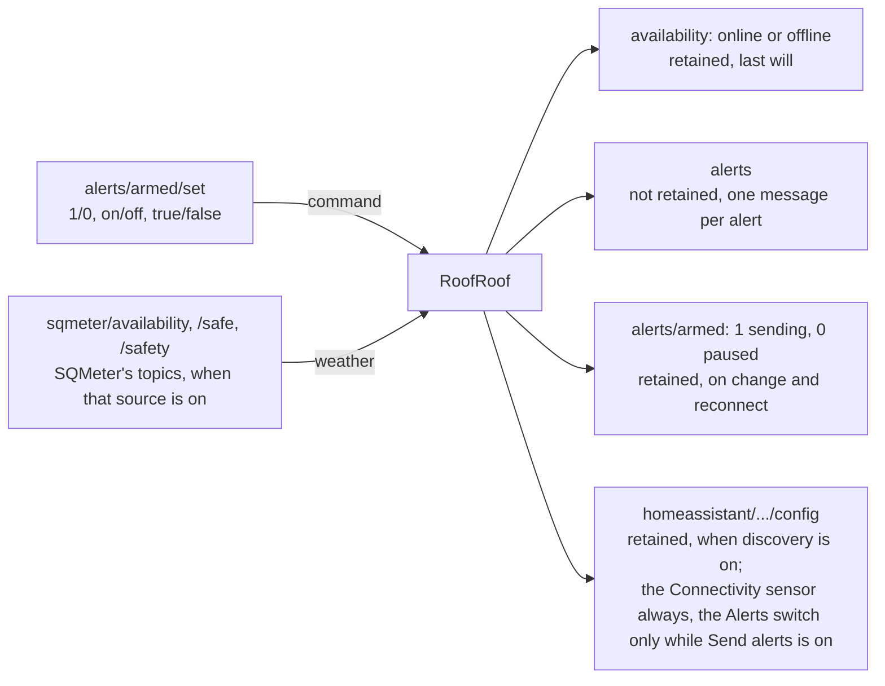

# MQTT Integration

RoofRoof publishes its availability and alerts to any MQTT broker, accepts a pause/resume command for alerts, and can announce itself to Home Assistant automatically.

!!! note "Roof topics come in a later spec"
    This release is the platform only. The roof's state, position and commands *come in a later spec* and will be added under the same base topic.

---

## Enabling MQTT

In **Settings → Network → MQTT**, turn on **Publish to a broker** and set the broker, credentials and **Base topic** (default `roofroof`). The same settings over the API:

```json
{
  "mqtt": {
    "enabled": true,
    "broker": "192.168.1.10",
    "port": 1883,
    "username": "mqttuser",
    "password": "mqttpass",
    "topic": "roofroof",
    "homeAssistant": { "enabled": true, "discoveryPrefix": "homeassistant" }
  }
}
```

The base topic may use letters, numbers, `_` and `-`, with `/` between levels. `publishIntervalMs` (default 60000) is the publish interval for periodic documents; nothing is published periodically yet.

!!! warning "Telemetry, not an interlock"
    MQTT is a plaintext LAN integration. Use it for telemetry and automation; keep physical safety interlocks independent.

---

!!! note "While the roof moves"
    If the broker connection drops while the roof is opening or closing, the device waits until the roof stops before reconnecting, and a read from the broker gives up after 3 s: a dead broker must never hold up the main loop that hands the weather and park checks to the roof ([Roof motion](roof-motion.md#weather-and-park-checks)). Saving new MQTT settings answers at once; the main loop then disconnects from the old broker and connects to the new one, under the same rules.

## Topics

| Topic | Retained | Payload | When |
|---|---|---|---|
| `<base>/availability` | Yes | `online` / `offline` (last will) | On connect / disconnect |
| `<base>/alerts` | No | One message per alert (with **Settings → Alerts → MQTT** on): `{"event","events"?,"title","message","level","device","timestamp"}` | Each alert |
| `<base>/alerts/armed` | Yes | `1` sending alerts, `0` paused | On change and reconnect |
| `<base>/alerts/armed/set` | - | Subscribed: `1`/`0`, `on`/`off`, `true`/`false` resume or pause alerts | Command |

With **SQMeter over MQTT** switched on as a weather source (see [Safety inputs](safety-inputs.md)), RoofRoof also listens to SQMeter's own topics on the same broker, under SQMeter's base topic (`safety.mqtt.topic`, default `sqmeter`):

| Topic (SQMeter's) | Payload RoofRoof accepts |
|---|---|
| `<sqmeter>/availability` | `online` / `offline` |
| `<sqmeter>/safe` | `1` safe / `0` unsafe |
| `<sqmeter>/safety` | SQMeter's safety JSON (`safe`, `reasonFlags`, ...) |

Booleans are `1`/`0`; availability uses Home Assistant's `online`/`offline`.

<!-- diagram: DIA-09
sources: src/WebServerAlerts.cpp#WebServer::publishArmedState src/WebServerStatus.cpp#WebServer::publishDiscovery src/MQTTClient.cpp src/AlertDispatcher.cpp#AlertDispatcher::dispatch
blocking: false
fingerprint: dc24356934967c40
-->
<figure class="diagram" markdown>



<figcaption>MQTT topic map: the topics RoofRoof listens to (left) and what it publishes (right). Its own topics sit under the base topic, default <code>roofroof</code>; SQMeter's under SQMeter's, default <code>sqmeter</code>.</figcaption>
</figure>

??? info "Diagram in words"

    Under the base topic (default `roofroof`), RoofRoof publishes:

    - `availability` - `online`, or `offline` as the last will, retained;
    - `alerts` - one message per alert, not retained (with the MQTT alert channel on);
    - `alerts/armed` - `1` sending / `0` paused, retained, on change and on reconnect.

    It listens on `alerts/armed/set` (`1`/`0`, `on`/`off`, `true`/`false`) to resume or pause alerts.

    When SQMeter over MQTT is a weather source, it also listens on SQMeter's `availability`, `safe` and `safety` topics under SQMeter's base topic (default `sqmeter`). It never publishes to them.

    With Home Assistant discovery on, it also publishes retained `config` topics for the Connectivity sensor and the Alerts switch under the discovery prefix (default `homeassistant`), and clears them when discovery is switched off or moved. The sensor is always announced; the switch is only announced while **Send alerts** is on, and is removed otherwise.

!!! note "The same in every language"
    Topics and payloads never change with the UI language, including Home Assistant discovery. Alert titles and messages are English (or your own alert wording) for people to read: automate on the alert `event`.

---

## Home Assistant

Turn on **Settings → Network → MQTT → Home Assistant → MQTT discovery**. RoofRoof then appears as a device (named after the device name) with:

- **Connectivity** (binary sensor): connected while the device is `online`, disconnected when it goes `offline`. It is announced whenever discovery is on, so the device shows up even with **Send alerts** off.
- **Switch**: *Alerts* - on while sending, off while paused (see [When to send](alerts.md#when-to-send)). It is announced only while **Send alerts** is on.

The Alerts switch is unavailable while the device is offline. The discovery prefix defaults to `homeassistant`. The roof's own entities *come in a later spec*.

See [Alerts](alerts.md) for the alert events.

---

## Mosquitto Test

```bash
mosquitto_sub -h <broker-ip> -t 'roofroof/#' -v
```
