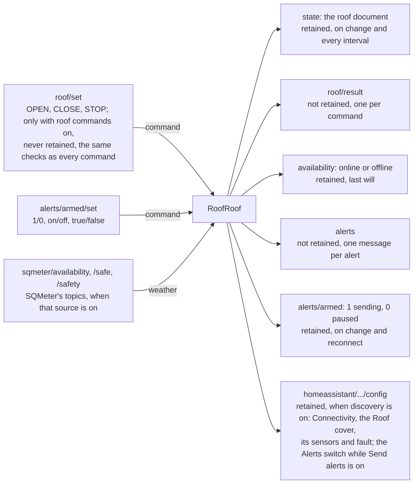

# MQTT Integration

RoofRoof publishes the roof's state, its availability and alerts to any MQTT broker, accepts a pause/resume command for alerts and, when you switch them on, open, close and stop commands for the roof, and can announce itself to Home Assistant as a roof cover with sensors.

---

## Enabling MQTT

In **Settings → Network → MQTT**, turn on **Publish to a broker** and set the broker, credentials and **Base topic** (default `roofroof`). The same settings over the API:

```json
{
  "mqtt": {
    "enabled": true,
    "broker": "192.168.1.10",
    "port": 1883,
    "username": "mqttuser",
    "password": "mqttpass",
    "topic": "roofroof",
    "homeAssistant": { "enabled": true, "discoveryPrefix": "homeassistant" },
    "roofCommands": false
  }
}
```

The base topic may use letters, numbers, `_` and `-`, with `/` between levels. `publishIntervalMs` (default 60000) is how often the roof's state document is republished while nothing changes. `roofCommands` (default `false`) lets MQTT open, close and stop the roof ([Roof commands](#roof-commands)). `changeMinSeconds` (default 1, 1-60; **Settings → Roof → Automatic close → Advanced → MQTT change gap**) is the shortest time between two publishes of a change at rest.

!!! warning "Telemetry, not an interlock"
    MQTT is a plaintext LAN integration. Use it for telemetry and automation; keep physical safety interlocks independent.

---

!!! note "While the roof moves"
    If the broker connection drops while the roof is opening or closing, the device waits until the roof stops before reconnecting, and a read from the broker gives up after 3 s: a dead broker must never hold up the main loop that hands the weather and park checks to the roof ([Roof motion](roof-motion.md#weather-and-park-checks)). Saving new MQTT settings answers at once; the main loop then disconnects from the old broker and connects to the new one, under the same rules. For the same reason, while the roof is busy all MQTT writes and reads in one pass of the main loop share 500 ms (a read only runs once a whole message has arrived, and a write gets at most 250 ms; at rest a write gets 1 s), and running out drops the connection, and while the roof moves, a close waits or the [automatic close](close-on-unsafe.md) is under way the state document is only published when the move or the attempt starts, reverses, ends or faults (at most twice, 5 s apart, and not again after a failed publish), not periodically, and Home Assistant discovery waits until it is over. The live position during a move is in [`/ws/status`](../api/websocket.md).

## Topics

| Topic | Retained | Payload | When |
|---|---|---|---|
| `<base>/availability` | Yes | `online` / `offline` (last will) | On connect / disconnect |
| `<base>/state` | Yes | The roof document (below) | On connect; at rest, within the MQTT change gap (a second by default) of a change of the roof's state, fault, known position, automatic-close phase, or weather or park check, and every publish interval; while the roof moves or the automatic close is under way, only when it starts, reverses, ends or faults (at most twice, 5 s apart) |
| `<base>/roof/set` | - | Subscribed: `OPEN`, `CLOSE`, `STOP` (any case) | Command ([Roof commands](#roof-commands)) |
| `<base>/roof/result` | No | `{"command","accepted","reason","text","state"}` | One per message on `roof/set` |
| `<base>/alerts` | No | One message per alert (with **Settings → Alerts → MQTT** on): `{"event","events"?,"title","message","level","device","timestamp"}` | Each alert |
| `<base>/alerts/armed` | Yes | `1` sending alerts, `0` paused | On change and reconnect |
| `<base>/diag` | No | The [diagnostics](diagnostics.md) live document (the same as [`GET /api/diag`](../api/rest.md#get-apidiag)) | With **Diagnostics over MQTT** on: every 60 s at rest; nothing while the roof is busy |
| `<base>/diag/move` | No | One finished move's summary | With **Diagnostics over MQTT** on: once per finished move, once the roof is at rest |
| `<base>/alerts/armed/set` | - | Subscribed: `1`/`0`, `on`/`off`, `true`/`false` resume or pause alerts | Command |

With **SQMeter over MQTT** switched on as a weather source (see [Safety inputs](safety-inputs.md)), RoofRoof also listens to SQMeter's own topics on the same broker, under SQMeter's base topic (`safety.mqtt.topic`, default `sqmeter`):

| Topic (SQMeter's) | Payload RoofRoof accepts |
|---|---|
| `<sqmeter>/availability` | `online` / `offline` |
| `<sqmeter>/safe` | `1` safe / `0` unsafe |
| `<sqmeter>/safety` | SQMeter's safety JSON (`safe`, `reasonFlags`, ...) |

Booleans are `1`/`0`; availability uses Home Assistant's `online`/`offline`.

### The roof document

`<base>/state` carries the time and the roof, the same `roof` object as [`GET /api/status`](../api/rest.md#get-apistatus) and [`/ws/status`](../api/websocket.md), field for field:

```json
{
  "timestamp": 1794480000,
  "timeValid": true,
  "roof": {
    "state": "closed", "positionKnown": true, "positionMm": 0, "positionPercent": 0, "target": null,
    "hall": { "level": "low", "counts": 712 }, "supplyVolts": 12.46, "supplyLow": false,
    "currentSense": false, "motorAmps": null, "fault": null,
    "closePhase": "idle", "weather": "safe", "weatherText": "safe",
    "parkConfirmed": true, "parkText": "parked",
    "...": "every other field of the status's roof object"
  }
}
```

`timestamp` is Unix seconds (`0`, with `timeValid` false, until the clock is set). Values that can't be read are `null`, never a made-up number: the position while unknown, the supply when unreadable, the motor current while current sense is off. `closePhase` is the [automatic close](close-on-unsafe.md)'s phase; `weather` and `parkConfirmed` are what the roof's command checks use at that moment, with their reasons.

---

## Diagnostics

With [advanced diagnostics](diagnostics.md) and **Settings → Device → Diagnostics → Diagnostics over MQTT** on, the device publishes `<base>/diag` (the live document) every 60 seconds and `<base>/diag/move` (one move summary) once for each finished move. Both wait until the roof is at rest: not moving, no close waiting and the automatic close not attempting. Neither is retained. They use none of the budget of the roof's state document.

## Roof commands

With **Settings → Network → MQTT → Accept roof commands** on (`mqtt.roofCommands`, off by default), RoofRoof acts on `OPEN`, `CLOSE` and `STOP` sent to `<base>/roof/set` on its own broker. Home Assistant's cover sends exactly these.

```bash
mosquitto_pub -h <broker-ip> -t roofroof/roof/set -m OPEN
```

MQTT has no login of its own, so these commands have the same limits as an ASCOM Alpaca client's, never fewer:

- **Open** only while the weather is safe and, with the daylight failsafe on "Alert and close", the sun is down; **close** only onto a confirmed park, re-checked throughout the close ([Roof motion](roof-motion.md#weather-and-park-checks)).
- Neither while the position is unknown or a fault is latched: a person moves the roof from an unknown position and clears faults in the web UI. There is no MQTT command to clear a fault, abort or set a position.
- **Stop** stops the roof, except while a close runs or waits and the weather isn't safe, or the sun is up with the daylight failsafe on "Alert and close": then it is refused and the roof keeps closing (Stop in the web UI still works). An MQTT stop never counts as a person's, so it never stands the [automatic close](close-on-unsafe.md) down. With **Settings → Roof → Automatic close → Remote Stop calls off a close** on, that one stop is accepted instead and counts as a person's: the automatic close stands down and raises its critical alert ([Settings of the automatic close](close-on-unsafe.md#settings-of-the-automatic-close)).
- **Open** is refused while a close runs or waits, or after a close was stopped part-way: MQTT can't reverse a close.
- A **retained** message on `roof/set` is never acted on when the broker replays it (on every reconnect). Send commands without the retain flag: one sent with it still runs once if the device is connected at that moment, then stays on the broker and is refused on every replay. To clear one left there: `mosquitto_pub -r -n -t roofroof/roof/set`. The same goes for `alerts/armed/set`: a retained pause isn't replayed. A broker *bridged* to another broker can pass on a message retained there as a live one, so keep no retained message on `roof/set` on any broker.
- Commands sent while the device is offline are not queued.

Every message on `roof/set` gets an answer on `<base>/roof/result` (not retained):

```json
{ "command": "open", "accepted": false, "reason": "weatherNotSafe",
  "text": "Weather not safe: unsafe: SQMeter HTTP says unsafe: rain", "state": "closed" }
```

| `reason` | Meaning |
|---|---|
| `""` | accepted (`text` says so when a close waits for an upload or connect to finish) |
| `switchedOff` | **Accept roof commands** is off |
| `retained` | the message was retained (or its flag couldn't be read) |
| `notACommand` | not `OPEN`, `CLOSE` or `STOP` (`command` is `null`) |
| `weatherNotSafe`, `mountNotParked` | the weather or park check |
| `daylight` | an open while the [daylight failsafe](close-on-unsafe.md#daylight-failsafe) is on "Alert and close" and the sun is up (`Daylight: Sun 3.2° ≥ 0.0°`) |
| `unsafeClose`, `closing` | the limits above: a stop during a close in bad weather or in daylight, an open during or after a close |
| `positionUnknown`, `faultLatched`, `busy`, `restarting`, `hotspot`, `notStarted`, ... | the roof's own checks, as for the [REST commands](../api/rest.md#roof) |

`text` always says why, with the measured value and the limit or the input that failed.

<!-- diagram: DIA-09
sources: src/WebServerAlerts.cpp#WebServer::publishArmedState src/WebServerStatus.cpp#WebServer::publishDiscovery src/MQTTClient.cpp src/AlertDispatcher.cpp#AlertDispatcher::dispatch src/WebServerRoof.cpp lib/RoofIoLogic/include/RoofMqtt.h
blocking: false
fingerprint: e3f38e1cc9df39cf
-->
<figure class="diagram" markdown>



<figcaption>MQTT topic map: the topics RoofRoof listens to (left) and what it publishes (right). Its own topics sit under the base topic, default <code>roofroof</code>; SQMeter's under SQMeter's, default <code>sqmeter</code>.</figcaption>
</figure>

??? info "Diagram in words"

    Under the base topic (default `roofroof`), RoofRoof publishes:

    - `state` - the roof document, retained, on a change and every publish interval;
    - `roof/result` - one answer per message on `roof/set`, not retained;
    - `availability` - `online`, or `offline` as the last will, retained;
    - `alerts` - one message per alert, not retained (with the MQTT alert channel on);
    - `alerts/armed` - `1` sending / `0` paused, retained, on change and on reconnect.

    It listens on `roof/set` (`OPEN`, `CLOSE`, `STOP`), acted on only with roof commands switched on, never when retained, and always through the same weather, park and motion checks as every other command. It listens on `alerts/armed/set` (`1`/`0`, `on`/`off`, `true`/`false`) to resume or pause alerts.

    When SQMeter over MQTT is a weather source, it also listens on SQMeter's `availability`, `safe` and `safety` topics under SQMeter's base topic (default `sqmeter`). It never publishes to them.

    With Home Assistant discovery on, it also publishes retained `config` topics under the discovery prefix (default `homeassistant`), and clears them when discovery is switched off or moved: the Connectivity sensor, the Roof cover, its position, supply, Hall and (with current sense on) motor current sensors and the Roof fault sensor always; the Alerts switch only while **Send alerts** is on.

!!! note "The same in every language"
    Topics and payloads never change with the UI language, including Home Assistant discovery. Alert titles and messages are English (or your own alert wording) for people to read: automate on the alert `event`.

---

## Home Assistant

Turn on **Settings → Network → MQTT → Home Assistant → MQTT discovery**. RoofRoof then appears as a device (named after the device name) with:

- **Connectivity** (binary sensor): connected while the device is `online`, disconnected when it goes `offline`. It is announced whenever discovery is on, so the device shows up even with **Send alerts** off.
- **Roof** (cover): open, opening, closed, closing or stopped; unknown while the roof's state is `unknown` or `error`. With **Accept roof commands** on it has Open, Close and Stop, which send the [roof commands](#roof-commands) with all their limits; otherwise it is read-only. It has no position slider: the roof can't be sent to a position.
- **Roof position** (%, `null` and so unknown while the position is unknown), **Supply voltage** (V), **Hall reading** (raw counts, a diagnostic) and, only while current sense is on, **Motor current** (A).
- **Roof fault** (binary sensor, problem): on while a fault is latched; its attributes carry the fault's kind, cause, measured value, limit and text.
- **Switch**: *Alerts* - on while sending, off while paused (see [When to send](alerts.md#when-to-send)). It is announced only while **Send alerts** is on.

Every entity except Connectivity is unavailable while the device is offline. The discovery prefix defaults to `homeassistant`. Discovery is published again on every reconnect and when a setting it depends on changes (but not while the roof moves).

See [Alerts](alerts.md) for the alert events.

---

## Mosquitto Test

```bash
mosquitto_sub -h <broker-ip> -t 'roofroof/#' -v
```
