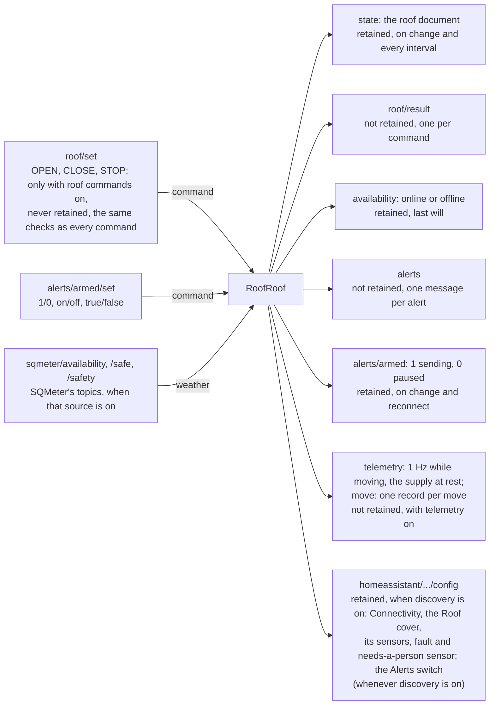

# MQTT Integration

RoofRoof publishes the roof's state, its availability and alerts to any MQTT broker, accepts a pause/resume command for alerts and, when you switch them on, open, close and stop commands for the roof, and can announce itself to Home Assistant as a roof cover with sensors. [Home Assistant](../integration/home-assistant.md) lists every topic and entity.

---

## Enabling MQTT

In **Settings → Network → MQTT**, turn on **Publish to a broker** and set the broker, credentials and **Base topic** (default `roofroof`). The same settings over the API:

```json
{
  "mqtt": {
    "enabled": true,
    "broker": "192.168.1.10",
    "port": 1883,
    "username": "mqttuser",
    "password": "mqttpass",
    "topic": "roofroof",
    "homeAssistant": { "enabled": true, "discoveryPrefix": "homeassistant" },
    "roofCommands": false
  }
}
```

The base topic may use letters, numbers, `_` and `-`, with `/` between levels. `publishIntervalMs` (default 60000) is how often the roof's state document is republished while nothing changes. `roofCommands` (default `false`) lets MQTT open, close and stop the roof ([Roof commands](#roof-commands)). `changeMinSeconds` (default 1, 1-60; **Settings → Roof → Automatic close → Advanced → MQTT change gap**) is the shortest time between two publishes of a change at rest.

!!! warning "Telemetry, not an interlock"
    MQTT is a plaintext LAN integration. Use it for telemetry and automation; keep physical safety interlocks independent.

---

!!! note "While the roof moves"
    If the broker connection drops while the roof is opening or closing, the device waits until the roof stops before reconnecting, and a read from the broker gives up after 3 s: a dead broker must never hold up the main loop that hands the weather and park checks to the roof ([Roof motion](roof-motion.md#weather-and-park-checks)). Saving new MQTT settings answers at once; the main loop then disconnects from the old broker and connects to the new one, under the same rules. For the same reason, while the roof is busy all MQTT writes and reads in one pass of the main loop share 500 ms (a read only runs once a whole message has arrived, and a write gets at most 250 ms; at rest a write gets 1 s), and running out drops the connection, and a write only starts with its whole 250 ms left in the pass (otherwise it waits for the next pass rather than being cut short). While the roof moves, the state document goes out as soon as the move starts (`opening` or `closing`, `driving`, `target` and the starting `positionPercent`), every 3 s after that with the position, at a reversal or fault, and when the move ends. While a close waits or the [automatic close](close-on-unsafe.md) is attempting with the roof still, it is only published when that starts or ends (at most twice, 5 s apart). A failed publish while busy is tried again 5 s later; it never holds back the end of the move or the documents at rest. Home Assistant discovery waits until the roof is at rest. The live position is also in [`/ws/status`](../api/websocket.md).

## Topics

| Topic | Retained | Payload | When |
|---|---|---|---|
| `<base>/availability` | Yes | `online` / `offline` (last will) | On connect / disconnect |
| `<base>/state` | Yes | The roof document (below) | On connect; at rest, within the MQTT change gap (a second by default) of a change of the roof's state, fault, known position, automatic-close phase, or weather or park check, and every publish interval; while the roof moves, at once when it starts, every 3 s with the position, and at a reversal, fault or the end (within a second); while a close waits with the roof still, only when that starts or ends (at most twice, 5 s apart) |
| `<base>/roof/set` | - | Subscribed: `OPEN`, `CLOSE`, `STOP` (any case) | Command ([Roof commands](#roof-commands)) |
| `<base>/roof/result` | No | `{"command","accepted","reason","text","state"}` | One per message on `roof/set` |
| `<base>/alerts` | No | One message per alert (with **Settings → Alerts → MQTT** on): `{"event","events"?,"title","message","level","device","timestamp"}` | Each alert |
| `<base>/alerts/armed` | Yes | `1` sending alerts, `0` paused | On change and reconnect |
| `<base>/diag` | No | The [diagnostics](diagnostics.md) live document (the same as [`GET /api/diag`](../api/rest.md#get-apidiag)) | With **Diagnostics over MQTT** on: every 60 s at rest; nothing while the roof is busy |
| `<base>/diag/move` | No | One finished move's summary | With **Diagnostics over MQTT** on: once per finished move, once the roof is at rest |
| `<base>/telemetry` | No | Telemetry for long-term logging ([below](#telemetry-influxdb)): the full sample while the roof moves, `{"ts","volts"}` at rest | With **Publish telemetry** on (the default): about once a second while the roof moves and for 3 s after; at rest every `mqtt.telemetry.restVoltsSeconds` (60 s) or sooner on a 0.2 V change |
| `<base>/move` | No | One record per finished move ([below](#telemetry-influxdb)) | With **Publish telemetry** and [advanced diagnostics](diagnostics.md) on: once per finished move |
| `<base>/alerts/armed/set` | - | Subscribed: `1`/`0`, `on`/`off`, `true`/`false` resume or pause alerts | Command |

With **SQMeter over MQTT** switched on as a weather source (see [Safety inputs](safety-inputs.md)), RoofRoof also listens to SQMeter's own topics on the same broker, under SQMeter's base topic (`safety.mqtt.topic`, default `sqmeter`):

| Topic (SQMeter's) | Payload RoofRoof accepts |
|---|---|
| `<sqmeter>/availability` | `online` / `offline` |
| `<sqmeter>/safe` | `1` safe / `0` unsafe |
| `<sqmeter>/safety` | SQMeter's safety JSON (`safe`, `reasonFlags`, ...) |

Booleans are `1`/`0`; availability uses Home Assistant's `online`/`offline`.

### The roof document

`<base>/state` carries the time and the roof, the same `roof` object as [`GET /api/status`](../api/rest.md#get-apistatus) and [`/ws/status`](../api/websocket.md), field for field:

```json
{
  "timestamp": 1794480000,
  "timeValid": true,
  "roof": {
    "state": "closed", "positionKnown": true, "positionMm": 0, "positionPercent": 0, "target": null,
    "hall": { "level": "low", "counts": 712 }, "supplyVolts": 12.46, "supplyLow": false,
    "currentSense": false, "motorAmps": null, "fault": null,
    "closePhase": "idle", "weather": "safe", "weatherText": "safe",
    "parkConfirmed": true, "parkText": "parked",
    "...": "every other field of the status's roof object"
  }
}
```

The state document also carries what an observatory dashboard needs (spec 027), beside the status's own `roof` fields:

| Field | Meaning |
|---|---|
| `roof.parkWait` | `null`, or `{command, origin, leftSeconds, asked}` while an Open or Close waits for the mount to park |
| `roof.parkWaitEnded` | text of the last wait that ended without running, or `null` |
| `roof.override`, `roof.openOverridable` | the person's confirmed overrides in effect (`weatherNotSafe`, `daylight`, `mountNotParked`), and what a person could override for an Open now |
| `roof.nina` | `{set, state, reachable, connected, atPark, ageSeconds}`: N.I.N.A.'s health (no `text` here) |
| `roof.sqmeter` | `{on, state, lastReplySeconds}`: the weather source's health (`lastReplySeconds` `null` without a good reply; no `text` here) |
| `roof.closeRearmSeconds` | seconds until a held automatic close lapses (the safe spell, or a person's Stop lapsing with `autoClose.personStopLapse` set), or `null` |
| `roof.needsPerson` | `{active}`: the roof needs a person (a restart with the position unknown or a fault latched, a Hall sensor failure, the automatic close unable to move). Its text is in `GET /api/status` only. A change of `active` publishes the document at once |
| `roof.blind` | the move is a [blind close](close-on-unsafe.md#blind-close-when-the-hall-sensor-has-failed) (the Hall sensor is dead; closing on time alone) |
| `roof.daylightState` | `off`, `unknown`, `night` or `day` |
| `roof.blocked` | one line saying why the roof can't move now (a fault, the weather, daylight, the park, a park wait), or `""` |

`timestamp` is Unix seconds (`0`, with `timeValid` false, until the clock is set). Values that can't be read are `null`, never a made-up number: the position while unknown, the supply when unreadable, the motor current while current sense is off. `roof.testBox` says whether a [test box](test-box.md) bypass is set and in effect (`set`, `active`, `park`, `weather`, `daylight`, `until`, `expired`, `waitingForClock` and a `text`); it is always there, with everything false when nothing is set. `closePhase` is the [automatic close](close-on-unsafe.md)'s phase; `weather` and `parkConfirmed` are what the roof's command checks use at that moment, with their reasons.

---

## Diagnostics

With [advanced diagnostics](diagnostics.md) and **Settings → Device → Diagnostics → Diagnostics over MQTT** on, the device publishes `<base>/diag` (the live document) every 60 seconds and `<base>/diag/move` (one move summary) once for each finished move. Both wait until the roof is at rest: not moving, no close waiting and the automatic close not attempting. Neither is retained. They use none of the budget of the roof's state document.

## Telemetry (InfluxDB)

For a long-term record of the roof (for example InfluxDB through Telegraf), RoofRoof publishes two small JSON documents, neither retained, at QoS 0. **Settings → Network → MQTT → Telemetry**: **Publish telemetry** (`mqtt.telemetry.enabled`, on by default) and **Supply at rest every** (`mqtt.telemetry.restVoltsSeconds`, 60 s, 0-3600; 0 sends nothing at rest). Nothing high-rate goes out while the roof is idle: the full sample only while it moves.

**`<base>/telemetry`**, while the roof is opening or closing, and for 3 s after it stops (to catch the end), about once a second (the first at once when the move starts):

```json
{"ts":1764150000123,"state":"closing","pos":42.3,"hall":2050,"volts":12.41,"duty":100,"phase":"closing","target":"closed","origin":"automatic"}
```

At rest only the supply, every **Supply at rest every** seconds, or sooner when it has changed by 0.2 V or more since the last sample (but never more often than every 10 s):

```json
{"ts":1764150060123,"volts":12.60}
```

| Field | Type | Meaning |
|---|---|---|
| `ts` | integer | Unix time in milliseconds; before the clock is set, the uptime in milliseconds (below 10<sup>12</sup>) |
| `state` | string | `unknown`, `closed`, `open`, `opening`, `closing`, `stopped`, `error` |
| `pos` | number or `null` | Position in percent, 0 closed to 100 open (one decimal); `null` while it isn't known |
| `hall` | integer | The Hall sensor's raw reading (ADC counts) |
| `volts` | number or `null` | The 12 V supply (two decimals); `null` when unreadable |
| `duty` | integer | The motor's PWM duty applied now, percent (0 in the dead time and after the stop) |
| `phase` | string | The automatic close's phase: `idle`, `waitPark`, `closing`, `retryWait`, `heldByPerson`, `cannotMove`, `halted` |
| `target` | string | The end the move goes to: `open` or `closed` (the last move's, after it ends) |
| `origin` | string | Who asked for the move: `person`, `client` (Alpaca), `mqtt`, `automatic` |

**`<base>/move`**, one record for each finished move, a second or so after it ends. It is the move's summary from [advanced diagnostics](diagnostics.md) (the same as in [`GET /api/diag/moves`](../api/rest.md#get-apidiagmoves)), so it needs **Settings → Device → Diagnostics → Advanced diagnostics** on; the 1 Hz telemetry doesn't.

```json
{"ts":1764150057000,"id":12,"origin":"automatic","target":"closed","endState":"closed","result":"arrived","fault":null,"durationMs":57000,"drivenMs":56000,"hallStart":2900,"hallEnd":1050,"hallPeak":1010,"hallPeakMs":56500,"restVolts":12.61,"minVolts":11.90,"sagVolts":0.71,"peakAmps":6.40,"averageAmps":3.25,"fromUnknown":false,"blind":false,"calibration":false}
```

| Field | Type | Meaning |
|---|---|---|
| `ts` | integer | When the move ended: Unix milliseconds (uptime milliseconds before the clock is set) |
| `id` | integer | The move's number in the diagnostics log |
| `origin` | string | `person`, `client`, `mqtt`, `automatic` |
| `target` | string | `open` or `closed` |
| `endState` | string | The state it ended in (as `state` above) |
| `result` | string | `arrived` (at its target's magnet), `stopped` (part-way: a stop, an abort, a reversal), `fault` |
| `fault` | string or `null` | With `result` `fault`: its kind (`timeout`, `didNotLeave`, `wrongMagnet`, `hallRail`, `overCurrent`, `currentUnreadable`, `supplyLow`, `lateStep`, `driveBudget`, `external`, `endTooEarly`, `noEndMagnet`, `noMovement`); otherwise `null` |
| `durationMs` | integer | From the start of the move to its end |
| `drivenMs` | integer | How long the motor was driven |
| `hallStart`, `hallEnd` | integer | The Hall reading at the start and the end |
| `hallPeak`, `hallPeakMs` | integer | The reading furthest from `hallStart`, and when (ms from the start) |
| `restVolts` | number or `null` | The supply at rest before the move |
| `minVolts` | number or `null` | The lowest supply while driven |
| `sagVolts` | number or `null` | `restVolts` − `minVolts` |
| `peakAmps`, `averageAmps` | number or `null` | The motor current while driven; only with current sense fitted (`roof.currentSenseEnabled`), otherwise left out |
| `fromUnknown` | boolean | The move started from an unknown position |
| `blind` | boolean | A blind close (the automatic close from an unknown position) |
| `calibration` | boolean | A leg of the calibration run |

Nothing is queued: a document that can't go (MQTT down, or no time left in the main loop's pass while the roof moves) is dropped, and a move that finishes while MQTT is down has no record (the device keeps its last moves in `/api/diag/moves`). While the roof moves, the telemetry shares the state document's write budget (each write at most 250 ms, never started without it) and goes out after it.

### Telegraf

An example for Telegraf's `mqtt_consumer` with the `json_v2` parser (InfluxDB 2, bucket `roofroof`). Use your broker, login and base topic. `ts` becomes the point's time.

```toml
[[inputs.mqtt_consumer]]
  name_override = "roof_telemetry"
  servers = ["tcp://broker.local:1883"]
  topics = ["roofroof/telemetry"]
  username = "telegraf"
  password = "${MQTT_PASSWORD}"
  qos = 0
  data_format = "json_v2"
  [[inputs.mqtt_consumer.json_v2]]
    [[inputs.mqtt_consumer.json_v2.object]]
      path = "@this"
      timestamp_key = "ts"
      timestamp_format = "unix_ms"
      [inputs.mqtt_consumer.json_v2.object.fields]
        hall = "int"
        duty = "int"

[[inputs.mqtt_consumer]]
  name_override = "roof_move"
  servers = ["tcp://broker.local:1883"]
  topics = ["roofroof/move"]
  username = "telegraf"
  password = "${MQTT_PASSWORD}"
  qos = 0
  data_format = "json_v2"
  [[inputs.mqtt_consumer.json_v2]]
    [[inputs.mqtt_consumer.json_v2.object]]
      path = "@this"
      timestamp_key = "ts"
      timestamp_format = "unix_ms"
      tags = ["origin", "target", "result"]
      [inputs.mqtt_consumer.json_v2.object.fields]
        id = "int"
        durationMs = "int"
        drivenMs = "int"
        hallStart = "int"
        hallEnd = "int"
        hallPeak = "int"
        hallPeakMs = "int"

[[outputs.influxdb_v2]]
  urls = ["http://influxdb.local:8086"]
  token = "${INFLUX_TOKEN}"
  organization = "home"
  bucket = "roofroof"
```

`null` values are skipped, so a sample at rest writes only `volts`. The string fields (`state`, `phase`, `target`, `origin`, `endState`, `fault`) are stored as string fields; make them tags instead if you group by them.

## Roof commands

With **Settings → Network → MQTT → Accept roof commands** on (`mqtt.roofCommands`, off by default), RoofRoof acts on `OPEN`, `CLOSE` and `STOP` sent to `<base>/roof/set` on its own broker. Home Assistant's cover sends exactly these.

```bash
mosquitto_pub -h <broker-ip> -t roofroof/roof/set -m OPEN
```

MQTT has no login of its own, so these commands have the same limits as an ASCOM Alpaca client's, never fewer:

- **Open** only while the weather is safe, the mount is confirmed parked and, with the daylight failsafe on "Alert and close", the sun is down; **close** only onto a confirmed park, re-checked throughout the close ([Roof motion](roof-motion.md#weather-and-park-checks)). When only the park refuses a command and N.I.N.A. can be asked, it is accepted and **waits for the park** ([Park before every move](close-on-unsafe.md#park-before-every-move)); the result says so. MQTT never has an override: only a person at the web UI or REST can confirm an open or a close without a check.
- Neither while the position is unknown or a fault is latched: a person moves the roof from an unknown position and clears faults in the web UI. There is no MQTT command to clear a fault, abort or set a position.
- **Stop** stops the roof, except while a close runs or waits and the weather isn't safe, or the sun is up with the daylight failsafe on "Alert and close": then it is refused and the roof keeps closing (Stop in the web UI still works). An MQTT stop never counts as a person's, so it never stands the [automatic close](close-on-unsafe.md) down. With **Settings → Roof → Automatic close → Remote Stop calls off a close** on, that one stop is accepted instead and counts as a person's: the automatic close stands down and raises its critical alert ([Settings of the automatic close](close-on-unsafe.md#settings-of-the-automatic-close)).
- **Open** is refused while a close runs or waits, or after a close was stopped part-way: MQTT can't reverse a close.
- A **retained** message on `roof/set` is never acted on when the broker replays it (on every reconnect). Send commands without the retain flag: one sent with it still runs once if the device is connected at that moment, then stays on the broker and is refused on every replay. To clear one left there: `mosquitto_pub -r -n -t roofroof/roof/set`. The same goes for `alerts/armed/set`: a retained pause isn't replayed. A broker *bridged* to another broker can pass on a message retained there as a live one, so keep no retained message on `roof/set` on any broker.
- Commands sent while the device is offline are not queued.

Every message on `roof/set` gets an answer on `<base>/roof/result` (not retained):

```json
{ "command": "open", "accepted": false, "reason": "weatherNotSafe",
  "text": "Weather not safe: unsafe: SQMeter HTTP says unsafe: rain", "state": "closed" }
```

| `reason` | Meaning |
|---|---|
| `""` | accepted (`text` says so when the command waits: a close for an upload or connect to finish, an open or close for the mount to park) |
| `switchedOff` | **Accept roof commands** is off |
| `retained` | the message was retained (or its flag couldn't be read) |
| `notACommand` | not `OPEN`, `CLOSE` or `STOP` (`command` is `null`) |
| `weatherNotSafe`, `mountNotParked` | the weather or park check (`mountNotParked` for an open too; the text says when N.I.N.A. can't be asked to park) |
| `daylight` | an open while the [daylight failsafe](close-on-unsafe.md#daylight-failsafe) is on "Alert and close" and the sun is up (`Daylight: Sun 3.2° ≥ 0.0°`) |
| `unsafeClose`, `closing` | the limits above: a stop during a close in bad weather or in daylight, an open during or after a close |
| `positionUnknown`, `faultLatched`, `busy`, `restarting`, `hotspot`, `notStarted`, ... | the roof's own checks, as for the [REST commands](../api/rest.md#roof) |

`text` always says why, with the measured value and the limit or the input that failed.

<!-- diagram: DIA-09
sources: src/WebServerAlerts.cpp#WebServer::publishArmedState src/WebServerStatus.cpp#WebServer::publishDiscovery src/MQTTClient.cpp src/AlertDispatcher.cpp#AlertDispatcher::dispatch src/WebServerRoof.cpp lib/RoofIoLogic/include/RoofMqtt.h
blocking: false
fingerprint: defdc1d67a3a626c
-->
<figure class="diagram" markdown>



<figcaption>MQTT topic map: the topics RoofRoof listens to (left) and what it publishes (right). Its own topics sit under the base topic, default <code>roofroof</code>; SQMeter's under SQMeter's, default <code>sqmeter</code>.</figcaption>
</figure>

??? info "Diagram in words"

    Under the base topic (default `roofroof`), RoofRoof publishes:

    - `state` - the roof document, retained, on a change and every publish interval;
    - `roof/result` - one answer per message on `roof/set`, not retained;
    - `availability` - `online`, or `offline` as the last will, retained;
    - `alerts` - one message per alert, not retained (with the MQTT alert channel on);
    - `alerts/armed` - `1` sending / `0` paused, retained, on change and on reconnect;
    - `telemetry` - about once a second while the roof moves, only the supply at rest, and `move` - one record per finished move, neither retained (with telemetry on; `move` also needs advanced diagnostics).

    It listens on `roof/set` (`OPEN`, `CLOSE`, `STOP`), acted on only with roof commands switched on, never when retained, and always through the same weather, park and motion checks as every other command. It listens on `alerts/armed/set` (`1`/`0`, `on`/`off`, `true`/`false`) to resume or pause alerts.

    When SQMeter over MQTT is a weather source, it also listens on SQMeter's `availability`, `safe` and `safety` topics under SQMeter's base topic (default `sqmeter`). It never publishes to them.

    With Home Assistant discovery on, it also publishes retained `config` topics under the discovery prefix (default `homeassistant`), and clears them when discovery is switched off or moved: the Connectivity sensor, the Roof cover, its position, supply, Hall and (with current sense on) motor current sensors, the Roof fault sensor and the Needs a person sensor always; the weather, park, automatic close, daylight, SQMeter and N.I.N.A. entities; and the Alerts switch, whenever discovery is on.

!!! note "The same in every language"
    Topics and payloads never change with the UI language, including Home Assistant discovery. Alert titles and messages are English (or your own alert wording) for people to read: automate on the alert `event`.

---

## Home Assistant

Turn on **Settings → Network → MQTT → Home Assistant → MQTT discovery**. RoofRoof then appears as a device (named after the device name) with:

- **Connectivity** (binary sensor): connected while the device is `online`, disconnected when it goes `offline`. It is announced whenever discovery is on, so the device shows up even with **Send alerts** off.
- **Roof** (cover): open, opening, closed, closing or stopped; unknown while the roof's state is `unknown` or `error`. With **Accept roof commands** on it has Open, Close and Stop, which send the [roof commands](#roof-commands) with all their limits; otherwise it is read-only. It has no position slider: the roof can't be sent to a position.
- **Roof position** (%, `null` and so unknown while the position is unknown), **Supply voltage** (V), **Hall reading** (raw counts, a diagnostic) and, only while current sense is on, **Motor current** (A).
- **Roof fault** (binary sensor, problem): on while a fault is latched; its attributes carry the fault's kind, cause, measured value, limit and text.
- **Needs a person** (binary sensor, problem): on while the roof needs a person: a restart with the position unknown or a fault latched, the Hall sensor failing, or the automatic close unable to move ([Alerts](alerts.md#roof-needs-a-person)). It reads `roof.needsPerson.active` of the state document.
- **Test box bypass** (binary sensor, problem): on while a [test box](test-box.md) bypass is in effect. Its attributes are the `roof.testBox` object.
- **Weather safe**, **Mount parked**, **Automatic close held** (binary sensors), **Automatic close** (the phase), **Hold lapses in** (seconds), **Roof blocked** (why the roof can't move, as a line of text), **Waiting for park** (seconds left), **Daylight**, and, as diagnostics, **SQMeter last reply** (seconds) and **N.I.N.A. reachable**.
- **Switch**: *Alerts* - on while sending, off while paused (see [When to send](alerts.md#when-to-send)). It is announced whenever discovery is on.

Every entity except Connectivity is unavailable while the device is offline. The discovery prefix defaults to `homeassistant`. Discovery is published again on every reconnect and when a setting it depends on changes (but not while the roof moves).

[Home Assistant](../integration/home-assistant.md) lists every entity with its id, unit, source field and availability, and an example dashboard card. See [Alerts](alerts.md) for the alert events.

---

## Mosquitto Test

```bash
mosquitto_sub -h <broker-ip> -t 'roofroof/#' -v
```
