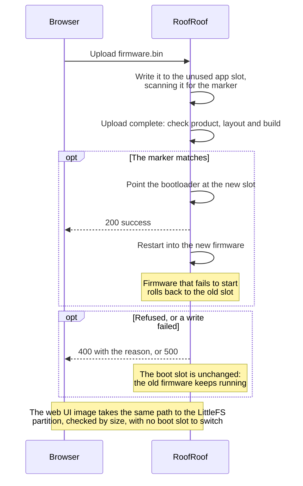

# Updates

RoofRoof is updated by **uploading a file** to it, over WiFi from the web UI or over USB. The device never contacts GitHub or any release server: nothing is checked or downloaded for you, by design. Get the files from the release's assets (or your own build) and upload them yourself.

---

## What to upload

| File | What it is |
|------|------------|
| `roofroof-l2-firmware-<tag>.bin` | The firmware |
| `roofroof-l2-littlefs-<tag>.bin` | The web UI |
| `roofroof-l2-usb-<tag>.zip` | Every part for a [USB flash](../getting-started/usb-flash.md) |

`l2` is the partition layout the files are for. Update the firmware and the web UI from the same release so they match.

---

## Via the web UI (manual upload)

1. Open the web UI and go to **Updates**.
2. Under **Manual upload**, choose the **Image**: **Firmware (firmware.bin)** or **Web UI (littlefs.bin)**.
3. Choose the `.bin` file and click **Upload**.
4. The device restarts automatically into the new firmware (or with the new web UI).

If switching the device to the new firmware fails once after a complete upload ("Could not activate partition"), it checks the image again and retries the switch before answering; the API reply then includes `"retried": true`.

If an upload stops sending for 20 seconds, usually a weak WiFi link, the Updates page cancels it and tries once more by itself ("Upload stalled, trying again"). The device drops the half-sent image straight away, so the retry starts clean; nothing was written to the running firmware. If it stalls again, move the device or the access point closer, or upload from a computer on the same network, then try again.

!!! note "Files the device refuses"
    Every firmware file carries a marker with the product and the partition layout it is made for. The device checks it before switching to the new firmware and refuses, with `400` and a reason, a file that isn't for this device: "Not RoofRoof firmware." (no RoofRoof marker, for example another project's image), "This is firmware for another product (sqmeter)." (naming the product the file is for), or "Wrong partition layout: flash this one over USB." A [bench-mode](bench-mode.md) image is refused too: "This is a bench-mode image (simulated roof, no motor): install it over USB." Command-line OTA checks the same marker once the image is received, before it is booted, and keeps the running firmware if it would have been refused here (the upload tool still reports success; the log says why). A web UI file must fill this device's web UI partition exactly; one made for a different layout is refused before anything is erased. Nothing is changed by a refused upload.

!!! note "While the roof moves or closes"
    An upload is refused (`409`, with the reason) while the roof is opening or closing or a close is waiting to start, and also while the [automatic close](close-on-unsafe.md) is waiting for the park or closing: a web UI upload ends in a restart nothing can cancel. A close always wins over an upload in progress: the upload stops at its next chunk and fails with `409`. The restart after an upload waits until the roof is at rest (after a firmware upload, also until the automatic close isn't waiting for the park or closing). See [Roof motion](roof-motion.md#while-the-roof-moves).

!!! warning "Don't interrupt"
    Keep the browser open during upload. A power cut mid-flash leaves the slot being written incomplete; it's never booted, so the device keeps starting the firmware it was running.

!!! note "Web UI updates"
    The web UI update replaces the dashboard and settings pages and keeps your settings (they live in NVS). It doesn't touch the firmware. The partition is erased before it is rewritten, so a connection drop *during* the write leaves the web UI unavailable until a later upload succeeds (or you flash over USB); the REST API and the update endpoints stay reachable.

!!! warning "Security"
    Updates are open to anyone who can reach the web UI unless **Settings → Device → Security → Password-protect changes** is on. Even then the login is plain HTTP: keep the device on a trusted network and don't expose it through port forwarding.

---

## API Endpoints

The Updates page uses these endpoints (both need the password when protection is on):

| Endpoint | Purpose | File |
|----------|---------|------|
| `POST /api/update` | Firmware upload | `roofroof-l2-firmware-<tag>.bin` |
| `POST /api/update/fs` | Web UI (LittleFS) upload | `roofroof-l2-littlefs-<tag>.bin` |

Both take `multipart/form-data` and return `200 {"success": true}`, `400 {"error": "..."}` for a file that isn't for this device (nothing was changed), or `500 {"error": "..."}` when writing failed. The device restarts after a successful upload.

```bash
curl -u admin:pass -F "file=@roofroof-l2-firmware-v0.1.0.bin" http://roofroof.local/api/update
```

---

## Version numbers

The Updates page shows the installed version (`v` plus the firmware version, also `firmware.version` in `/api/status`). Release builds report their tag without the `v`.

---

## Via ArduinoOTA

Command-line ArduinoOTA is disabled by default. To enable it, set both fields below in the device configuration and restart:

```json
{
  "ota": {
    "enabled": true,
    "password": "use-a-long-random-password"
  }
}
```

Use the same password from your upload tool. If `ota.enabled` is false or `ota.password` is empty, the device will not start the ArduinoOTA listener.

---

## Via esptool (USB)

If the device is unresponsive over WiFi, fall back to USB:

```bash
# Firmware only
esptool.py --chip esp32 --port PORT --baud 460800 \
  write_flash 0x10000 roofroof-l2-firmware-vX.Y.Z.bin
```

For everything at once (settings kept), use the release's USB package - see [USB flash](../getting-started/usb-flash.md).

---

## How an update works

The partition table has two app slots (`app0` at `0x10000`, `app1` at `0x1D0000`, 1.75 MB each). A firmware upload writes the new firmware to the slot that isn't running; the image is checked while it arrives, and only when it is complete and found to be for this product and layout is the bootloader pointed at it for the next boot. A partial, corrupt or foreign image is therefore never booted.

A new firmware is only kept once it has started properly: WiFi, the web server and every other service up. If it crashes or restarts before then, the bootloader goes back to the previous slot on the next boot. Once it has started it is kept, even if it misbehaves later, so the way back from a bad release is to upload another one (or the previous one), or flash over USB.

Settings (WiFi, thresholds, alert channels) live in NVS, a separate partition from both app slots and the web UI, so an update never touches them.

<!-- diagram: DIA-08
sources: src/WebServerUpdates.cpp#firmwareUploadChunk src/WebServerUpdates.cpp#firmwareUploadEnd src/WebServerUpdates.cpp#WebServer::handleFirmwareUploadDone lib/FirmwareImage/ src/FirmwareMarker.cpp
blocking: false
fingerprint: ca36807ef8333982
-->
<figure class="diagram" markdown>



<figcaption>Updating by file upload. The device never downloads anything.</figcaption>
</figure>

??? info "Diagram in words"

    1. **Upload**: the browser sends a firmware file to the device, which writes it to the app slot that isn't running and scans it for the RoofRoof marker as it arrives.
    2. **Check**: once the upload is complete, the device checks that the marker names this product and this partition layout, and that it isn't a [bench-mode](bench-mode.md) image.
    3. **Success**: only then does it point the bootloader at the new slot, answer `200` and restart into the new firmware.
    4. **Refusal or failure** (wrong product or layout, a bench-mode image, a failed write): the device answers `400` with the reason or `500`, and the boot slot is unchanged, so the old firmware keeps running.
    5. If the new firmware fails before it has started properly (WiFi and the web server up), the bootloader returns to the previous slot; once it has started, it's kept.
    6. The **web UI image** takes the same path to the LittleFS partition, checked by size, with no boot slot to switch. A failure during its write can leave the web UI unavailable until a later upload succeeds.
