# Roof motion

This page explains how the controller decides when and how the roof moves. The decisions live in
`lib/RoofLogic` (the motion) and `lib/RoofIoLogic` (the hardware layer), and are covered by tests.
The roof moves on a person's command through the [REST API](../api/rest.md#roof); the automatic
close on bad weather, Alpaca, MQTT and the dashboard's roof card come in later releases. Wire the
board from [Wiring](../hardware/wiring.md) and set the Hall thresholds with
[Calibration](../hardware/calibration.md) before the first move.

!!! warning "Motion safety"
    The roof is moved by a motor strong enough to damage a telescope. The rules below are the
    controller's guarantees, but the first moves on a new roof must be watched by a person at the
    roof, ready to cut the power.

---

## Where the roof is

The controller knows where the roof is in only two ways:

- **At a magnet.** One Hall sensor reads two magnets, one at each end. A reading at or above the
  high threshold is the magnet of the end set as "high"; a reading at or below the low threshold is
  the other end's. The reading must be the same three times in a row before it counts, and leaving
  a magnet needs the reading 40 counts past its threshold, so noise can't make it flicker.
- **Estimated from time.** During a move from a known end, the position is estimated from the time
  driven and the duty, at the speed you set. The estimate only decides where to slow down: the
  magnet always ends the move.

Everything else is **unknown**: after a start-up between the magnets, after an abort part-way,
after a fault, and when the reading leaves a magnet while the roof is at rest.

## States

| State | Meaning |
|---|---|
| `closed` | The closed magnet is read |
| `open` | The open magnet is read |
| `opening`, `closing` | A move is under way (including the half-second pause before the motor starts) |
| `stopped` | Stopped part-way; the position is the estimate |
| `unknown` | Between the magnets with no estimate |
| `error` | A fault is latched; nothing moves until a person clears it |

<!-- diagram: DIA-21
sources: lib/RoofLogic/src/RoofController.cpp lib/RoofLogic/src/RoofControllerStep.cpp lib/RoofLogic/include/RoofTypes.h
blocking: true
fingerprint: a17b5f73f98847c4
-->

```mermaid
stateDiagram-v2
    accTitle: The roof's states
    accDescr: The roof starts closed or open when a magnet is read, otherwise unknown. Open and close commands start opening or closing; reaching the target magnet ends the move at that end. Stop part-way gives stopped, which can carry on in either direction. Abort part-way gives unknown, from which only a person's command moves the roof, slowly, to the first magnet. Any fault from any state gives error, which only a person can clear.
    [*] --> Closed: closed magnet read
    [*] --> Open: open magnet read
    [*] --> Unknown: no magnet read
    Closed --> Opening: open
    Open --> Closing: close
    Stopped --> Opening: open
    Stopped --> Closing: close
    Unknown --> Opening: open, by a person only (slow)
    Unknown --> Closing: close, by a person only (slow)
    Opening --> Open: open magnet read
    Closing --> Closed: closed magnet read
    Opening --> Closing: close (motor off for the dead time first)
    Closing --> Opening: open (motor off for the dead time first)
    Opening --> Stopped: stop part-way
    Closing --> Stopped: stop part-way
    Opening --> Unknown: abort part-way
    Closing --> Unknown: abort part-way
    Open --> Unknown: magnet lost at rest
    Closed --> Unknown: magnet lost at rest
    Stopped --> Unknown: new settings
    Opening --> Error: fault
    Closing --> Error: fault
    Error --> Unknown: a person clears it (or the end, at a magnet)
```

<figure class="diagram" markdown>

<figcaption>The roof's states. Any state can go to error on a Hall sensor fault or a fault raised from outside.</figcaption>
</figure>

??? info "Diagram in words"

    1. At start-up the roof is `closed` or `open` if a magnet is read, otherwise `unknown`.
    2. Open and close start `opening` or `closing`. Reading the target magnet ends the move at that end.
    3. A command for the other direction during a move switches the motor off for half a second, then turns it the other way. The same half-second pause comes before the first drive after start-up.
    4. Stop part-way gives `stopped`, with the estimated position; open or close carries on from there.
    5. Abort part-way gives `unknown`. From `unknown`, only a person's open or close moves the roof, at the slow duty, stopping at the first magnet.
    6. A magnet lost while the roof is at rest makes it `unknown`; a magnet read at rest makes it that end. New settings while `stopped` make it `unknown`, since the estimate used the old ones.
    7. Any fault, from any state, gives `error`. Only a person can clear it; the roof is then at the end whose magnet is read, or `unknown`.

## Commands

| Command | What it does |
|---|---|
| Open, Close | Start a move. Refused, with the reason, while a fault is latched, while the Hall reading hasn't settled, while the supply is below its minimum (with the voltage and the limit) or can't be read, while current sense is on and gives no reading, and while the settings are invalid. With the position unknown, refused unless a person asked. Asking for the end the roof is already at, or the move already under way, changes nothing. |
| Stop | Motor off at once; the estimate is kept (`stopped`). Always accepted. |
| Abort | Motor off at once; part-way, the position becomes unknown. With no move under way it changes nothing. Always accepted. |
| Clear fault | Only a person can clear a fault. A restart never clears one. |

## The speed profile

A move from a known end starts at the **slow duty** and rises in a straight line to the **top
duty** over the **ramp-up** time. Near the end it slows down: within the distance the roof covers
at the top duty in the **ramp-down** time, the duty falls toward the slow duty as the estimate gets
closer. Once the estimate says the roof has arrived, the motor carries on at the slow duty until
the magnet is read. A move from an unknown position runs at the slow duty all the way.

The duty never goes above the top duty, and never above the slow duty when the position is unknown.
Between any stop and the next start the motor stays off for half a second, so a change of direction
always goes through stop. The pause is timed by the controller's own control loop, never by the
time a command arrived, and it also applies after start-up.

## Timeouts and faults

Every move has a hard timeout: the time the profile needs for the distance to go, plus the
**timeout margin**. A move from an unknown position gets the whole travel at the slow duty plus the
margin. The clock starts when the motor starts.

Any of these stops the motor on the spot, switches the driver off and **locks out motion** until a
person clears it. Each records what was measured and the limit it broke.

| Fault | When |
|---|---|
| `timeout` | No target magnet within the move's timeout (with current sense off, this is how a jam is caught) |
| `didNotLeave` | A move from a magnet still on it after the **leave time** (jammed at the end, or the motor wired backwards) |
| `wrongMagnet` | The other end's magnet is read, or the start magnet again after leaving it |
| `hallRail` | Three of the last eight Hall readings at either end of its range (sensor disconnected, shorted or an intermittent connector), moving or not |
| `overCurrent` | Current sense on, and the motor current at or above its limit for a quarter of a second |
| `currentUnreadable` | Current sense on, and no current reading for a quarter of a second during a move |
| `supplyLow` | The supply below its minimum, or unreadable, for a quarter of a second during a move |
| `lateStep` | The control loop ran more than 100 ms late while the motor was on |
| `driveBudget` | The motor has run toward one end, in total, for longer than the longest single move (the whole travel at the slow duty plus the margin) since a magnet was last read, for example a jammed roof stopped and restarted many times. Each direction is counted separately, so reversing once part-way never trips it. |
| `external` | Raised by the hardware layer; its `cause` says which: `watchdog` (the control task stopped stepping with the motor on), `watchdogStopped` (the watchdog timer itself stopped with the motor on), `parkInterlock` (the park confirmation was lost during a close) or `storedUnreadable` (the fault saved before a restart couldn't be read back) |

A low supply at rest does not latch a fault: open and close are refused until it recovers. A
supply reading above 16 V, or a current reading below -0.5 A, can't be right on this hardware and
is treated as unreadable.

## On the board

The controller runs in its own task on the ESP32, apart from WiFi, the web server and MQTT:

- **Every 20 ms** it reads the Hall sensor (the median of five readings), the 12 V supply and,
  with current sense on, the motor current, plus the park switches and the rain contact. It steps
  the motion logic and sets the motor driver at once. A busy network can delay a command; it can
  never prolong a move. The web server runs below it (priority 3 against the task's 5), so a
  burst of requests can't starve a step.
- **With current sense on**, the reading is taken under the 20 kHz PWM, so it is scaled back by
  the duty that was applied. A broken sense wire is caught only if you set `roof.minRunningAmps`
  from a bench measurement (a running current below it after a second is `currentUnreadable`);
  the ADC can't tell the lowest currents from a broken wire, so it is off by default
  ([Calibration](../hardware/calibration.md#current-sense)).
- **A watchdog** on the other processor core looks every 10 ms. If the motor is on and the task
  hasn't stepped for more than 100 ms, it switches the driver off itself and keeps it off until the
  task has latched an `external` fault with the cause `watchdog`. If the task hangs outright, the
  system watchdog restarts the device, and the EN pull-down holds the driver off meanwhile. The
  watchdog is itself watched: the driver can only switch on while its last check is at most 30 ms
  old, and if the controller wants the motor on when it isn't, it latches `watchdogStopped`
  rather than wait silently.
- **A latched fault survives a restart.** It is saved within one step of being latched and latched
  again at start-up before the first step. A saved record that can't be read back latches a fault
  of its own. Clearing the fault removes it.
- **If the control task or the watchdog can't start**, the motor driver is never switched on until
  a restart, and every command answers that the controller didn't start.
- **A watchdog trip survives a crash.** If the device restarts before the trip's fault was saved
  (a hung task restarted by the system watchdog), the fault is latched again at start-up. A power
  cut at that moment loses it; so does an NVS partition the system has to reformat at start-up.
- **After a start-up** the roof is at the end whose magnet it reads, or `unknown` between the
  magnets. Nothing moves until a command.

### Weather and park checks

Before the motion logic sees a command:

- **Open** is refused unless the [weather verdict](safety-inputs.md) is safe. An open in progress
  stops (no fault, the estimate kept) as soon as the verdict is no longer safe.
- **Close** is refused unless the mount is confirmed parked: N.I.N.A. reports it at park AND every
  fitted park switch reads closed. During the close this is checked every step; if it no longer
  holds, the motor stops with an `external` fault, cause `parkInterlock`, naming the input that
  failed. The weather never blocks a close.
- **Stop** is always accepted.

If the safety inputs haven't been handed to the controller for 5 s (a stalled main loop), the
weather counts as not safe and the park as not confirmed. While the roof moves, the main loop
tries no MQTT reconnect, and MQTT reads give up after 3 s, so a dead broker can't stall it that
long.

### While the roof moves

Writing the flash pauses the processor's code cache, and with it the control task and the
watchdog, so nothing writes the flash while the roof is opening or closing:

- settings saves, restores, firmware and web UI uploads, WiFi changes and restarts are refused
  (`409`, "stop it first"); a restart already scheduled waits until the roof stops;
- the alerts pause state is saved once the roof stops; command-line OTA is only serviced while the
  roof is closed (it can't be stopped part-way).

And before a move starts, **a close always wins**:

- open is refused (`busy`) while an upload or command-line OTA writes the flash, an MQTT connect is
  under way or a restart is scheduled;
- a close cancels a scheduled restart and stops an upload at its next chunk; if an upload or MQTT
  connect is still finishing, the close waits (`roof.closePending`) and starts as soon as it is
  done. An upload that stops sending counts as finished after 5 s, so a dropped connection never
  blocks a close;
- stop is never refused, and cancels a waiting close.

Settings saved at rest are taken at once; saved while stopped part-way, they make the position
unknown.

## Settings

The roof's settings are the `roof` section of the configuration (see the
[configuration reference](configuration.md#roof)). The defaults are deliberately cautious and
are meant to be replaced by the values measured on the roof:

- the **travel** and **speed** (time a full move at 100% duty);
- the **Hall thresholds** and which end reads high, from the live reading at each end;
- the **open direction**, if the motor turns the wrong way;
- **current sense**, once the IBT-2's current outputs are wired.
