# Roof motion

This page explains how the controller decides when and how the roof moves. The decisions live in
one place, `lib/RoofLogic`, and are covered by tests. The board wiring that feeds it readings and
drives the motor comes in a later release. Until then nothing in the firmware moves the roof: the
motor driver stays off.

!!! warning "Motion safety"
    The roof is moved by a motor strong enough to damage a telescope. The rules below are the
    controller's guarantees, but the first moves on a new roof must be watched by a person at the
    roof, ready to cut the power.

---

## Where the roof is

The controller knows where the roof is in only two ways:

- **At a magnet.** One Hall sensor reads two magnets, one at each end. A reading at or above the
  high threshold is the magnet of the end set as "high"; a reading at or below the low threshold is
  the other end's. The reading must be the same three times in a row before it counts, and leaving
  a magnet needs the reading 40 counts past its threshold, so noise can't make it flicker.
- **Estimated from time.** During a move from a known end, the position is estimated from the time
  driven and the duty, at the speed you set. The estimate only decides where to slow down: the
  magnet always ends the move.

Everything else is **unknown**: after a start-up between the magnets, after an abort part-way,
after a fault, and when the reading leaves a magnet while the roof is at rest.

## States

| State | Meaning |
|---|---|
| `closed` | The closed magnet is read |
| `open` | The open magnet is read |
| `opening`, `closing` | A move is under way (including the half-second pause before the motor starts) |
| `stopped` | Stopped part-way; the position is the estimate |
| `unknown` | Between the magnets with no estimate |
| `error` | A fault is latched; nothing moves until a person clears it |

<!-- diagram: DIA-21
sources: lib/RoofLogic/src/RoofController.cpp lib/RoofLogic/src/RoofControllerStep.cpp lib/RoofLogic/include/RoofTypes.h
blocking: true
fingerprint: 5bec16c416b628f5
-->

```mermaid
stateDiagram-v2
    accTitle: The roof's states
    accDescr: The roof starts closed or open when a magnet is read, otherwise unknown. Open and close commands start opening or closing; reaching the target magnet ends the move at that end. Stop part-way gives stopped, which can carry on in either direction. Abort part-way gives unknown, from which only a person's command moves the roof, slowly, to the first magnet. Any fault from any state gives error, which only a person can clear.
    [*] --> Closed: closed magnet read
    [*] --> Open: open magnet read
    [*] --> Unknown: no magnet read
    Closed --> Opening: open
    Open --> Closing: close
    Stopped --> Opening: open
    Stopped --> Closing: close
    Unknown --> Opening: open, by a person only (slow)
    Unknown --> Closing: close, by a person only (slow)
    Opening --> Open: open magnet read
    Closing --> Closed: closed magnet read
    Opening --> Closing: close (motor off for the dead time first)
    Closing --> Opening: open (motor off for the dead time first)
    Opening --> Stopped: stop part-way
    Closing --> Stopped: stop part-way
    Opening --> Unknown: abort part-way
    Closing --> Unknown: abort part-way
    Open --> Unknown: magnet lost at rest
    Closed --> Unknown: magnet lost at rest
    Stopped --> Unknown: new settings
    Opening --> Error: fault
    Closing --> Error: fault
    Error --> Unknown: a person clears it (or the end, at a magnet)
```

<figure class="diagram" markdown>

<figcaption>The roof's states. Any state can go to error on a Hall sensor fault or a fault raised from outside.</figcaption>
</figure>

??? info "Diagram in words"

    1. At start-up the roof is `closed` or `open` if a magnet is read, otherwise `unknown`.
    2. Open and close start `opening` or `closing`. Reading the target magnet ends the move at that end.
    3. A command for the other direction during a move switches the motor off for half a second, then turns it the other way. The same half-second pause comes before the first drive after start-up.
    4. Stop part-way gives `stopped`, with the estimated position; open or close carries on from there.
    5. Abort part-way gives `unknown`. From `unknown`, only a person's open or close moves the roof, at the slow duty, stopping at the first magnet.
    6. A magnet lost while the roof is at rest makes it `unknown`; a magnet read at rest makes it that end. New settings while `stopped` make it `unknown`, since the estimate used the old ones.
    7. Any fault, from any state, gives `error`. Only a person can clear it; the roof is then at the end whose magnet is read, or `unknown`.

## Commands

| Command | What it does |
|---|---|
| Open, Close | Start a move. Refused, with the reason, while a fault is latched, while the Hall reading hasn't settled, while the supply is below its minimum (with the voltage and the limit) or can't be read, while current sense is on and gives no reading, and while the settings are invalid. With the position unknown, refused unless a person asked. Asking for the end the roof is already at, or the move already under way, changes nothing. |
| Stop | Motor off at once; the estimate is kept (`stopped`). Always accepted. |
| Abort | Motor off at once; part-way, the position becomes unknown. With no move under way it changes nothing. Always accepted. |
| Clear fault | Only a person can clear a fault. A restart never clears one. |

## The speed profile

A move from a known end starts at the **slow duty** and rises in a straight line to the **top
duty** over the **ramp-up** time. Near the end it slows down: within the distance the roof covers
at the top duty in the **ramp-down** time, the duty falls toward the slow duty as the estimate gets
closer. Once the estimate says the roof has arrived, the motor carries on at the slow duty until
the magnet is read. A move from an unknown position runs at the slow duty all the way.

The duty never goes above the top duty, and never above the slow duty when the position is unknown.
Between any stop and the next start the motor stays off for half a second, so a change of direction
always goes through stop. The pause is timed by the controller's own control loop, never by the
time a command arrived, and it also applies after start-up.

## Timeouts and faults

Every move has a hard timeout: the time the profile needs for the distance to go, plus the
**timeout margin**. A move from an unknown position gets the whole travel at the slow duty plus the
margin. The clock starts when the motor starts.

Any of these stops the motor on the spot, switches the driver off and **locks out motion** until a
person clears it. Each records what was measured and the limit it broke.

| Fault | When |
|---|---|
| `timeout` | No target magnet within the move's timeout (with current sense off, this is how a jam is caught) |
| `didNotLeave` | A move from a magnet still on it after the **leave time** (jammed at the end, or the motor wired backwards) |
| `wrongMagnet` | The other end's magnet is read, or the start magnet again after leaving it |
| `hallRail` | Three of the last eight Hall readings at either end of its range (sensor disconnected, shorted or an intermittent connector), moving or not |
| `overCurrent` | Current sense on, and the motor current at or above its limit for a quarter of a second |
| `currentUnreadable` | Current sense on, and no current reading for a quarter of a second during a move |
| `supplyLow` | The supply below its minimum, or unreadable, for a quarter of a second during a move |
| `lateStep` | The control loop ran more than 100 ms late while the motor was on |
| `driveBudget` | The motor has run, in total, for longer than the longest single move (the whole travel at the slow duty plus the margin) since a magnet was last read, for example a jammed roof stopped and restarted many times |
| `external` | Raised by another part of the firmware (for example a watchdog) |

A low supply at rest does not latch a fault: open and close are refused until it recovers. A
supply reading above 16 V, or a current reading below -0.5 A, can't be right on this hardware and
is treated as unreadable.

## Settings

The roof's settings are the `roof` section of the configuration (see the
[configuration reference](configuration.md#roof)). The defaults are deliberately cautious and
are meant to be replaced by the values measured on the roof:

- the **travel** and **speed** (time a full move at 100% duty);
- the **Hall thresholds** and which end reads high, from the live reading at each end;
- the **open direction**, if the motor turns the wrong way;
- **current sense**, once the IBT-2's current outputs are wired.
