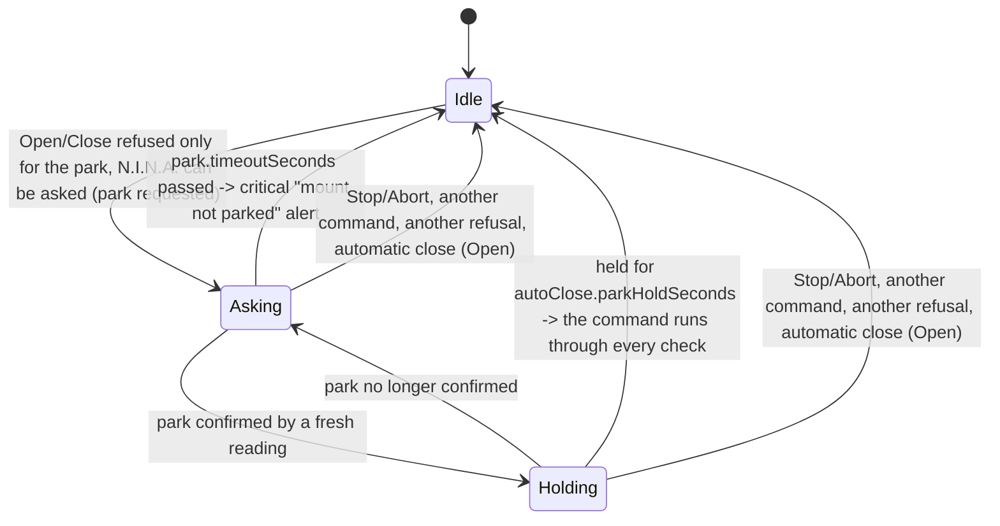

# Feature Specification: N.I.N.A. Park Before Every Move, and Guards a Person Can Confirm

**Feature Branch**: `spec/027-nina-park-and-open-guards`

**Created**: 2026-11-25

**Status**: Draft

## Context

The first nights with a real N.I.N.A. on the bench (an older build, before PRs #33, #34 and #37)
found gaps between what the roof does and what an observatory needs:

1. **Park.** The park check gated only Close. The roof opened while N.I.N.A. said the mount was not
   parked: a roll-off roof moving over a telescope that points up can hit it either way. A Close
   with an unparked mount was refused even though "may ask N.I.N.A. to park" was on: only the
   automatic close ever asked N.I.N.A. to park; a Close from the web UI, Alpaca or MQTT went straight
   to the park check and was refused. On the bench the automatic close was also stood down (a
   person's Stop, `heldByPerson`), so nothing asked for the park at all.
2. **N.I.N.A.** Its address had to start with `http://`; an `https://` N.I.N.A. (behind a TLS proxy)
   could not be used, and when N.I.N.A. could not be reached the only sign was a line in the park
   text: no alert.
3. **N.I.N.A.'s dome sequence.** N.I.N.A. sees the device as "RoofRoof roof" with a driver version
   of `0.1.0+dev`. Its "open, then close" sequence stopped: the Close came back as an error N.I.N.A.
   showed only in its log, because the mount was not parked and nothing asked for the park. An Open
   of a roof already open was refused when the weather or daylight checks failed, though there was
   nothing to do.
4. **Buttons.** When Open is refused the dashboard showed a greyed button and Stop. A person at the
   roof could not open it in daylight or under thin cloud on purpose, and a person could not close it
   by hand when the park could not be confirmed (N.I.N.A. down, mount parked by hand).
5. **SQMeter.** When SQMeter stopped answering nothing said when it last replied or what failed.
6. **Hall sensor.** A Hall reading at a rail latched a fault even with the roof at rest, and only a
   person could clear it, so a loose connector at rest locked the roof until someone came.
7. **Held close.** After a person's Stop during the automatic close, the page did not say clearly
   why the close was held, for how long, or how to end it.
8. **Home Assistant.** An observatory dashboard needs more than the cover: weather, park, the close
   phase, why the roof is blocked, the countdowns, daylight, SQMeter's and N.I.N.A.'s health. The
   Alerts switch was not announced unless the alert master switch was on.

## Clarifications

### Session 2026-11-25

- Q: Does the park check gate Open too? → A: Yes. Open and Close both need the mount confirmed
  parked (Principle II's park rule, the same park source). A roof already at the end asked for is a
  success with nothing to do, whatever the checks say.
- Q: What does an Open or Close do when only the park blocks it? → A: When N.I.N.A. can be asked
  (an address set, park requests on), the command is accepted as **waiting for the park**: N.I.N.A.
  is asked to park (again every `autoClose.parkRequestSeconds`), the device waits up to
  `park.timeoutSeconds` for the park to hold for `autoClose.parkHoldSeconds`, then runs the command
  through every check again. When N.I.N.A. can't be asked, the command is refused saying why and
  what to do.
- Q: What ends a wait? → A: The park holding (the move runs), the time limit (the critical "mount
  not parked" alert, naming the command), any Stop or Abort, a new Open or Close, another check
  failing (for example the weather turns unsafe for a waiting Open), and the automatic close starting
  (it calls off a waiting Open).
- Q: Which Open refusals can a person override? → A: Daylight, and the weather when SQMeter reports
  it unsafe for anything but rain. Not overridable: rain or a failed rain sensor; a weather source
  that is missing, stale, unreachable, unreadable or offline (doubt); an unparked mount; a fault,
  an unknown position, a suspect park switch, the supply, the device being busy.
- Q: How long does an Open override last? → A: It covers the reasons the person confirmed, from the
  Open until the roof reads closed, a Close is accepted, every confirmed reason has cleared, or a
  reason the person did not confirm appears (rain, a lost source). Meanwhile those reasons neither
  stop the opening roof nor start the automatic close; anything else does.
- Q: Who may override, and how? → A: Only a person, from the web UI or the REST API with the
  password, by naming each reason in the request after a dialog that lists them. Alpaca, MQTT, Home
  Assistant and the automatic close never override.
- Q: Can a person close without a confirmed park? → A: Yes, deliberately: Close first asks N.I.N.A.
  to park (when it can) and the dialog says the mount is not confirmed parked and the roof could hit
  the telescope; **Close anyway** sends a Close that overrides the park check (the start and the
  re-check during that close) for that one close. Alpaca, MQTT and the automatic close keep the park
  rule.
- Q: What does Alpaca report while a move waits for the park? → A: `ShutterStatus` opening or
  closing and `Slewing` true. If the wait fails, `ShutterStatus` reads error until the next command,
  so N.I.N.A. stops waiting and says so. `CanPark` stays false and `AtPark` NotImplemented (the Dome
  is the roof; the mount's park is N.I.N.A.'s).
- Q: The Hall rail fault? → A: A rail reading while the motor is driving latches the fault as
  before. One that latched with the roof at rest clears itself after 60 s of readings off the rails
  with the roof still at rest, and the position is then read from the Hall afresh. **Clear fault**
  stays, explained.
- Q: SQMeter configured and silent, with the test box's weather bypass set? → A: The bypass is in
  effect only while no SQMeter source is on (spec 022), so a silent SQMeter reads unsafe and the roof
  closes. Unchanged rule, now proven by tests; the status says when the bypass is set but not in
  effect and why.
- Q: The firmware version? → A: No release has been tagged; `0.1.0` is the first planned release
  (CHANGELOG "Unreleased", releasing guide's `v0.1.0-beta.1`). Local and CI builds now carry the
  commit: `0.1.0+dev.<commit>`; tagged builds carry the tag.

## User Scenarios & Testing *(mandatory)*

### User Story 1 - The mount is parked before the roof moves (Priority: P1)

A Close or an Open from anywhere (web UI, N.I.N.A. over Alpaca, MQTT or Home Assistant) with the
mount not parked asks N.I.N.A. to park, waits, and moves once the park is confirmed; it never moves
over an unparked mount, and it says so when the park fails.

**Independent Test**: In the demo, unpark the mount and press Close: the roof card says "Waiting for
the mount to park", the demo mount parks, the roof closes. Make the park fail: after the limit the
wait ends with the "mount not parked" alert and the roof has not moved.

**Acceptance Scenarios**:

1. **Given** the roof closed, the weather safe and the mount not parked, **When** a person presses
   Open, **Then** N.I.N.A. is asked to park, the card shows the wait with its time left and Stop, and
   the roof opens only once the park is confirmed.
2. **Given** the roof open and the mount not parked, **When** N.I.N.A. calls CloseShutter, **Then** it
   gets success, `ShutterStatus` reads closing and `Slewing` true while the device waits for the park,
   and the roof closes once parked.
3. **Given** a wait for the park, **When** the park limit passes, **Then** the wait ends, the roof
   stays where it is, the critical "mount not parked" alert names the command, and Alpaca's
   `ShutterStatus` reads error until the next command.
4. **Given** park requests off or no N.I.N.A. address, **When** Close is pressed with the park not
   confirmed, **Then** it is refused saying the park can't be asked for and how to fix it.
5. **Given** a wait for the park, **When** anyone presses Stop, **Then** the wait ends and nothing moves.
6. **Given** the roof open, **When** N.I.N.A. calls OpenShutter in daylight, **Then** it succeeds with
   nothing to do.

### User Story 2 - A person confirms an Open past the checks they can see (Priority: P1)

A person at the roof presses Open in daylight under thin cloud. A dialog lists every reason Open is
refused, says which can be overridden for this one opening, and opens on a deliberate confirmation.

**Independent Test**: In the demo, set "Sun up" and make the weather unsafe (not rain), press Open:
the dialog lists both reasons with **Open anyway**; confirm: the roof opens and stays open, the card
says the checks are overridden. Turn on rain: the automatic close starts.

**Acceptance Scenarios**:

1. **Given** Open refused for daylight and cloud, **When** the person presses Open, **Then** the dialog
   lists "2 reasons" with each one's text and offers **Open anyway**.
2. **Given** one of the reasons is rain or a lost weather source, **When** the dialog opens, **Then** it
   lists every reason and offers no override.
3. **Given** an overridden Open, **When** rain starts, **Then** the override ends and the automatic
   close runs as usual.
4. **Given** the roof is still, nothing waiting, **Then** the card shows Open and Close (never only
   Stop) and the reasons a move is blocked; Stop shows only while the roof moves, a close waits, or a
   move waits for the park.

### User Story 3 - A person closes by hand when the park can't be confirmed (Priority: P1)

N.I.N.A. is down and the owner parked the mount by hand. Close asks N.I.N.A. to park when it can,
and the dialog warns that the mount is not confirmed parked and the roof could hit the telescope;
**Close anyway** closes the roof once, without the park check.

**Acceptance Scenarios**:

1. **Given** the park not confirmed, **When** the person presses Close, **Then** the dialog warns and
   offers **Close anyway** (and shows the park wait when N.I.N.A. was asked).
2. **Given** **Close anyway**, **Then** the roof closes without the park check and without the park
   re-check during that close; the next Close checks the park again.
3. **Given** Alpaca or MQTT, **Then** no override exists: the park rule of story 1 applies.

### User Story 4 - N.I.N.A. over https, tested from Settings, and its failures reported (Priority: P2)

**Acceptance Scenarios**:

1. **Given** `https://nina.local:1888`, **When** it is saved, **Then** it is accepted and polled over TLS
   without a certificate check (as SQMeter's https address).
2. **Given** the N.I.N.A. card in Settings, **When** **Test** is pressed, **Then** it shows whether
   N.I.N.A. answered, whether the mount is connected and whether it is parked, or why not.
3. **Given** "may ask N.I.N.A. to park", **Then** it sits under the address and its Test, with what it
   does.
4. **Given** N.I.N.A. unreachable for a minute with an address set, **Then** the status, the dashboard
   and the alert "N.I.N.A. not reachable" say so, with the error.

### User Story 5 - Know why SQMeter is silent, and close when it is (Priority: P2)

**Acceptance Scenarios**:

1. **Given** SQMeter on, **Then** the dashboard's weather row and Diagnostics say when it last replied
   and what the last failure was (no reply, HTTP status, unreadable reply).
2. **Given** SQMeter on and silent past its stale time with the test box's weather bypass set, **Then**
   the weather is unsafe and the automatic close runs.

### User Story 6 - The device and its holds explain themselves (Priority: P2)

1. N.I.N.A. lists the Dome as "RoofRoof", driver info "RoofRoof v0.1.0+dev.<commit>", a short
   description.
2. A held automatic close says why (a person's Stop), how long until it lapses with the weather safe,
   and offers **Release hold**.
3. A Hall rail fault at rest says it clears itself after a minute of good readings, shows the live
   reading, and keeps **Clear fault**.

### User Story 7 - Home Assistant has what an observatory dashboard needs (Priority: P3)

Weather safe, mount parked, close phase and held, why blocked, the countdowns, daylight, SQMeter's
last reply age, N.I.N.A. reachable, and the Alerts switch whenever discovery is on; documented in
`docs/integration/home-assistant.md`.

### Edge Cases

- A wait for the park and the automatic close at once: both ask N.I.N.A.; the automatic close calls
  off a waiting Open; a waiting Close carries on beside it (both lead to the same close).
- A wait whose command is refused once the park holds (a fault, the supply): the wait ends with that
  refusal, logged and in the status; no retry.
- An override Open whose roof stops part-way: the override lasts until one of its ends, as for a
  fully open roof.
- Park switches only: no N.I.N.A. to ask; a command with the park not confirmed is refused as before
  (fitted switches confirm the park), and a person's **Close anyway** still works.
- Test box park bypass: the park reads confirmed; nothing waits.
- A Close override during unsafe weather: allowed (it closes); the automatic close sees the roof
  closing.
- A restart during a wait: the wait is not kept; the command must be sent again (the automatic close
  keeps its own state as before).

## Park wait state machine

The wait is an explicit phase in pure logic (`RoofIo::ParkWait`, driven by `RoofIo::MoveGuard`
under the roof's lock), stepped every control step (20 ms).

| Phase | Enter | Each step | Leave |
|---|---|---|---|
| Idle | boot (a wait is never kept over a restart), any end | nothing | an Open or Close refused only for the park, with N.I.N.A. askable |
| Asking | the command | ask N.I.N.A. at once, then every `autoClose.parkRequestSeconds`; re-run every other check with the park set aside | park confirmed → Holding; limit → GaveUp (alert); any refusal → Refused; Stop, a different command, the automatic close (Open only) → Cancelled |
| Holding | park confirmed | as Asking | park lost → Asking; held for the hold time → the command runs (Ran), or is refused by its checks (Refused) |

### Races (acceptance criteria, each with a native test)

1. **Park lost mid-move**: the park interlock re-checks every step during an open as during a close;
   a lost park latches the park-interlock fault, which stops the motor and sends the fault alert
   (`test_roof_gates`, `test_roof_overrides`: `test_the_interlock_watches_an_open_and_not_an_overridden_close`).
2. **Stale park**: the park result counts only fresh readings (spec 021's freshness limit, every
   step). A wait starts only while the park is not confirmed, N.I.N.A. is polled in order on one task,
   so a confirmation seen during the wait comes from a reading taken after the one that said not
   parked, and it must hold for the hold time (`test_park_wait`, `test_move_guard`: `test_the_wait_phases`).
3. **Open only at the end**: Alpaca's `ShutterStatus` reads open only with the open magnet confirmed;
   during the wait and the move it reads opening or closing (`test_dome_bridge`: `test_park_wait_states`).
4. **Competing commands**: a different command replaces the wait; the same command joins it (no
   second park request, the same limit); the automatic close calls off a waiting Open and leaves a
   waiting Close; any Stop or Abort ends it; every command is decided under the roof's lock
   (`test_move_guard`).
5. **Conditions change**: every step the waiting command is checked again with the park set aside
   (weather, daylight, a fault, the position...), and a waiting Open also against what refuses an open
   (an upload, the hotspot, a restart): a refusal ends it with the reason. A waiting Close waits for
   those as a close does (`test_move_guard`: `test_the_wait_gives_up_and_ends_on_another_refusal`).
6. **N.I.N.A. gone**: an unreachable or stale N.I.N.A. is "not parked": nothing moves and the wait
   ends at its limit with the alert. Park requests are rate-limited (the gap) and coalesced by the
   poller; N.I.N.A.'s own "park before the shutter moves" can park the mount meanwhile: the wait then
   sees the park and goes on, so neither waits on the other.
7. **Sources disagree**: the park source setting decides (spec 024); with N.I.N.A. and switches,
   disagreement is "not parked" (`test_park_source`).
8. **Timeouts**: the limit is `park.timeoutSeconds` (default 240 s, 30-1800 s), the same as the
   automatic close's. Alpaca and REST calls answer at once; nothing waits on the web server's task.
   N.I.N.A.'s dome shutter timeout must be longer than the park limit (docs).
9. **Restart**: a wait lives in memory only; after a restart nothing waits and nothing moves.

## Requirements *(mandatory)*

### Functional Requirements

- **FR-001**: Open MUST need the mount confirmed parked by the park source, as Close does; an Open
  under way MUST stop with the park-interlock fault when the park no longer holds, as a close does.
- **FR-002**: An Open or Close of a roof already at that end (not moving) MUST succeed with nothing to
  do, from every origin, before any other check.
- **FR-003**: An Open or Close refused only because the park is not confirmed MUST wait for the park
  when N.I.N.A. can be asked (address set, `park.requestPark` on), from every origin; otherwise it MUST
  be refused naming why and the fix.
- **FR-004**: A wait MUST ask N.I.N.A. to park at once and again every `autoClose.parkRequestSeconds`,
  run the command through every check once the park has held for `autoClose.parkHoldSeconds`, and end
  after `park.timeoutSeconds` with the critical `mount_not_parked` alert naming the command.
- **FR-005**: A wait MUST end on any Stop or Abort, a new Open or Close, another check refusing the
  command, or (for Open) the automatic close starting; each end MUST be logged and shown in the status.
- **FR-006**: The status MUST report a wait (`roof.parkWait`: command, origin, seconds left, whether
  N.I.N.A. was asked, and the last failure's text); Alpaca MUST report it as opening or closing with
  `Slewing` true, and a failed wait as error until the next command.
- **FR-007**: A person (web UI or authenticated REST) MAY override Open refusals for daylight and for
  SQMeter-reported unsafe weather other than rain, by naming each in the request; any other refusal
  MUST remain, and a request that doesn't name every overridable refusal present MUST be refused.
- **FR-008**: An Open override MUST last until the roof reads closed, a Close is accepted, every
  overridden reason has cleared, or a reason not overridden appears; meanwhile the overridden reasons
  MUST NOT stop the opening roof or start the automatic close, and everything else MUST.
- **FR-009**: A person MAY override the park check of one Close by naming it; that close MUST skip the
  park check at its start and the park re-check while it runs; Alpaca, MQTT and the automatic close
  MUST NOT.
- **FR-010**: The status MUST say which Open refusals can be overridden now (`roof.openOverridable`)
  and which override is in effect (`roof.override`).
- **FR-011**: The dashboard MUST show Open and Close while the roof is still and nothing waits, Stop
  only while the roof moves or a move or close waits; pressing a blocked button MUST open a dialog
  listing every reason with the count, offering the override only when every reason is overridable.
- **FR-012**: The N.I.N.A. address MUST accept `https://` (no certificate check) as well as `http://`.
- **FR-013**: `POST /api/nina/test` (password) MUST read N.I.N.A.'s mount once at the given or saved
  address and answer reachable, mount connected, parked and slewing, or why not.
- **FR-014**: A new alert event `nina_lost` ("N.I.N.A. not reachable", warning by default) MUST go out
  when N.I.N.A., with an address set, has not answered usefully for 60 s, with the error.
- **FR-015**: The status MUST report N.I.N.A.'s health (`roof.nina`: state, reachable, age, text) and
  SQMeter's (`roof.sqmeter`: state, seconds since the last good reply, the last failure's text).
- **FR-016**: The test box's weather bypass MUST stay out of effect while an SQMeter source is on, and
  the status MUST say so when it is set but not in effect.
- **FR-017**: A Hall rail fault latched with the motor off MUST clear itself after 60 s of readings off
  the rails with the roof at rest; one latched while driving MUST wait for a person.
- **FR-018**: The Alpaca Dome MUST be named "RoofRoof", with driver info "RoofRoof v<version>"; the
  description MUST stay short; the UniqueID MUST NOT change.
- **FR-019**: Dev builds MUST report `0.1.0+dev.<commit>`; tagged builds the tag.
- **FR-020**: Home Assistant discovery MUST add: weather safe, mount parked, close phase, close held,
  blocked reason, park-wait seconds, close re-arm seconds, daylight, SQMeter last reply age, N.I.N.A.
  reachable; the Alerts switch MUST be announced whenever discovery is on.
- **FR-021**: `docs/integration/home-assistant.md` MUST list every topic and entity.
- **FR-022**: Settings' N.I.N.A. card MUST put the address, **Test** with its answer, and "may ask
  N.I.N.A. to park" together, in that order.
- **FR-023**: A held automatic close MUST say it was held by a person's Stop, the time left with the
  weather safe, and offer **Release hold** when allowed.

### Key Entities

- **Park wait**: command, origin, started, limit, last request, park held since, asked, ended why.
- **Override**: bits weather and daylight (Open) or park (one Close); active from the accepted command.
- **N.I.N.A. test answer**: reachable, connected, atPark, slewing, text.

## Design *(mandatory for UI changes)*

Design-system parts only (constitution VII): the modal dialog (DS-11) for the move dialog with the
Stop bar inside it, `Note` and `InfoTip` for reasons, `Button` (primary for the safe choice,
danger for **Open anyway** and **Close anyway**), `ReadingRow` for N.I.N.A.'s Test answer, the
existing `MoveBlockers` list. Copy follows DS-20 to DS-28.

## Success Criteria *(mandatory)*

- **SC-001**: No path moves the roof with the mount reported unparked except a person's confirmed
  Close (native tests on every origin).
- **SC-002**: N.I.N.A.'s "open, then close" sequence with the mount unparked ends with the roof closed
  and the mount parked, or with an error N.I.N.A. shows, within `park.timeoutSeconds` (demo and bench).
- **SC-003**: A person opens in daylight under thin cloud in two presses; rain still closes it.
- **SC-004**: Flash at most 95% of the OTA slot; LittleFS within its 75% limit; Config.h within 600 lines.

## Assumptions decided for the owner

1. **Open needs the park** (Principle II, more protective). An Open that only the park blocks waits
   for N.I.N.A. to park; nothing else changes for the calibration run and teach (they already need it).
2. **Overridable Open reasons** are daylight and SQMeter's own "unsafe" for anything but rain. Rain,
   a failed rain sensor and every kind of doubt about the source stay hard refusals, because the
   override would otherwise leave the roof open with nothing watching the weather. The override is a
   relaxation of Principle III; constitution 7.0.0 states the risk.
3. **The override lasts** until closed, a Close, the reasons clearing, or a new reason. No time limit
   of its own: daylight ends at night, and the person who opened in cloud is expected to be there.
4. **Close anyway** skips the park check for that close, including N.I.N.A. and fitted park switches,
   because the person has looked; it is a relaxation of Principle II (7.0.0).
5. **A wait for the park** uses `park.timeoutSeconds` (default 240 s, the automatic close's limit)
   rather than a new setting: a mount may need a few minutes to slew to park, and the settings file is
   at its size limit. N.I.N.A.'s own shutter timeout needs to be longer. It is not kept over a restart (a command is not repeated by itself; the
   automatic close keeps its own state). A waiting Close from N.I.N.A. after a restart reads as open, so
   N.I.N.A. sees the move did not finish.
6. **N.I.N.A. not reachable** is a warning alert (`nina_lost`, level 2), not critical: the critical
   "mount not parked" covers the case where it matters (a close that can't confirm the park).
7. **Hall rail at rest** clears after 60 s of good readings at rest (relaxes Principle I's "until a
   person clears it" for this one fault and case; 7.0.0). A rail while driving still latches for a person.
8. **Version**: `0.1.0` stays the planned first release; builds carry the commit. Cutting `v0.2.0`
   instead is the owner's choice when tagging.
9. **The test box's weather bypass** is not extended to "an SQMeter address saved for site data but
   its weather source off": that SQMeter is not a weather source, and making it one would start
   automatic closes on boxes that only take site data from SQMeter.
10. **The Alerts switch** in Home Assistant is announced whenever discovery is on; with the master
    switch off it shows paused-or-armed as the device reports it, and arming changes nothing until
    alerts are on.

## Left for the owner

- Bench: N.I.N.A.'s dome sequence (open, close) with the mount unparked, over http and https.
- Bench: Open anyway in daylight; Close anyway with N.I.N.A. stopped.
- Bench: a Hall connector pulled at rest clears a minute after it is pushed back.

## Out of scope

The web UI's live-state loading, WebSocket cadence, helper-text typography and tooltip layering
(spec 028). N.I.N.A. API v3.
