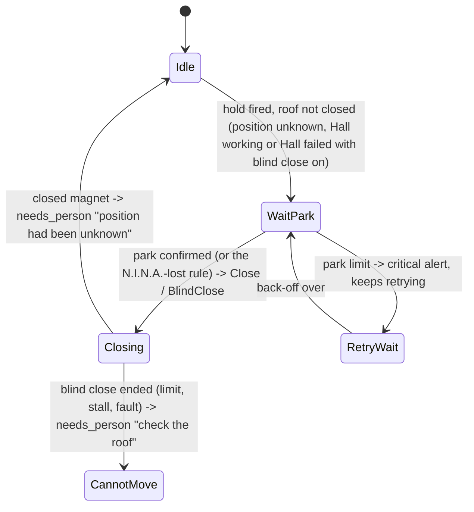

# Data Model: Spec 030

## Weather hold (`CloseSeq::WeatherHold`)

| Field | Meaning |
|---|---|
| countedMs | unsafe time added up (each step at most 1 s) |
| safeRunMs | safe time without a break |
| fired | the close is wanted |

| Step input | Effect |
|---|---|
| hold 0 | pass the verdict through |
| rain | fired |
| unsafe | count += step; count >= hold: fired; safe run = 0 |
| safe | safe run += step; safe run >= hold: count = 0, fired = false |
| override in effect, safe | count = 0, fired = false |

Output to the sequence: weather safe = not fired. Status `roof.weatherHold`: counted s, left s (-1),
fired.

## Close from an unknown position

## Blind close report

ended count, why (limit, stall, fault, stopped), driven ms, supply at rest, deepest sag.

## Fault record (16 bytes, version 1)

Byte 5: the Hall rail latched at rest (spec 027). Spec 030 adds a blind-close-done flag in a spare
byte; records without it read as "not done".

## Kept alert (NVS, one slot per critical event)

version, event, level, epoch queued, title, message, checksum. Written when queued undelivered,
erased when delivered or resolved.

## Settings

| Setting | Default | Range |
|---|---|---|
| autoClose.unsafeHoldSeconds | 60 | 0-300 |
| autoClose.ninaLostClose | false | |
| autoClose.ninaLostMinutes | 5 | 1-60 |
| roof.blindClose | true (also after an upgrade) | |
| roof.blindSagVolts | 2.0 | 0.5-6.0 |
| alerts.events.needs_person.level | wake | urgent-wake |
